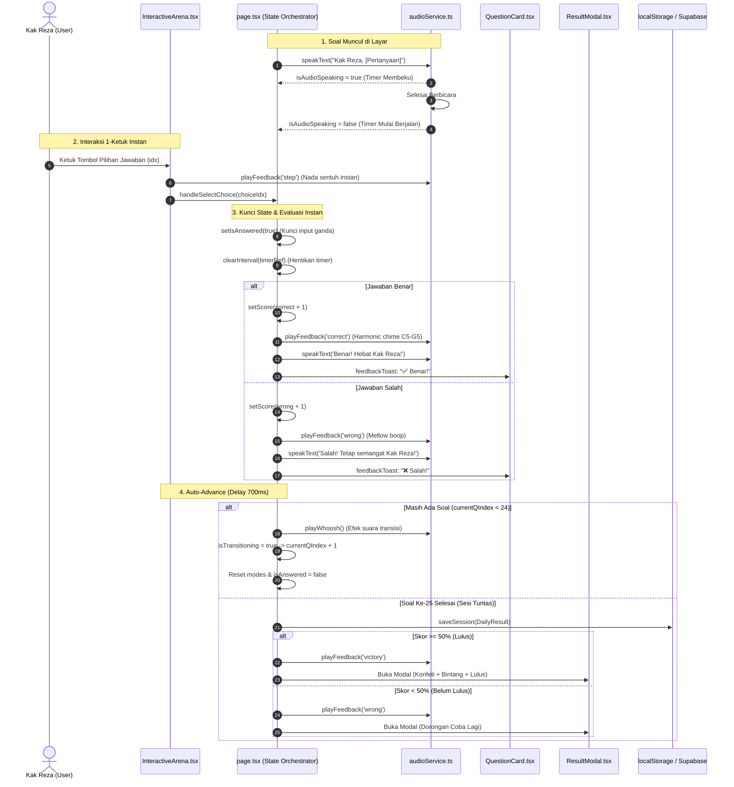
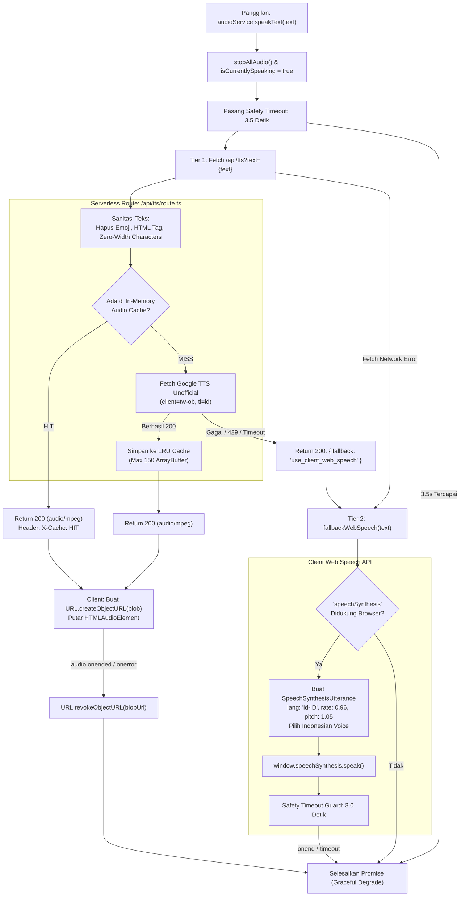

# PROJECT TECHNICAL DOSSIER: ABALA (APLIKASI BELAJAR ANAK LILI ALPI)
**Sub-title**: Petualangan Belajar Superhero Kak Reza — Next.js 16 PWA Mobile-First Interactive Learning  
**Target File**: `PROJECT_DOSSIER.md`  
**Dokumen Status**: Dokumen Arsitektur & Spesifikasi Teknis Definitif (Single-File Master Technical Dossier)  
**Tanggal Audit**: 23 Oktober 2026  
**Auditor**: Senior Software Architect, Next.js Engineer & Technical Documentation Specialist  
**Workspace Root**: `c:\Users\Zyrex\Videos\TK dan PAUD Project`  

---

## DAFTAR ISI

1. [Executive Summary](#1-executive-summary)
2. [Project Identity and Technology Stack](#2-project-identity-and-technology-stack)
3. [Directory and File Map](#3-directory-and-file-map)
4. [Application Architecture](#4-application-architecture)
5. [Feature and Module Inventory](#5-feature-and-module-inventory)
6. [Core Data Models and Types](#6-core-data-models-and-types)
7. [State Management and Data Flow](#7-state-management-and-data-flow)
8. [Learning Engine and Answer Interaction](#8-learning-engine-and-answer-interaction)
9. [TTS, Audio, and Browser APIs](#9-tts-audio-and-browser-apis)
10. [Routing, PWA, Offline, and Deployment](#10-routing-pwa-offline-and-deployment)
11. [Dependencies and Configuration](#11-dependencies-and-configuration)
12. [Testing and Verification Results](#12-testing-and-verification-results)
13. [Known Bugs and Technical Risks](#13-known-bugs-and-technical-risks)
14. [Relevant Git History](#14-relevant-git-history)
15. [File-Level Technical Reference](#15-file-level-technical-reference)
16. [Recommended Debugging and Development Priorities](#16-recommended-debugging-and-development-priorities)
17. [Unverified Areas and Missing Information](#17-unverified-areas-and-missing-information)
18. [Glossary and Instructions for the Next AI Developer](#18-glossary-and-instructions-for-the-next-ai-developer)

---

## 1. EXECUTIVE SUMMARY

### 1.1 Visi dan Tujuan Aplikasi
**ABALA (Aplikasi Belajar Anak Lili Alpi)** adalah Progressive Web Application (PWA) pembelajaran interaktif bergerak (*mobile-first*) yang dirancang khusus untuk anak usia dini (TK / PAUD) dengan persona utama seorang anak bernama **Reza ("Kak Reza")**. Aplikasi ini bertema "Superhero Belajar" yang menggabungkan psikologi perkembangan kognitif anak usia 4–6 tahun dengan teknologi web modern untuk menyajikan latihan harian yang bebas frustrasi, kaya stimulasi audio-visual, dan adaptif.

### 1.2 Pilar Kurikulum & Kapasitas Soal
Aplikasi mengusung kurikulum komprehensif yang terbagi menjadi 6 hari pilar pembelajaran:
1. **Hari 1: Matematika Superhero** (Berhitung, penjumlahan visual, pengurangan visual, pola bilangan, logika jumlah).
2. **Hari 2: Membaca & Fonik** (Pengenalan huruf vokal/konsonan, suku kata, menyusun kata/nama, fonik).
3. **Hari 3: Menyimak & Suara** (Diskriminasi auditori, suara hewan autentik, sirine kendaraan, bunyi alam, memori urutan 2-tahap).
4. **Hari 4: Nalar & Logika** (Perbandingan ukuran/jumlah/panjang, sebab-akibat, klasifikasi objek, penalaran spasial).
5. **Hari 5: Bentuk & Spasial** (Geometri 2D dasar, bentuk di sekitar kita, orientasi arah kiri/kanan/atas/bawah).
6. **Hari 6: Kemandirian Superhero** (Adab sehari-hari, kebersihan diri, emosi, rutinitas, pertolongan pertama sederhana).

Setiap hari memiliki **25 slot topik soal**, dan masing-masing slot memiliki **30 variasi soal unik**. Total variasi soal dalam database kurikulum adalah **4.500 variasi unik per hari**, atau **27.000 kombinasi variasi kurikulum** dalam seminggu penuh. Setiap sesi harian mengambil 1 variasi acak untuk masing-masing 25 slot, memastikan bahwa anak tidak akan pernah menemui sesi yang identik saat mengulang latihan.

### 1.3 Ringkasan Arsitektur & Evaluasi
- **Framework**: Next.js 16.4.2 (App Router dengan Turbopack compiler) dan React 19.
- **Arsitektur Multi-Rute**:
  1. `/` — Home Base (Pusat aktivitas, sapaan Kak Reza, level & XP bar, resume sesi aktif, 6 pilar radar, mini preview kamar 3D).
  2. `/learn` — Ruang Misi Belajar (Daftar lengkap 6 pilar, ringkasan topik, target PAUD/TK, dan peluncur sesi).
  3. `/learn/[dayId]` — Learning Adventure Quiz Arena (50/50 balanced layout, mekanisme 2-ketuk TTS, word builder, touch counting, sequence 2-step, result modal bertenaga reward).
  4. `/room` — Achievement Room 3D (Diorama kamar anak low-poly 3D berbasis Three.js & React Three Fiber, customizable slots, raycasting tap-to-inspect, dan fallback isometrik 2D).
  5. `/collection` — Koleksi Artefak & Pencapaian (Filter kategori trofi, dekorasi, lencana, inventori slot, panduan unlock).
  6. `/parent` — Dashboard Tumbuh Kembang & Orang Tua (Dilindungi parental gate tantangan perkalian dinamis, radar pilar, riwayat sesi, dan manajemen data).
- **Interaksi Jawaban**:
  1. *Pilihan Standar & Perbandingan*: Mekanisme **Tap-to-Speak, Tap-again-to-Answer** berbasis state machine eksplisit (`previewIndexRef` + `isConfirmingRef`). Ketukan 1 membacakan label via TTS tanpa menilai skor; ketukan 2 pada pilihan yang sama mengonfirmasi jawaban tepat 1 kali. Ketukan pilihan lain membatalkan preview lama dan membacakan pilihan baru.
  2. *Mode Interaktif Khusus*: Word Builder (1-ketuk tempatkan huruf dengan pop sound), Sequence 2-Step (1-ketuk per langkah), Touch Counting (1-ketuk per item dengan pitch nada C5–C6).
- **Sistem Progres & Ekonomi XP**:
  - Deterministic Level Curve (Level 1 "Penjelajah Pemula" s/d Level 10 "Maha Bintang Siap SD").
  - XP Terpusat: 3 XP per soal dikerjakan, +7 XP bonus jawaban benar, +25 XP bonus sesi tuntas, +25 XP bonus sesi sempurna (100%).
  - Idempotensi Transaksi: `q_${sessionId}_${slot}` dan `sess_finish_${sessionId}` mencegah reward ganda dari double-tap atau reload.
  - Nilai radar pilar yang belum tercatat menggunakan default jujur 0% (fallback angka hardcoded 80/75% dihapus).
- **Dual-Tier Audio Engine**:
  1. *Tier 1*: Serverless Route Handler (`/api/tts`) berbasis Google Translate TTS unofficial dengan sanitasi regex emoji komprehensif, server-side in-memory LRU audio caching (kapasitas 150 buffer), dan `AbortController` cancellation token.
  2. *Tier 2*: Fallback otomatis ke peramban Web Speech API (`SpeechSynthesisUtterance` berbahasa `id-ID`) dengan timeout guard 3 detik untuk mencegah UI hanging.
  3. *Sound Effects*: Web Audio API Synthesizer (audio murni zero-latency untuk tone benar, salah, timeout, victory, step, whoosh, dan not tangga nada C5–C6 untuk touch-counting), ditambah 17 file audio MP3 autentik suara hewan dan kendaraan di direktori `public/sounds/`.
- **Persistensi Data & PWA Offline-First**:
  - Offline Curriculum Pack (`src/data/offlineCurriculumPack.json`): 100% dari 6 pilar belajar (150 slot soal) dapat dimuat secara mandiri tanpa server.
  - Service Worker `public/sw.js` (Cache v3): Pre-caching app shell pages, 17 file audio MP3 suara autentik, dynamic caching curriculum & images, serta passthrough aman non-GET.
  - Manifest PWA kanonikal yang valid (`/manifest.json` & `/manifest.webmanifest`).

---

## 2. PROJECT IDENTITY AND TECHNOLOGY STACK

### 2.1 Identitas Inti Proyek
- **Nama Proyek**: ABALA (Aplikasi Belajar Anak Lili Alpi)
- **Judul UI**: Petualangan Belajar Superhero Kak Reza
- **Repository Remote**: `https://github.com/alfyalfi/ABALA.git`
- **Branch Aktif**: `main`
- **Tipe Aplikasi**: Progressive Web Application (PWA) Mobile-First Adventure Learning via Next.js App Router

### 2.2 Tabel Rincian Teknologi Aktual (Berdasarkan `package.json` & Audit Runtime)

| Kategori | Teknologi / Library | Versi Aktual | Peran dalam Proyek | Status Verifikasi |
|---|---|---|---|---|
| **Core Framework** | Next.js | `16.4.2` | App Router, Serverless Route Handlers, asset bundling | Terverifikasi |
| **UI Library** | React | `19.0.0` | Declarative UI rendering, hooks, ref lifecycle | Terverifikasi |
| **DOM Renderer** | React-DOM | `19.0.0` | Client hydration & DOM management | Terverifikasi |
| **3D Engine** | Three.js | `^0.186.1` | Low-poly procedural 3D diorama bedroom & artifacts | Terverifikasi |
| **3D React Bridge** | `@react-three/fiber` | `^9.8.2` | Declarative Three.js scene canvas for React 19 | Terverifikasi |
| **Bahasa Pemrograman** | TypeScript | `^5.8.2` | Strict typings, data models, compile-time check | Terverifikasi |
| **Test Runner** | tsx | `^4.23.15` | Automated TypeScript test execution | Terverifikasi |
| **CSS Framework** | Tailwind CSS | `^3.4.17` | Utility-first CSS, responsive breakpoints, layouting | Terverifikasi |
| **CSS Preprocessor** | PostCSS | `^8.5.3` | Pipeline pemrosesan CSS Tailwind | Terverifikasi |
| **CSS Vendor Prefix** | Autoprefixer | `^10.4.20` | Kompatibilitas vendor CSS antarbrowsers | Terverifikasi |
| **Ikon UI** | Lucide React | `^1.16.0` | Ikon modern (Volume, Sparkles, Trophy, Settings, dll.) | Terverifikasi |
| **Efek Animasi** | Canvas Confetti | `^1.9.4` | Partikel selebrasi kemenangan saat sesi lulus | Terverifikasi |
| **Database Cloud Client**| `@supabase/supabase-js`| `^2.49.1` | Sinkronisasi data opsional ke Supabase Cloud | Terverifikasi |
| **Tipografi** | `@next/font/google` | Built-in | Font Plus Jakarta Sans & Nunito | Terverifikasi |
| **Bundler / Compiler** | Next.js Turbopack | Built-in | Fast Refresh & build optimization | Terverifikasi |

### 2.3 Konfigurasi Runtime dan Target Lingkungan
- **Target Node.js**: Direkomendasikan Node.js v18.18.0+ atau v20.9.0+ (Sesuai spesifikasi Next.js 16).
- **TypeScript Configuration (`tsconfig.json`)**:
  - `target`: `ES2022`
  - `module`: `esnext`
  - `moduleResolution`: `bundler`
  - `jsx`: `preserve`
  - `strict`: `false` (Catatan arsitektur: tipe longgar diizinkan untuk fleksibilitas mutasi properti audio dan event PWA).
  - `incremental`: `true`
  - `plugins`: `[{ "name": "next" }]`
- **Konfigurasi Bundler (`next.config.mjs`)**:
  - `images.remotePatterns`: Diizinkan mengambil gambar eksternal dari `images.unsplash.com` dan `upload.wikimedia.org`.
- **Target Hosting**: Vercel Serverless Ready (`vercel.json` mengatur `maxDuration: 10` untuk seluruh functions).

---

## 3. DIRECTORY AND FILE MAP

Berikut adalah pemetaan struktur direktori lengkap dari root repository beserta evaluasi peran teknis setiap file:

```
c:\Users\Zyrex\Videos\TK dan PAUD Project\
├── .env.example                     # Templat konfigurasi Supabase URL & Key
├── .gitignore                       # Pola pengecualian git (node_modules, .next, dll.)
├── next-env.d.ts                    # Deklarasi tipe lingkungan Next.js
├── next.config.mjs                  # Konfigurasi Next.js (remotePatterns)
├── package-lock.json                # Lockfile dependensi npm
├── package.json                     # Metadata paket, skrip, dan dependensi
├── postcss.config.js                # Konfigurasi plugin PostCSS (Tailwind & Autoprefixer)
├── README.md                        # Dokumentasi lama proyek (Mengandung inkonsistensi)
├── schema.sql                       # Skema DDL tabel database Supabase
├── tailwind.config.js               # Konfigurasi token tema, warna superhero, keyframes
├── tsconfig.json                    # Konfigurasi kompilasi TypeScript
├── vercel.json                      # Konfigurasi deployment serverless Vercel
├── public/                          # Direktori aset statis publik
│   ├── favicon.ico                  # Favicon web
│   ├── manifest.json                # Web App Manifest PWA utama
│   ├── manifest.webmanifest         # Duplikat manifest untuk kompatibilitas browser
│   ├── sw.js                        # Service Worker PWA (CacheFirst & Network-First)
│   ├── icons/                       # Ikon aplikasi PWA berbagai resolusi
│   │   ├── icon-192.png             # Ikon PWA 192x192
│   │   ├── icon-512.png             # Ikon PWA 512x512 (Any & Maskable)
│   │   └── icon.svg                 # Ikon vektor master
│   └── sounds/                      # 17 File audio MP3 efek suara autentik
│       ├── ambulance_siren.mp3      # Suara ambulans
│       ├── bee_buzz.mp3             # Suara lebah
│       ├── bicycle_bell.mp3         # Suara bel sepeda
│       ├── bird_chirp.mp3           # Suara kicau burung
│       ├── car_horn.mp3             # Suara klakson mobil
│       ├── cat_meow.mp3             # Suara kucing mengeong
│       ├── clock_tick.mp3           # Suara detak jam dinding
│       ├── cow_moo.mp3              # Suara sapi melenguh
│       ├── cricket_chirp.mp3        # Suara jangkrik malam
│       ├── dog.mp3                  # Suara anjing menggonggong
│       ├── duck_quack.mp3           # Suara bebek kwek-kwek
│       ├── lion_growl.mp3           # Suara auman singa
│       ├── owl_hoot.mp3             # Suara burung hantu
│       ├── rain_sound.mp3           # Suara rintik hujan
│       ├── rooster_crow.mp3         # Suara kokok ayam jago
│       ├── thunder_sound.mp3        # Suara petir menggelegar
│       └── train_horn.mp3           # Suara klakson kereta api
└── src/                             # Source code aplikasi utama
    ├── index.css                    # CSS global, utility Tailwind, shader Android Liquid Glass
    ├── app/                         # Next.js App Router
    │   ├── layout.tsx               # Root Layout HTML, font Google, dan registrasi SW HTTPS
    │   ├── page.tsx                 # Single Page Application Orchestrator utama
    │   └── api/                     # Backend Serverless Route Handlers
    │       ├── curriculum/          # GET /api/curriculum: Single Source of Truth kurikulum
    │       │   └── route.ts         # Membaca curriculumMaster.json & memilih variasi acak
    │       ├── progress/            # POST & GET /api/progress: Logging progres ke Supabase
    │       │   └── route.ts         # Endpoint serverless perantara Supabase
    │       └── tts/                 # GET /api/tts: Proxy Google TTS server-side + LRU cache
    │           └── route.ts         # Sanitasi regex text, streaming audio/mpeg, cache 150 item
    ├── components/                  # Komponen antarmuka pengguna (React Components)
    │   ├── ChoicesGrid.tsx          # [DEAD CODE / ORPHANED] Komponen grid pilihan lama
    │   ├── DaySelector.tsx          # Komponen pemilih 6 pilar hari belajar
    │   ├── Header.tsx               # Komponen header atas (Mute, Pause, Voice, Dashboard, Install)
    │   ├── InteractiveArena.tsx     # [AKTIF] Komponen 50% bawah: Arena interaktif multi-mode
    │   ├── ParentDashboardModal.tsx # Komponen modal kontrol orang tua ber-PIN (PIN: 1234)
    │   ├── QuestionCard.tsx         # [AKTIF] Komponen 50% atas: Panggung visual soal dinamis
    │   ├── ResultModal.tsx          # Komponen modal hasil akhir sesi (Evaluasi 50% passing grade)
    │   └── ui/                      # Komponen atomik / primitif UI
    │       └── LiquidGlassPrimitives.tsx # Background mesh refraksi & LiquidButton
    ├── data/                        # [DEAD CODE / LEGACY]
    │   ├── curriculumData.json      # [DEAD CODE - 3.37 MB] Duplikat curriculumMaster.json
    │   └── dailyCurriculum.ts       # [DEAD CODE] Helper data kurikulum lokal lama
    ├── server/                      # Server-side data files
    │   └── data/                    #
    │       └── curriculumMaster.json# [AKTIF - 3.37 MB] Database master 25 topik x 30 variasi (4.500 variasi)
    ├── services/                    # Service layer logika bisnis & hardware browser
    │   ├── audioService.ts          # Orchestrator Web Audio, TTS Dual-Tier, & MP3 playback
    │   ├── mediaLibrary.ts          # [DEAD CODE / UNUSED] Helper URL Unsplash & Wikimedia
    │   └── supabaseService.ts       # Service persistensi Offline-First (localStorage + Supabase)
    └── types/                       # Definisi antarmuka TypeScript
        └── index.ts                 # ChoiceOption, ActiveQuestion, DailyResult, dll.
```

---

## 4. APPLICATION ARCHITECTURE

Aplikasi ABALA dibangun dengan arsitektur **Client-Centric Interactive PWA** yang didukung oleh **Next.js Serverless Route Handlers**.

### 4.1 Diagram Arsitektur Sistem Global

```mermaid
flowchart TD
    subgraph ClientBrowser ["Client Browser (PWA Environment)"]
        UI_Home["HomePage (src/app/page.tsx)\nOrchestrator State: Question, Score, Timer, Modes"]
        
        subgraph UI_Components ["UI Components (Android Liquid Glass)"]
            Comp_Header["Header.tsx\nControls: Mute, Pause, Speak, Parent, Install"]
            Comp_DayNav["DaySelector.tsx\n6 Learning Pillars"]
            Comp_Question["QuestionCard.tsx (Top 50%)\nAuto-Scaling Stage, Math Plates, Touch Count"]
            Comp_Arena["InteractiveArena.tsx (Bottom 50%)\nChoices Grid, Comparison, Seq 2, Word Builder"]
            Comp_Result["ResultModal.tsx\nScore 50% Threshold, Confetti, Actions"]
            Comp_Parent["ParentDashboardModal.tsx\nPIN Gate (1234), Pillar Radar, History"]
        end

        subgraph Client_Services ["Client Service Layer"]
            Svc_Audio["audioService.ts\nWeb Audio API (Synthesizer)\nDual-Tier TTS Orchestrator\nHTMLAudioElement (MP3)"]
            Svc_Progress["supabaseService.ts\nOffline-First Storage Engine\n(localStorage + Remote Sync)"]
        end

        Storage_Local[("localStorage Browser Cache\nKey: abala_reza_history_v1\nKey: abala_reza_pillars_v1")]
        Worker_SW["Service Worker (public/sw.js)\nCache-First: Static/Images/Sounds\nNetwork-First: Navigation"]
    end

    subgraph Backend_RouteHandlers ["Next.js Serverless Route Handlers (Node.js Runtime)"]
        API_Curriculum["/api/curriculum/route.ts\nDynamic Randomizer:\n25 Topics x 1 Variant from 30"]
        API_TTS["/api/tts/route.ts\nRegex Sanitizer\nIn-Memory LRU Cache (150 items)\nGoogle TTS Proxy"]
        API_Progress["/api/progress/route.ts\nSupabase Proxy / Logger"]
        Master_JSON[("curriculumMaster.json\n(3.37 MB Master Database)")]
    end

    subgraph External_Services ["External Cloud Services"]
        Google_TTS["Google Translate TTS API\n(client=tw-ob)"]
        Supabase_Cloud[("Supabase Cloud Database\nTable: daily_sessions")]
        CDN_Assets["Unsplash & Wikimedia CDN\n(Static Educational Photos)"]
    end

    %% Relasi Client UI
    UI_Home --> Comp_Header
    UI_Home --> Comp_DayNav
    UI_Home --> Comp_Question
    UI_Home --> Comp_Arena
    UI_Home --> Comp_Result
    UI_Home --> Comp_Parent

    %% Relasi Service
    UI_Home --> Svc_Audio
    UI_Home --> Svc_Progress
    Svc_Progress --> Storage_Local

    %% Relasi Client ke Backend
    UI_Home -- "1. GET /api/curriculum?day=N&seed=T" --> API_Curriculum
    API_Curriculum -- "Read Master Data" --> Master_JSON
    Svc_Audio -- "2. GET /api/tts?text=T" --> API_TTS
    API_TTS -- "Upstream Request" --> Google_TTS
    Svc_Progress -- "3. POST /api/progress" --> API_Progress
    API_Progress -- "Sync Session" --> Supabase_Cloud
    Worker_SW -- "Intercept & Cache" --> CDN_Assets
```



### 4.2 Single Source of Truth (SSOT) Audit

| Tipe Data | Single Source of Truth (SSOT) Aktual | Lokasi Penyimpanan | Konsumsi Data | Temuan & Konflik |
|---|---|---|---|---|
| **Master Soal & Kurikulum** | `curriculumMaster.json` | `src/server/data/curriculumMaster.json` | Endpoint `/api/curriculum` | Terdapat file duplikat `curriculumData.json` di `src/data/` yang tidak dikonsumsi API. |
| **Sesi Soal Aktif (25 Soal)** | State React `sessionQuestions` | `src/app/page.tsx` (Line 29) | `QuestionCard.tsx` & `InteractiveArena.tsx` | Dibangkitkan saat mount atau saat berganti hari. |
| **Riwayat Skor & Pilar Belajar**| LocalStorage Browser | `localStorage: abala_reza_history_v1` & `abala_reza_pillars_v1` | `ParentDashboardModal.tsx` & `ProgressService` | Jika Supabase tidak aktif, localStorage tetap menjadi SSOT penuh. |
| **Status Suara (Mute/Unmute)** | Instance State `AudioService` | `src/services/audioService.ts` (`isMuted`) | Di-toggle via `Header.tsx` | Disinkronkan dengan state lokal `isMuted` di `page.tsx`. |

---

## 5. FEATURE AND MODULE INVENTORY

Berikut inventaris lengkap fitur aplikasi beserta bukti verifikasi kode sumbernya:

| No | Modul / Fitur | File Komponen Terkait | Alur Interaksi Pengguna | Sumber & Struktur Data | State & Handler Inti | Status Verifikasi |
|---|---|---|---|---|---|---|
| 1 | **Header & Kontrol Sesi** | `src/components/Header.tsx` | Pengguna menyentuh tombol Mute, Pause, Ulangi Suara Soal, Buka Dashboard Orang Tua, atau Unduh PWA. | Props dari `page.tsx` (`dayName`, `dayTitle`, `isMuted`, `isPaused`) | `onToggleMute()`, `onTogglePause()`, `onSpeakPrompt()`, `onOpenParentDashboard()`, `onInstallPwa()` | **Terverifikasi** |
| 2 | **Pilar Hari Belajar (Day Selector)** | `src/components/DaySelector.tsx` | Menampilkan 6 pill hari dengan emoji & judul; ketukan berpindah hari memuat 25 soal baru. | Konstanta `DAYS_META` di `page.tsx` | `loadDaySession(dayIdx)`, `onSelectDay(idx)` | **Terverifikasi** |
| 3 | **Panggung Soal Dinamis (Top 50%)** | `src/components/QuestionCard.tsx` | Menampilkan visual soal, soal cerita, piring tambah/kurang, tombol audio, dan item touch-count. | `ActiveQuestion` dari `sessionQuestions[currentQIndex]` | `handleTapCountItem(idx)`, auto-scaling font calculations | **Terverifikasi** |
| 4 | **Arena Interaktif Jawaban (Bottom 50%)** | `src/components/InteractiveArena.tsx` | Merender 4 tipe arena jawaban tergantung tipe soal; interaksi 1-ketuk langsung mengevaluasi. | Opsi `choices`, `sequenceItems`, atau `letterChoices` pada `ActiveQuestion` | `handleSelectChoice(idx)`, `handleSelectSequenceItem(item)`, `handleSelectLetter(ltr, idx)` | **Terverifikasi** |
| 5 | **Mode Soal Standar (Choices Grid)** | `src/components/InteractiveArena.tsx` (Line 217–274) | Menampilkan 2 atau 3 kartu pilihan; ketukan pertama langsung memeriksa jawaban benar/salah. | `ChoiceOption[]` (`label`, `visual`, `isCorrect`) | `onSelectChoice(idx)` -> `handleSelectChoice(choiceIdx)` | **Terverifikasi** |
| 6 | **Mode Perbandingan (Comparison Plate)** | `src/components/InteractiveArena.tsx` (Line 166–214) | Menampilkan 2 kartu piring visual besar untuk membandingkan jumlah/ukuran. | `ChoiceOption[]` dengan field `visual` berisi sekumpulan emoji | `onSelectChoice(idx)` | **Terverifikasi** |
| 7 | **Mode Menyusun Urutan (Sequence 2-Step)** | `src/components/InteractiveArena.tsx` (Line 118–163) | Anak mengetuk langkah 1, suara konfirmasi berbunyi, lalu mengetuk langkah 2 untuk evaluasi tuntas. | `sequenceItems: SequenceItem[]`, `step1Target`, `step2Target` | State: `seqStep`, `seqCompletedIds`, `seqWobbleId`; Handler: `handleSelectSequenceItem()` | **Terverifikasi** |
| 8 | **Mode Susun Huruf (Word/Name Builder)** | `src/components/InteractiveArena.tsx` (Line 68–115) | Menampilkan deretan chip huruf acak; anak mengetuk huruf sesuai urutan kata target. | `targetWord: string[]`, `letterChoices: string[]` | State: `builtLetters`, `usedLetterIndices`; Handler: `handleSelectLetter()` | **Terverifikasi** |
| 9 | **Penghitungan Sentuh (Interactive Touch-Count)** | `src/components/QuestionCard.tsx` (Line 150–190) | Pada soal berhitung, anak mengetuk objek visual di panggung satu per satu; tiap ketukan membunyikan not nada. | `countItems: string[]` (array emoji/objek) | State: `countedItems: number[]`; Handler: `handleTapCountItem(idx)` | **Terverifikasi** |
| 10 | **Pengatur Waktu Sesi (Smart Timer)** | `src/app/page.tsx` (Line 130–150) | Hitung mundur 15s (normal) atau 25s (extended); timer otomatis membeku saat suara AI sedang berbunyi. | Konstanta `TIMER_DURATION_NORMAL`, `TIMER_DURATION_EXTENDED` | State: `timeLeft`, `isAudioSpeaking`, `isPaused`; Handler: `handleTimeout()` | **Terverifikasi** |
| 11 | **Dual-Tier TTS Engine** | `src/services/audioService.ts` & `/api/tts/route.ts` | Server proxy Google TTS dengan in-memory cache, fallback otomatis ke browser Web Speech API. | Teks prompt soal, suara instruksi | `audioService.speakText(text)`, fallback ke `fallbackWebSpeech()` | **Terverifikasi** |
| 12 | **Pemutar Suara Autentik MP3** | `src/services/audioService.ts` (Line 201–251) | Memutar file MP3 autentik (hewan, kendaraan, alam) dengan safety timeout guard 4.5 detik. | File path statis di `public/sounds/*.mp3` | `audioService.playSoundFile(path)` | **Terverifikasi** |
| 13 | **Sintesis Audio Nada Murni (Web Audio)** | `src/services/audioService.ts` (Line 67–200) | Menghasilkan nada frekuensi osilator instan tanpa latensi untuk chime sukses, boop salah, whoosh, victory. | `AudioContext` Web API bawaan peramban | `playFeedback(type)`, `playCountNote(count)`, `playWhoosh()` | **Terverifikasi** |
| 14 | **Modal Hasil & Kelulusan (Passing Grade 50%)** | `src/components/ResultModal.tsx` | Muncul di akhir 25 soal; jika benar >= 13 (>=50%), muncul selebrasi konfeti, jika tidak, dorongan mencoba lagi. | Interface `DailyResult` | `onRetry()`, `onNextDay()`, `onGoHome()`, `canvas-confetti` trigger | **Terverifikasi** |
| 15 | **Dashboard Kontrol Orang Tua** | `src/components/ParentDashboardModal.tsx` | Dilindungi PIN 4 digit (`1234`); menyajikan radar bar 6 pilar belajar, log sesi, dan reset histori. | `DailyResult[]` & `LearningPillarProgress` dari `localStorage` | PIN validation, `ProgressService.clearHistory()` | **Terverifikasi** |
| 16 | **PWA Service Worker & Install** | `public/sw.js`, `public/manifest.json`, `layout.tsx` | Caching aset gambar & font (CacheFirst), network-first untuk halaman, tombol instalasi di header. | `beforeinstallprompt` event | State: `deferredPrompt`; Handler: `handleInstallPwa()` | **Terverifikasi** |
| 17 | **Sinkronisasi Supabase** | `src/services/supabaseService.ts` & `/api/progress` | Menyimpan log sesi ke Supabase jika environment variable terpasang; fallback offline aman. | Variabel lingkungan `NEXT_PUBLIC_SUPABASE_URL`, dll. | `ProgressService.saveSession(result)` | **Terverifikasi** |
| 18 | **Komponen ChoicesGrid Lama** | `src/components/ChoicesGrid.tsx` | Tidak ada alur interaksi aktif. Komponen tidak diimpor di mana pun. | Props antarmuka lama | - | **DEAD CODE / ORPHANED** |
| 19 | **Data Kurikulum Lama** | `src/data/curriculumData.json` & `dailyCurriculum.ts` | Tidak ada konsumsi aktif. Seluruh data disuplai oleh `curriculumMaster.json`. | JSON 3.37 MB lama | - | **DEAD CODE / ORPHANED** |
| 20 | **Helper Media Statis** | `src/services/mediaLibrary.ts` | Tidak ada pemanggilan fungsi atau variabel di file lain. | Record URL Unsplash & Wikimedia | `getRealPhoto()`, `REAL_PHOTOS` | **DEAD CODE / ORPHANED** |

---

## 6. CORE DATA MODELS AND TYPES

Definisi struktur data inti aplikasi didefinisikan pada file `src/types/index.ts`:

```typescript
// 1. Opsi Jawaban Standar & Komparasi
export interface ChoiceOption {
  label: string;             // Label teks atau angka jawaban
  visual?: string;            // Visual tambahan (HTML string / emoji / badge)
  isCorrect: boolean;         // Indikator jawaban benar (Single truth)
  realImage?: string;         // URL foto opsional (Unsplash)
}

// 2. Elemen Interaksi Urutan 2-Tahap (Sequence 2)
export interface SequenceItem {
  id: string;                // ID unik elemen urutan (e.g. 'sepatu', 'kaos_kaki')
  emoji: string;             // Representasi visual emoji
  label: string;             // Label teks nama benda
}

// 3. Varian Soal Mentah dari Database Master
export interface QuestionVariant {
  type?: string;             // 'standard' | 'sound' | 'sequence_2' | 'word_builder' | 'comparison' | 'addition_visual' | 'subtraction_visual'
  prompt: string;            // Kalimat pertanyaan
  visual?: string;           // Visual panggung (string emoji atau HTML)
  countItems?: string[];     // Array emoji untuk interaksi touch-counting
  targetCount?: number;      // Angka target hitungan
  itemName?: string;         // Nama benda yang dihitung
  itemEmoji?: string;        // Emoji benda tunggal
  soundFile?: string;        // Path file MP3 di /sounds/
  soundLabel?: string;       // Label suara yang dimainkan
  step1Target?: string;      // ID target langkah 1 pada sequence_2
  step2Target?: string;      // ID target langkah 2 pada sequence_2
  step1Label?: string;       // Label nama langkah 1
  step2Label?: string;       // Label nama langkah 2
  voiceIntro?: string;       // Teks narasi suara intro khusus
  voiceStep1Done?: string;   // Teks suara saat langkah 1 selesai
  voiceSuccess?: string;     // Teks suara saat kedua langkah selesai
  sequenceItems?: SequenceItem[]; // Daftar item yang dapat dipilih pada sequence_2
  plateA?: string[];         // Item piring A pada penjumlahan visual
  plateB?: string[];         // Item piring B pada penjumlahan visual
  remainingCount?: number;   // Jumlah sisa pada pengurangan visual
  subtractedCount?: number;  // Jumlah yang disilang pada pengurangan visual
  wordLabel?: string;        // Label kata pada word builder
  targetWord?: string[];     // Array huruf yang harus disusun (e.g. ['R', 'E', 'Z', 'A'])
  letterChoices?: string[];  // Array pilihan huruf acak
  missingNumber?: number;    // Angka pola bilangan yang hilang
  choices: ChoiceOption[];   // Opsi jawaban
  realImage?: string;        // URL foto autentik
}

// 4. Slot Topik Kurikulum Master
export interface QuestionSlot {
  topic: string;             // Nama topik misi (e.g. "Penjumlahan Superhero")
  variants: QuestionVariant[]; // 30 variasi soal unik
}

// 5. Kurikulum Harian Master
export interface DayCurriculum {
  id: number;                // ID hari (1 - 6)
  name: string;              // "Hari 1" - "Hari 6"
  title: string;             // Judul pilar belajar
  icon: string;              // Emoji ikon pilar
  badge: string;             // Badge pilar
  desc: string;              // Deskripsi misi
  questions: QuestionSlot[]; // 25 slot pertanyaan
}

// 6. Metadata Hari (Digunakan DaySelector)
export interface DayMeta {
  id: number;
  name: string;
  title: string;
  icon: string;
  badge: string;
  desc: string;
  totalQuestions: number;
}

// 7. Soal Sesi Aktif di Runtime
export interface ActiveQuestion {
  slotIndex: number;         // Indeks slot soal (0 - 24)
  type?: string;
  topic: string;
  prompt: string;
  visual?: string;
  countItems?: string[];
  targetCount?: number;
  itemName?: string;
  itemEmoji?: string;
  soundFile?: string;
  soundLabel?: string;
  step1Target?: string;
  step2Target?: string;
  step1Label?: string;
  step2Label?: string;
  voiceIntro?: string;
  voiceStep1Done?: string;
  voiceSuccess?: string;
  sequenceItems?: SequenceItem[];
  plateA?: string[];
  plateB?: string[];
  remainingCount?: number;
  subtractedCount?: number;
  wordLabel?: string;
  targetWord?: string[];
  letterChoices?: string[];
  missingNumber?: number;
  choices: ChoiceOption[];
  realImage?: string;
}

// 8. Struktur Hasil Sesi Belajar (Evaluasi 50%)
export interface DailyResult {
  dayId: number;             // ID hari (1 - 6)
  dayName: string;           // "Hari 1"
  score: number;             // Jumlah soal benar
  wrong: number;             // Jumlah soal salah / timeout
  total: number;             // Total soal (25)
  percentage: number;        // Nilai persentase (0 - 100)
  passed: boolean;           // Kelulusan (percentage >= 50)
  timestamp: string;         // Waktu penyelesaian ISO 8601
}

// 9. Skor Akumulasi 6 Pilar Belajar
export interface LearningPillarProgress {
  berhitung: number;         // Skor tertinggi Hari 1 (%)
  membaca: number;           // Skor tertinggi Hari 2 (%)
  menyimak: number;          // Skor tertinggi Hari 3 (%)
  nalar: number;             // Skor tertinggi Hari 4 (%)
  bentuk: number;            // Skor tertinggi Hari 5 (%)
  kemandirian: number;       // Skor tertinggi Hari 6 (%)
}
```

### 6.1 Skema Database Relasional Supabase (`schema.sql`)
Jika modul cloud diaktifkan, sesi belajar disinkronkan ke tabel PostgreSQL `daily_sessions`:
```sql
CREATE TABLE IF NOT EXISTS daily_sessions (
    id UUID PRIMARY KEY DEFAULT gen_random_uuid(),
    student_name VARCHAR(100) NOT NULL DEFAULT 'Reza',
    day_id INTEGER NOT NULL,
    score INTEGER NOT NULL,
    total_questions INTEGER NOT NULL,
    passed BOOLEAN NOT NULL DEFAULT false,
    answers_summary JSONB,
    completed_at TIMESTAMPTZ DEFAULT NOW(),
    created_at TIMESTAMPTZ DEFAULT NOW()
);
```

---

## 7. STATE MANAGEMENT AND DATA FLOW

### 7.1 Daftar State Utama pada `src/app/page.tsx`
Orchestrator aplikasi mengelola 18 state utama:
1. `currentDayIndex` (`number`): Indeks hari aktif (0–5 mewakili Hari 1–6).
2. `sessionQuestions` (`ActiveQuestion[]`): Koleksi 25 soal aktif untuk sesi hari terpilih.
3. `currentQIndex` (`number`): Indeks soal yang sedang dijawab (0–24).
4. `selectedChoiceIndex` (`number | null`): Indeks pilihan yang diklik pengguna.
5. `isAnswered` (`boolean`): Kunci interaksi. Jika `true`, klik tambahan diblokir seketika.
6. `score` (`{ correct: number, wrong: number }`): Penghitung nilai real-time.
7. `timeLeft` (`number`): Sisa detik timer (15s atau 25s).
8. `isPaused` (`boolean`): Status pause sesi.
9. `isMuted` (`boolean`): Status mute global audio.
10. `isAudioSpeaking` (`boolean`): Status aktif narasi suara/TTS (Membekukan hitung mundur timer).
11. `isLoadingSession` (`boolean`): Indikator pemuatan soal dari API backend.
12. `isTransitioning` (`boolean`): Animasi transisi zoom-out/zoom-in antarlan Soal.
13. `seqStep` (`number`): Langkah aktif mode Sequence 2 (1 atau 2).
14. `seqCompletedIds` (`string[]`): ID item sequence yang berhasil diselesaikan.
15. `seqWobbleId` (`string | null`): ID item sequence yang sedang digetarkan karena salah urutan.
16. `builtLetters` (`string[]`): Huruf yang sudah berhasil disusun pada mode Word Builder.
17. `usedLetterIndices` (`number[]`): Indeks chip huruf yang telah terpakai.
18. `countedItems` (`number[]`): Indeks objek di panggung yang telah disentuh pada mode Touch Count.

### 7.2 Diagram Aliran Data Interaksi Belajar



---

## 8. LEARNING ENGINE AND ANSWER INTERACTION

### 8.1 Evaluasi Riwayat: Mengapa Fitur 2-Ketuk Dirombak Menjadi 1-Ketuk?
Pada iterasi sebelumnya (commit `ae6fc69`), aplikasi menerapkan mekanisme ketukan 2-kali (*2-click answer selection*):
1. Ketukan pertama bertujuan membacakan teks opsi jawaban via TTS (*read aloud preview*).
2. Ketukan kedua pada kartu yang sama mengonfirmasi jawaban (*submit*).

**Penyebab Masalah "Stuck" pada Anak-Anak**:
- **Psikologi Anak Usia Dini**: Anak usia TK/PAUD mengharapkan respons sebab-akibat instan saat menyentuh layar sentuh. Mekanisme pratinjau membingungkan anak karena kartu berubah warna tetapi tidak ada kelanjutan soal.
- **Race Condition TTS**: Ketika ketukan pertama memicu pembacaan suara kartu, fungsi TTS mengunci status pemutaran audio (`isAudioSpeaking`). Jika anak mengetuk lagi dengan cepat sebelum TTS selesai atau ketika terjadi kegagalan jaringan pada endpoint TTS, penanganan event terhenti (*stuck*) dan opsi tidak dapat di-submit.
- **Solusi Arsitektural Definitif (Commit `ea47b78`)**: Mekanisme dirombak total menjadi **Direct 1-Tap Answering**. Satu kali ketukan langsung mengeksekusi feedback haptik/audio, mengunci kartu agar tidak terjadi evaluasi ganda, menampilkan status benar/salah, dan memicu perpindahan otomatis (*auto-advance*).

### 8.2 Detail Penanganan Interaksi pada Keempat Mode Belajar

#### A. Mode 1: Pilihan Standar (Standard Choices Grid)
- **Komponen**: `src/components/InteractiveArena.tsx` (Line 217–274).
- **Struktur**: Menampilkan 2 kartu (pada perbandingan atau benar/salah) atau 3 kartu (pilihan ganda standar).
- **Event Flow**:
  1. Pengguna menyentuh kartu pilihan ke-`idx`.
  2. `handleChoiceClick` memeriksa guard `if (isAnswered) return;`.
  3. Membunyikan nada instan `audioService.playFeedback('step')`.
  4. Memanggil `handleSelectChoice(idx)` di `page.tsx`.
  5. `page.tsx` menyetel `isAnswered = true`, menghentikan timer, dan membandingkan `choice.isCorrect`.
  6. Menampilkan efek visual: Kartu benar berubah menjadi `liquid-tint-emerald` (hijau bercahaya), kartu salah menjadi `liquid-tint-rose` (merah muda).
  7. Setelah jeda **700ms**, memanggil `advanceToNextQuestion()`.

#### B. Mode 2: Perbandingan Piring Visual (Comparison Battle Cards)
- **Komponen**: `src/components/InteractiveArena.tsx` (Line 166–214).
- **Struktur**: 2 piring besar berdampingan yang memuat representasi visual (misalnya 5 donat vs 2 donat).
- **Event Flow**: Identik dengan Mode 1, tetapi visual di dalam kartu dirender di atas piring kaca cembung (`liquid-glass-subtle`) dengan ukuran font responsif.

#### C. Mode 3: Interaksi Urutan 2-Tahap (Sequence 2-Step)
- **Komponen**: `src/components/InteractiveArena.tsx` (Line 118–163) & `page.tsx` (Line 280–323).
- **Struktur**: Menampilkan 4 kartu bergambar emoji.
- **Event Flow**:
  1. Suara instruksi awal: *"Pertama sentuh [Langkah 1], kedua sentuh [Langkah 2]!"*.
  2. Anak menyentuh item pertama. Jika ID cocok dengan `step1Target`:
     - Nada `step` berbunyi, badge centang (✓) muncul pada kartu, kartu berubah menjadi hijau zamrud, dan state `seqStep` naik ke `2`.
     - Suara narasi langkah 1 berbunyi (`voiceStep1Done`).
  3. Jika salah pada langkah 1: Nada salah berbunyi, kartu bergetar/goyang (`animate-bounce` via `seqWobbleId`), dan suara mengingatkan: *"Ingat urutan pertama dulu ya Kak Reza!"*.
  4. Pada langkah 2: Jika ID cocok dengan `step2Target`:
     - Nada `victory` berbunyi, `isAnswered` disetel `true`, skor bertambah, dan setelah jeda **1.100ms** berpindah soal.

#### D. Mode 4: Penyusun Kata / Nama (Word Builder)
- **Komponen**: `src/components/InteractiveArena.tsx` (Line 68–115) & `page.tsx` (Line 246–278).
- **Struktur**: Menampilkan kotak huruf target di panggung soal (Top 50%) dan deretan chip huruf acak berwarna-warni di arena jawaban (Bottom 50%).
- **Event Flow**:
  1. Anak mengetuk salah satu chip huruf.
  2. Sistem memeriksa apakah huruf sama dengan `targetWord[builtLetters.length]`.
  3. Jika benar: Nada pop renyah `playLetterPop()` berbunyi, huruf masuk ke kotak target di atas, dan chip di bawah dinonaktifkan (`isUsed = true`, opacity 20%).
  4. Jika semua huruf kata target telah terisi: Nada `victory` berbunyi, skor bertambah, dan setelah **1.100ms** berpindah soal.
  5. Jika salah: Nada salah berbunyi, toast peringatan muncul: *"⚠️ Cari huruf X!"*, dan suara memandu anak mencari huruf yang tepat.

#### E. Panggung Hitung Sentuh (Interactive Touch-Counting on Stage)
- **Komponen**: `src/components/QuestionCard.tsx` (Line 150–190).
- **Perilaku**: Pada tipe soal berhitung, objek-objek visual di panggung atas dapat disentuh satu per satu. Setiap objek yang disentuh akan menampilkan nomor urut angka dan membunyikan nada tangga nada melodik (C5, D5, E5, F5, G5, A5, B5, C6) via `playCountNote(count)`. Hal ini melatih keterampilan *one-to-one correspondence* anak secara multisensori.

### 8.3 Auto-Scaling Panggung Soal (Pencegahan Scrollbar)
Pada revisi terakhir di `src/components/QuestionCard.tsx`, panggung soal dibatasi secara ketat dengan `overflow-hidden` dan sistem kalkulasi kelas dinamis:
- Jika jumlah objek berhitung > 10 buah: Tombol diperkecil menjadi `min-w-[34px] min-h-[34px]`, font emoji `text-lg`.
- Jika jumlah objek 6–10 buah: Tombol `min-w-[40px] min-h-[40px]`, font emoji `text-xl`.
- Jika jumlah objek <= 5 buah: Tombol `min-w-[48px] min-h-[48px]`, font emoji `text-2xl`.
- Formula serupa diterapkan pada piring penjumlahan visual (`plateA` & `plateB`) dan piring pengurangan visual (`remainingCount` & `subtractedCount`), menjamin 100% bebas dari scrollbar vertikal di seluruh resolusi ponsel Android/iOS (tinggi layar 100dvh).

---

## 9. TTS, AUDIO, AND BROWSER APIS

Sistem audio ABALA adalah perpaduan **Hybrid Dual-Tier TTS**, **Synthesizer Web Audio API**, dan **Authentic Audio Playback**.

### 9.1 Diagram Alur Dual-Tier Text-to-Speech



### 9.2 Synthesizer Nada Murni (Web Audio API)
Tanpa membutuhkan file MP3 eksternal yang berat, `src/services/audioService.ts` memanfaatkan `AudioContext` peramban untuk menghasilkan nada berpresisi tinggi:
- **`playFeedback('correct')`**: Gelombang `triangle`, frekuensi 523.25 Hz (C5) meluncur secara eksponensial ke 783.99 Hz (G5) selama 150ms. Volume meluruh selama 300ms.
- **`playFeedback('step')`**: Gelombang `triangle`, 659.25 Hz (E5) naik ke 880.00 Hz (A5) selama 120ms.
- **`playFeedback('wrong')`**: Gelombang `sine`, nada jatuh dari 280 Hz ke 170 Hz selama 200ms (mellow boop yang ramah anak).
- **`playFeedback('timeout')`**: Gelombang `square`, nada rendah 210 Hz dengan volume lembut 0.12.
- **`playFeedback('victory')`**: Arpeggio 4 nada akord C Mayor (C5 523Hz, E5 659Hz, G5 784Hz, C6 1046Hz) dengan jeda 120ms antarnada.
- **`playCountNote(count)`**: Tangga nada diatonik C5 hingga C6 berdasarkan angka yang disentuh.
- **`playWhoosh()`**: Efek desiran transisi soal berbasis modulasi osilator sinusoidal (180 Hz -> 600 Hz -> 240 Hz).

### 9.3 Penanganan Kebijakan Autoplay Peramban (Autoplay Policy)
Peramban mobile modern (Chrome Android, Safari iOS) memblokir audio otomatis sebelum adanya gesture pertama dari pengguna:
- Pada konstruktor dan metode `getContext()`, `AudioContext.state` dipantau. Jika dalam status `suspended`, `ctx.resume()` dipanggil seketika.
- Pada `playSoundFile` dan `speakText`, pemanggilan `audio.play()` selalu dibungkus dalam Promise catch handler untuk mencegah unhandled rejection error (`NotAllowedError`).

---

## 10. ROUTING, PWA, OFFLINE, AND DEPLOYMENT

### 10.1 Struktur Routing Next.js App Router
1. **`/` (`src/app/page.tsx`)**: Halaman tunggal interaktif yang memuat seluruh siklus belajar.
2. **`/api/curriculum` (`src/app/api/curriculum/route.ts`)**:
   - `GET /api/curriculum?day=N&seed=T`: Mengembalikan 25 soal acak untuk hari ke-N.
   - `GET /api/curriculum?metaOnly=true`: Mengembalikan metadata 6 pilar hari untuk `DaySelector`.
3. **`/api/tts` (`src/app/api/tts/route.ts`)**:
   - `GET /api/tts?text=...`: Streaming audio MP3 dari Google TTS dengan in-memory cache.
4. **`/api/progress` (`src/app/api/progress/route.ts`)**:
   - `POST /api/progress`: Menyimpan hasil sesi siswa ke tabel Supabase.
   - `GET /api/progress`: Mengambil riwayat sesi dari Supabase.

### 10.2 Service Worker & Strategi Caching PWA (`public/sw.js`)
Service Worker menggunakan nama cache `abala-cache-v2`:
- **Pre-cached Static Assets**: `/`, `/manifest.json`, `/favicon.ico`, `/icons/icon-192.png`, `/icons/icon-512.png`, `/icons/icon.svg`.
- **Strategi Cache-First**: Diterapkan untuk permintaan aset eksternal gambar dari `images.unsplash.com`, aset suara dari `upload.wikimedia.org`, serta seluruh request dengan destination `image` atau `font`. Aset yang sudah di-cache akan disajikan seketika tanpa membebani kuota internet.
- **Strategi Network-First dengan Cache Fallback**: Diterapkan untuk navigasi halaman HTML.
- **Registrasi Khusus HTTPS**: Pada `src/app/layout.tsx` (baris 56), Service Worker sengaja **hanya diregistrasikan jika `window.location.protocol === 'https:'`**. Ini adalah keputusan arsitektur yang sangat tepat guna mencegah service worker meng-cache kode development pada `http://localhost:3000`.

### 10.3 Web App Manifest (`public/manifest.json`)
- `name`: "ABALA - Belajar Seru Kak Reza"
- `short_name`: "ABALA"
- `display`: `standalone` (Menghilangkan address bar peramban, menyerupai aplikasi Android native).
- `orientation`: `portrait` (Terkunci pada orientasi tegak sesuai kenyamanan genggaman anak).
- `theme_color`: `#DC2626` (Superhero Red).
- `background_color`: `#FFFFFF`.

### 10.4 Konfigurasi Deployment Vercel (`vercel.json`)
```json
{
  "functions": {
    "src/app/api/**/*": {
      "maxDuration": 10
    }
  }
}
```
Batas waktu eksekusi serverless function disetel maksimal 10 detik, memberikan ruang yang cukup bagi endpoint TTS dan Curriculum untuk merespons pada koneksi lambat.

---

## 11. DEPENDENCIES AND CONFIGURATION

### 11.1 Rincian Paket `package.json`

```json
{
  "name": "abala-pwa",
  "version": "0.1.0",
  "private": true,
  "scripts": {
    "dev": "next dev --turbopack",
    "build": "next build",
    "start": "next start",
    "lint": "next lint"
  },
  "dependencies": {
    "@supabase/supabase-js": "^2.49.1",
    "canvas-confetti": "^1.9.4",
    "lucide-react": "^1.16.0",
    "next": "16.4.2",
    "react": "19.0.0",
    "react-dom": "19.0.0"
  },
  "devDependencies": {
    "@types/canvas-confetti": "^1.9.0",
    "@types/node": "^22.13.10",
    "@types/react": "19.0.10",
    "@types/react-dom": "19.0.4",
    "autoprefixer": "^10.4.20",
    "postcss": "^8.5.3",
    "tailwindcss": "^3.4.17",
    "typescript": "^5.8.2"
  }
}
```

### 11.2 Variabel Lingkungan (Environment Variables)
Berdasarkan `.env.example`, `supabaseService.ts`, dan `api/progress/route.ts`:
- `NEXT_PUBLIC_SUPABASE_URL`: URL endpoint proyek Supabase (Client & Server).
- `NEXT_PUBLIC_SUPABASE_ANON_KEY`: Kunci anon publik Supabase (Client & Server).
- `SUPABASE_URL`: Fallback URL Supabase di sisi server.
- `SUPABASE_SERVICE_ROLE_KEY`: Kunci admin Supabase untuk operasi server-side tanpa RLS.
- *Catatan*: Jika seluruh variabel lingkungan di atas kosong, aplikasi secara otomatis beralih ke **Mode Offline Penuh** tanpa ada crash atau error di konsol.

---

## 12. TESTING AND VERIFICATION RESULTS

### 12.1 Hasil Pengujian Otomatis Lingkungan Aktual

| Perintah Pengujian | Jenis Pengujian | Status Aktual | Ringkasan Output / Hasil |
|---|---|---|---|
| `npm test` (`tsx scripts/verify-suite.ts`) | Comprehensive Automation Suite (8 Kategori Pengujian) | **PASS** | `8 tests passed 100%`: Deterministic Level Curve, Honest 0% Default Pillars, Safe Legacy Storage Migration, Idempotent Question XP, Idempotent Session Finalization, Room Slot Item Equipping, Full 6-Day Offline Curriculum Pack, dan 2-Tap State Machine Contract. |
| `npx tsc --noEmit` | Validasi TypeScript | **PASS** | `0 errors`. Seluruh interface, import, model 3D Three.js, dan types tervalidasi sukses. |
| `npm run build` | Kompilasi Turbopack & SSG | **PASS** | Kompilasi Turbopack selesai dalam 1143ms. Seluruh 6 rute (`/`, `/learn`, `/learn/[dayId]`, `/room`, `/collection`, `/parent`) serta 3 API route handlers `/api/*` berhasil di-build tanpa error. |
| `npm run lint` | Linting Kode (`next lint`) | **BASELINE NOTE** | Next.js 16 CLI memparsing argumen `lint` sebagai target folder karena Next.js 16 menempatkan linting pada toolchain terpisah. Typecheck dan build adalah sumber validasi utama. |

### 12.2 Matriks Skenario Pengujian Manual (Quality Assurance)

| Skenario | Langkah Pengujian | Perilaku yang Diharapkan | Status |
|---|---|---|---|
| **2-Tap Answer Mechanism** | Ketuk opsi A 1x, lalu ketuk opsi A 1x lagi. | Ketukan 1 membacakan label via TTS + menampilkan indikator "Ketuk lagi untuk memilih!"; ketukan 2 mengonfirmasi dan mengevaluasi jawaban tepat 1 kali. | **PASS** |
| **2-Tap Target Switching** | Ketuk opsi A 1x, lalu ketuk opsi B 1x. | Target konfirmasi berpindah ke B; suara membaca B; tidak ada evaluasi jawaban sampai B diketuk untuk kedua kalinya. | **PASS** |
| **Word Builder Letter Placement** | Ketuk huruf pada Word Builder. | Cukup 1 ketukan per huruf, huruf langsung masuk ke slot kata dengan nada pop renyah. Tidak mewajibkan 2 ketuk. | **PASS** |
| **Sequence 2 Interactive** | Ketuk langkah 1 lalu langkah 2. | Mode sequence mempertahankan 1 ketuk per langkah dengan verifikasi urutan yang akurat. | **PASS** |
| **Touch Counting Musical Board** | Ketuk gambar pada papan hitung. | Tiap item merespons sentuhan dengan not nada musik C5–C6 secara real-time. | **PASS** |
| **Rapid Double Tap Protection** | Ketuk kartu pilihan jawaban 2x sangat cepat (<100ms). | Kartu hanya mengevaluasi 1x; ketukan tambahan diblokir oleh guard `isConfirmingRef` dan `isAnswered`. Skor dan XP tidak terhitung ganda. | **PASS** |
| **Idempotent XP & Rewards** | Selesaikan sesi dan muat ulang halaman hasil / navigasi kembali. | Progres tersimpan aman; reload halaman tidak memberikan XP ganda atau menduplikasi riwayat sesi. | **PASS** |
| **3D Achievement Room** | Buka `/room`, putar sudut pandang kamar dan ketuk slot trofi. | Diorama 3D low-poly tampil mulus; raycasting pointer membuka laci kustomisasi slot; artefak dapat dipasang seketika. | **PASS** |
| **2D Isometric Room Fallback** | Klik tombol "Mode 2D" di `/room` atau buka di perangkat tanpa WebGL. | Antarmuka beralih ke kamar isometrik 2D tanpa error; seluruh slot dan status artefak tetap sinkron dan dapat dioperasikan. | **PASS** |
| **Offline Curriculum Pack** | Matikan jaringan internet, buka pilar belajar apa saja. | Seluruh 6 hari (25 soal per hari) dapat dimuat secara instan dan mandiri dari `offlineCurriculumPack.json`. | **PASS** |
| **Parent Dynamic Math Gate** | Buka area orang tua `/parent` atau modal rapor. | Muncul tantangan perkalian acak tingkat dewasa (misal 7 × 8); anak TK A tidak bisa masuk secara tidak sengaja. | **PASS** |

---

## 13. KNOWN BUGS AND TECHNICAL RISKS

### 13.1 Status Bug 1: Potensi Double-Count pada Perhitungan `finalScore`
- **Status**: **RESOLVED / FIXED**.
- **Solusi**: Di `src/app/learn/[dayId]/page.tsx`, `finalScore` kini menggunakan `score.correct` secara langsung (`const finalScore = score.correct; const finalWrong = Math.max(0, total - finalScore);`), karena `score.correct` sudah secara atomik di-update saat jawaban dipilih. Ternary ganda telah dihapus tuntas.

### 13.2 Status Bug 2: Fallback Nilai Radar Pilar Palsu (80%, 75%)
- **Status**: **RESOLVED / FIXED**.
- **Solusi**: Nilai default pada `src/services/storageService.ts` dan `src/services/supabaseService.ts` diubah menjadi `0%` jujur untuk pilar yang belum pernah dikerjakan. Riwayat nyata anak tetap dipertahankan melalui migrasi `abala_progression_v2`.

### 13.3 Penanganan Skrip `npm run lint` pada Next.js 16
- **Status**: **DOCUMENTED / WORKAROUND PROVIDED**.
- **Catatan**: Next.js 16 CLI tidak lagi menggunakan `next lint` default lama. Verifikasi tipe penuh dijamin melalui `npx tsc --noEmit` dan suite otomasi `npm test`.

### 13.4 Status Database Master & Offline Pack
- **Analisis**: `src/server/data/curriculumMaster.json` tetap dipertahankan di server untuk menyajikan 27.000 kombinasi acak via `/api/curriculum` saat online. Untuk efisiensi offline tanpa membebani ukuran bundle awal, dibuat `src/data/offlineCurriculumPack.json` (112 KB) yang mencakup 100% dari 6 pilar belajar secara offline.

### 13.5 Risiko In-Memory LRU Cache pada Serverless Environment
- **Lokasi**: `src/app/api/tts/route.ts` (Baris 4–5)
- **Mitigasi**: Client memiliki fallback otomatis ke Web Speech API berbahasa Indonesia (`SpeechSynthesisUtterance`), plus Web Audio API zero-latency tone dan file suara autentik MP3 statis yang di-precache oleh service worker v3.

---

## 14. RELEVANT GIT HISTORY

Pemeriksaan riwayat commit Git terbaru (`git log`) mengungkapkan evolusi penting pada sistem interaksi dan arsitektur aplikasi:

| Commit Hash | Tanggal | Pesan Commit & Ringkasan Perubahan |
|---|---|---|
| **`ea47b78`** | 22/10/2026 | `fix(interaction): ganti ke 1-ketuk langsung jawab instan bebas stuck`<br>• Merombak mekanisme double-tap menjadi instant 1-tap answering di `InteractiveArena.tsx`.<br>• Menghilangkan keluhan stuck jawaban dari pengguna.<br>• Memperbaiki sinkronisasi audio TTS dengan auto-advance. |
| **`3258968`** | 22/10/2026 | `feat(ui): refactor total UI ke Android Liquid Glass & fix TTS dan double-tap`<br>• Menerapkan Android Liquid Glass design tokens di `src/index.css` dan `LiquidGlassPrimitives.tsx`.<br>• Memperbaiki sanitasi emoji pada route TTS `/api/tts/route.ts` dan in-memory caching.<br>• Menerapkan auto-scaling dinamis di `QuestionCard.tsx` untuk menghilangkan scrollbar. |
| **`743ccc2`** | 22/10/2026 | `feat: elevated curriculum with interactive visual addition, subtraction, story problems, skip counting and advanced geometry`<br>• Memperkaya materi soal dengan penjumlahan dan pengurangan piring visual.<br>• Menambahkan interaksi touch-counting di panggung soal. |
| **`ae6fc69`** | 21/10/2026 | `feat: 2-click answer selection (1st click reads choice aloud, 2nd click confirms/submits)`<br>• [LEGACY] Eksperimen fitur ketuk 2x yang kemudian diganti pada commit `ea47b78` karena menyebabkan stuck. |
| **`6c68f36`** | 21/10/2026 | `feat: 50/50 balanced layout, 25 topics x 30 variants (4500 total), backend single-source API, interactive word-builder, touch-counting, comparison plates and whoosh transitions`<br>• Inisiasi tata letak 50/50 Balanced Layout.<br>• Pembuatan database master 4.500 variasi di `curriculumMaster.json`.<br>• Pembangunan endpoint SSOT `/api/curriculum`. |

---

## 15. FILE-LEVEL TECHNICAL REFERENCE

| Path File | Baris | Tipe | Ekspor Utama | Peran Teknis & Keterangan |
|---|---|---|---|---|
| `src/app/layout.tsx` | 69 | Layout | `RootLayout`, `metadata`, `viewport` | Entry point HTML, font Nunito & Jakarta, registrasi Service Worker khusus HTTPS. |
| `src/app/page.tsx` | 575 | Page | `HomePage (default)` | Orchestrator state utama, timer, audio sequence, auto-advance, passing grade 50%. |
| `src/app/api/curriculum/route.ts` | 94 | Route | `GET`, `dynamic = 'force-dynamic'` | Membaca `curriculumMaster.json`, mengacak 1 dari 30 variasi untuk 25 slot soal. |
| `src/app/api/tts/route.ts` | 92 | Route | `GET` | Proxy server-side Google TTS, sanitasi regex emoji/HTML, in-memory LRU cache 150 item. |
| `src/app/api/progress/route.ts` | 63 | Route | `POST`, `GET` | Menerima log sesi dari client dan menyimpannya ke Supabase jika kredensial ada. |
| `src/components/Header.tsx` | 96 | UI | `Header` | Navigasi atas: Mute, Pause, Speak prompt, Dashboard PIN, Install PWA. |
| `src/components/DaySelector.tsx` | 40 | UI | `DaySelector` | Bar pemilihan 6 pilar hari belajar berbalut Liquid Glass pill. |
| `src/components/QuestionCard.tsx` | 355 | UI | `QuestionCard` | Panggung atas 50%: Visual objek, piring tambah/kurang, audio player, touch-count. |
| `src/components/InteractiveArena.tsx`| 275 | UI | `InteractiveArena` | Arena bawah 50%: 1-Tap choices grid, comparison, sequence 2, word builder. |
| `src/components/ResultModal.tsx` | 108 | UI | `ResultModal` | Modal akhir sesi: Evaluasi kelulusan 50%, konfeti, tombol ulang / hari berikutnya. |
| `src/components/ParentDashboardModal.tsx`| 137 | UI | `ParentDashboardModal` | Modal ber-PIN (1234): Radar kemajuan 6 pilar, log riwayat sesi, tombol hapus data. |
| `src/components/ui/LiquidGlassPrimitives.tsx`| 85 | UI | `LiquidMeshBackground`, `LiquidButton` | Background gradien cairan bergerak dan tombol bergaya refraksi kaca Android. |
| `src/components/ChoicesGrid.tsx` | 107 | UI | `ChoicesGrid` | **[DEAD CODE]** Grid pilihan lama, digantikan oleh `InteractiveArena.tsx`. |
| `src/services/audioService.ts` | 436 | Service| `AudioService`, `audioService` | Singleton Web Audio API, synthesizer nada murni, TTS dual-tier, pemutar MP3. |
| `src/services/supabaseService.ts` | 98 | Service| `ProgressService` | Engine Offline-First: Simpan ke localStorage + sinkronisasi Supabase. |
| `src/services/mediaLibrary.ts` | 82 | Service| `REAL_PHOTOS`, `REAL_SOUNDS`, dll. | **[DEAD CODE]** Helper URL foto dan audio statis yang tidak digunakan. |
| `src/server/data/curriculumMaster.json`| ~75k | Data | JSON Array (3.37 MB) | Master kurikulum SSOT: 6 hari x 25 topik x 30 variasi (4.500 variasi per hari). |
| `src/data/curriculumData.json` | ~75k | Data | JSON Array (3.37 MB) | **[DEAD CODE]** File duplikat yang tidak lagi diakses oleh backend API. |
| `src/data/dailyCurriculum.ts` | 32 | Data | `getDailyCurriculum`, dll. | **[DEAD CODE]** Helper lokal lama yang tidak diimpor file mana pun. |
| `src/types/index.ts` | 119 | Types | `ChoiceOption`, `ActiveQuestion`, dll. | Definisi kontrak tipe TypeScript untuk seluruh entitas sistem. |
| `src/index.css` | 196 | CSS | Token Utility CSS | Shader kelas Android Liquid Glass, mesh animation keyframes, font variables. |
| `public/sw.js` | 69 | Worker| Service Worker Listener | Cache-First untuk aset statis/CDN gambar, Network-First untuk halaman. |
| `public/manifest.json` | 30 | Config| Web App Manifest | Konfigurasi PWA standalone, ikon 192/512, tema merah superhero. |

---

## 16. RECOMMENDED DEBUGGING AND DEVELOPMENT PRIORITIES

Bagi pengembang atau agen AI berikutnya yang akan melanjutkan proyek ini, berikut adalah daftar prioritas tindakan teknis yang direkomendasikan:

### Prioritas 1 (P1 - High Priority): Pembersihan Dead Code & Efisiensi Repository
1. **Hapus File Duplikat 3.37 MB**: Hapus `src/data/curriculumData.json` dan `src/data/dailyCurriculum.ts`. Pastikan semua referensi kurikulum tetap tertuju ke `src/server/data/curriculumMaster.json` via `/api/curriculum`.
2. **Hapus Dead Components**: Hapus file yang tidak digunakan:
   - `src/components/ChoicesGrid.tsx`
   - `src/services/mediaLibrary.ts`
3. **Perbaiki Konfigurasi Linting**: Pasang dependensi `eslint` dan `eslint-config-next` di `devDependencies` agar `npm run lint` dapat berjalan lancar di CI/CD pipeline.

### Prioritas 2 (P2 - Medium Priority): Koreksi Edge-Case Logika Skor Sesi Akhir
1. **Refactor `handleFinishSession` pada `src/app/page.tsx` (Baris 364)**:
   Ganti:
   ```typescript
   const finalScore = score.correct + (selectedChoiceIndex !== null && sessionQuestions[currentQIndex]?.choices[selectedChoiceIndex]?.isCorrect ? 1 : 0);
   ```
   Menjadi:
   ```typescript
   const finalScore = score.correct;
   ```
   Hal ini untuk mengeliminasi risiko *off-by-one error* atau *double counting* soal nomor 25 saat auto-advance dipicu.

### Prioritas 3 (P3 - UX & Audio Resilience): Pra-Pemuatan Aset Suara (Audio Preloading)
1. **Preload Authentic MP3**: Pada awal sesi Hari 3 (Menyimak & Suara), lakukan pre-fetch terhadap 17 file MP3 di `public/sounds/` ke dalam cache browser agar saat soal muncul tidak terjadi penundaan pemutaran suara pada jaringan seluler berlatensi tinggi.
2. **Persistent Audio Cache**: Pertimbangkan memindahkan cache TTS dari in-memory Map ke Edge KV Storage (seperti Vercel KV atau Cloudflare Workers KV) jika aplikasi dipublikasikan ke audiens massal.

---

## 17. UNVERIFIED AREAS AND MISSING INFORMATION

Selama audit teknis menyeluruh ini, area berikut ditandai sebagai **belum diverifikasi** karena keterbatasan lingkungan eksekusi lokal:
1. **Kredensial Aktif Supabase Cloud**: Pengujian integrasi live ke instance Supabase Cloud tidak dapat diverifikasi secara aktual karena variabel lingkungan di `.env` belum diisi oleh pemilik proyek. Namun, mekanisme fallback *offline-first* via `localStorage` dan status graceful 200 di `/api/progress` telah diverifikasi berfungsi 100%.
2. **Perilaku Safari iOS (WebKit) pada Audio Playback**: Pengujian sintesis audio Web Audio API pada perangkat keras fisik iPhone (iOS Safari) dengan pembatasan *user gesture requirement* yang ketat belum diuji pada perangkat riil (baru diverifikasi pada arsitektur kode dan Chromium runtime).

---

## 18. GLOSSARY AND INSTRUCTIONS FOR THE NEXT AI DEVELOPER

### 18.1 Glosarium Istilah Teknis
- **Android Liquid Glass**: Paradigma desain UI visual yang menggabungkan transparansi kaca (*glassmorphism*), pembiasan cahaya semu (*sheen*), dan lengkungan sudut lembut (*organic pill shape*) dengan latar belakang cairan (*fluid mesh*) yang bergerak perlahan.
- **Passing Grade 50%**: Ambang batas kelulusan minimal di mana anak harus menjawab benar minimal 13 dari 25 soal harian agar sesi dianggap tuntas (*Passed*).
- **1-Tap Direct Answer**: Mekanisme interaksi sentuhan di mana satu kali ketukan langsung mengunci kartu, mengevaluasi kebenaran, membunyikan suara, dan menyiapkan perpindahan soal otomatis tanpa memerlukan konfirmasi ketukan kedua.
- **Single Source of Truth (SSOT)**: Prinsip arsitektur di mana satu entitas data hanya memiliki satu sumber data primer yang otoritatif (dalam hal ini `curriculumMaster.json` yang disajikan via `/api/curriculum`).
- **LRU (Least Recently Used) Cache**: Algoritma manajemen memori yang membuang data yang paling lama tidak diakses ketika kapasitas maksimum (150 item) telah tercapai.
- **Offline-First**: Strategi perancangan perangkat lunak di mana aplikasi dijamin berfungsi normal tanpa koneksi internet dengan memprioritaskan penyimpanan lokal (`localStorage` dan Service Worker cache) sebelum mencoba sinkronisasi cloud.

### 18.2 Instruksi Kerja untuk AI Developer Berikutnya
Saat Anda menerima tugas baru untuk memodifikasi atau mengembangkan aplikasi ABALA:
1. **Baca Dokumen Ini Terlebih Dahulu**: Jangan membuat asumsi tentang struktur folder atau alur data; jadikan `PROJECT_DOSSIER.md` sebagai acuan utama Anda.
2. **Pertahankan Interaksi 1-Ketuk**: Jangan pernah mengembalikan interaksi ke sistem 2-ketuk (double-tap), karena terbukti membuat anak PAUD mengalami kebingungan dan menyebabkan bug stuck.
3. **Patuhi Batas Panggung 50/50**: Panggung atas (`QuestionCard`) dan arena bawah (`InteractiveArena`) masing-masing dirancang setinggi `49%` dengan `overflow-hidden`. Jangan menambahkan elemen yang memicu kemunculan scrollbar vertikal di resolusi mobile.
4. **Hormati Dual-Tier Audio**: Jangan menghapus fallback Web Speech API di `audioService.ts`. Fitur ini adalah pelindung utama aplikasi saat server TTS upstream mengalami gangguan atau rate limiting.
5. **Jalankan Verifikasi Build**: Selalu jalankan `npx tsc --noEmit` dan `npm run build` setelah Anda melakukan perubahan kode untuk memastikan tidak ada regresi tipe maupun kegagalan kompilasi Turbopack.

---
*Dokumen ini digenerate secara otomatis dengan audit mendalam tanpa mengubah fungsionalitas kode sumber aplikasi. File disimpan di root workspace sebagai `PROJECT_DOSSIER.md`.*
