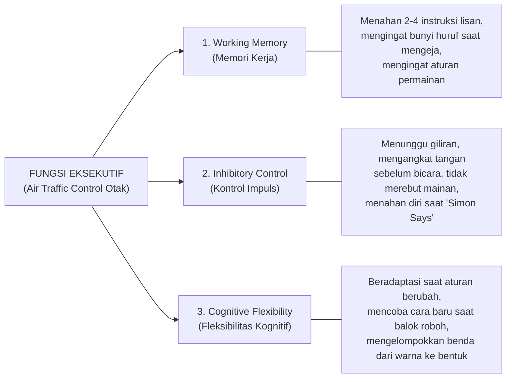

# Modul 01: Panduan Komprehensif Tumbuh Kembang Anak Usia 4–6 Tahun

Memahami tumbuh kembang anak usia 4–6 tahun secara ilmiah adalah syarat mutlak sebelum mengajarkan keterampilan menulis, membaca, berhitung, mendengar, maupun penalaran. Mengajarkan materi yang melampaui kematangan neurologis dan fisiologis anak akan memicu frustrasi, kecemasan belajar (*academic anxiety*), dan hilangnya motivasi intrinsik; sebaliknya, stimulasi yang selaras dengan tahap perkembangan (*Developmentally Appropriate Practice / DAP*) akan mengoptimalkan potensi emas anak.

---

## 1. Landasan Neurosains: Apa yang Terjadi di Otak Anak Usia 4–6 Tahun?

### 1.1 Pertumbuhan & Pemangkasan Sinaptik (*Synaptogenesis & Synaptic Pruning*)
- Pada usia **5 tahun**, volume otak anak telah mencapai sekitar **90% dari ukuran otak orang dewasa**.
- Anak usia 4–6 tahun memiliki kepadatan sambungan saraf (*sinapsis*) hampir **dua kali lipat** lebih banyak dibandingkan orang dewasa, sehingga otak mereka menyerap informasi dari lingkungan seperti spons (*The Absorbent Mind*).
- Pada periode ini, otak mulai melakukan **pemangkasan sinaptik (*synaptic pruning*)** dan **mielinasi (*myelination*)**: jalur saraf yang sering digunakan melalui pengalaman nyata dan pengulangan yang menyenangkan akan dilapisi selubung mielin sehingga menjadi permanen dan cepat, sedangkan jalur yang jarang digunakan akan dipangkas.

### 1.2 Gelombang Otak Anak (*Theta to Alpha Transition*)
- Anak usia 2–6 tahun didominasi oleh gelombang otak **Theta (4–8 Hz)** hingga **Alpha rendah (8–10 Hz)**—kondisi gelombang otak yang mirip dengan orang dewasa saat sedang melamun kreatif, bermeditasi, atau terhipnosis ringan.
- Akibatnya:
  1. **Imajinasi dan realitas menyatu:** Anak belajar jauh lebih efektif melalui **cerita, fantasi, bermain peran (*pretend play*), dan lagu** dibandingkan ceramah satu arah.
  2. **Sugestibilitas tinggi:** Label yang diberikan orang dewasa (misal *"Kamu pintar sekali berusaha!"* vs *"Kok begitu saja tidak bisa?"*) langsung tertanam ke dalam alam bawah sadar sebagai konsep diri (*self-concept*).

### 1.3 Fungsi Eksekutif (*Executive Function*) — Sistem Pemandu Otak
Menurut **Center on the Developing Child at Harvard University**, usia 3 hingga 6 tahun adalah periode lonjakan paling drastis (*rapid growth spurt*) bagi perkembangan **Prefrontal Cortex** yang mengatur **Fungsi Eksekutif (*Executive Function*)**. Riset membuktikan bahwa Fungsi Eksekutif di usia TK adalah prediktor keberhasilan akademik di SD yang **lebih kuat daripada skor IQ**.

Tiga komponen utama Fungsi Eksekutif yang harus dilatih setiap hari di TK/PAUD adalah:

---

## 2. Teori Psikologi Perkembangan Utama untuk Usia 4–6 Tahun

### 2.1 Jean Piaget: Tahap Pra-Operasional (*Preoperational Stage*, 2–7 Tahun)
Anak usia 4–6 tahun berada pada transisi dari **Sub-tahap Fungsi Simbolik (2–4 tahun)** menuju **Sub-tahap Pemikiran Intuitif (4–7 tahun)**. Karakteristik kognitif khas yang wajib dipahami guru dan orang tua:
1. **Berpikir Simbolik Kuat:** Anak mampu menggunakan satu benda untuk mewakili benda lain (misal: balok kayu dianggap telepon, huruf `B` mewakili bunyi `/b/`).
2. **Sentrasi (*Centration*):** Anak cenderung fokus pada **satu aspek visual yang paling mencolok** dan mengabaikan aspek lainnya.
   - *Contoh Klasik (Belum Matang Konservasi):* Jika 5 koin dijajarkan rapat dibandingkan dengan 5 koin yang dijajarkan renggang memanjang, anak usia 4–5 tahun akan menjawab barisan yang panjang "jumlahnya lebih banyak". Begitu pula air di gelas pendek lebar yang dituang ke gelas tinggi ramping akan dianggap "airnya bertambah banyak".
3. **Egosentrisme Kognitif (Menurun di Usia 5–6 Tahun):** Di usia 4 tahun, anak masih sering menganggap orang lain melihat dan merasakan persis seperti apa yang ia lihat. Di usia 5–6 tahun, kemampuan *Theory of Mind* (memahami sudut pandang orang lain) berkembang pesat.
4. **Animisme & Penalaran Transduktif:** Anak sering memberi sifat hidup pada benda mati (*"Awan itu sedih makanya menangis jadi hujan"*) dan menghubungkan dua peristiwa yang terjadi bersamaan sebagai sebab-akibat.

### 2.2 Lev Vygotsky: *Zone of Proximal Development (ZPD)* & *Scaffolding*
- **ZPD (Zona Perkembangan Proksimal):** Jarak antara apa yang sudah bisa dilakukan anak **sendirian** dengan apa yang bisa dicapai anak **dengan bantuan/pijakan (*scaffolding*)** dari orang dewasa atau teman yang lebih mahir.
- **Scaffolding (Perancah):** Bantuan bertahap yang diberikan guru (misal: memberi contoh, memberi petunjuk pertanyaan, memegang tangan sebentar) dan **dikurangi sedikit demi sedikit** seiring meningkatnya kemandirian anak.
- **Private Speech (Bicara Sendiri):** Anak usia 4–6 tahun sering berbicara keras-keras kepada dirinya sendiri saat sedang menggambar, menyusun puzzle, atau memecahkan masalah (*"Sekarang ambil yang biru, taruh di atas sini..."*). Menurut Vygotsky, **jangan pernah melarang anak berbicara sendiri saat berkegiatan**, karena *private speech* adalah alat utama anak untuk memandu pikiran dan regulasi dirinya sebelum berubah menjadi *inner speech* (berpikir dalam hati) di usia 7 tahun ke atas.

### 2.3 Erik Erikson: *Initiative vs. Guilt* (Inisiatif vs Rasa Bersalah, 3–6 Tahun)
- Pada usia 4–6 tahun, dorongan psikologis terbesar anak adalah **mengambil inisiatif**: merencanakan permainan sendiri, mencoba menuang air sendiri, memilih baju sendiri, mengajukan ratusan pertanyaan *"Kenapa?"*, dan memimpin proyek kecil.
- **Jika didukung dengan bijak:** Anak tumbuh menjadi pribadi yang memiliki **Purpose (Tujuan, Kepercayaan Diri, & Kepemimpinan)**.
- **Jika selalu dikritik, dilarang, atau dimarahi saat berbuat salah** (misal saat menumpahkan susu atau gambarnya keluar garis): Anak mengembangkan **Guilt (Rasa Bersalah Berlebih)**—menjadi pasif, takut mencoba hal baru, dan selalu menunggu disuruh.

### 2.4 Mildred Parten: Tahapan Perkembangan Bermain Sosial
Pada usia 4–6 tahun, anak bergerak menuju puncak tangga bermain sosial:
1. *Unoccupied Play* & *Solitary Play* (0–2 tahun): Bermain sendiri.
2. *Onlooker Play* & *Parallel Play* (2–3.5 tahun): Duduk berdampingan memainkan mainan serupa tetapi belum berinteraksi mendalam.
3. **Associative Play (3.5–4.5 tahun / Awal TK A):** Anak mulai bermain bersama, saling meminjamkan alat dan mengobrol, namun belum memiliki pembagian peran atau tujuan organisasi yang terstruktur.
4. **Cooperative Play (4.5–6 tahun / Akhir TK A & TK B):** Anak mampu bermain bekerja sama dengan tujuan bersama, membagi peran (*"Kamu jadi dokter, aku jadi pasiennya"*), dan menyepakati aturan permainan (*board games*, olahraga tim sederhana, membangun istana balok bersama).

---

## 3. Peta *Developmental Milestones* Lengkap (TK A vs TK B)

Tabel berikut merangkum indikator pencapaian perkembangan anak berdasarkan standar **CDC (Centers for Disease Control and Prevention)**, **WHO**, **AAP**, dan **STPPA Kemendikdasmen RI**:

### 3.1 Perkembangan Fisik & Motorik Kasar (*Gross Motor*)
| Kemampuan Motorik Kasar | Usia 4–5 Tahun (TK A) | Usia 5–6 Tahun (TK B) |
| :--- | :--- | :--- |
| **Keseimbangan Statis & Dinamis** | Berdiri dengan 1 kaki selama **4–8 detik**; berjalan di atas garis lurus atau papan titian lebar. | Berdiri dengan 1 kaki selama **10+ detik** (bahkan dengan mata tertutup sebentar); berjalan mundur dengan tumit menyentuh ujung jari kaki (*heel-to-toe*). |
| **Gerak Lokomotor (Lari & Lompat)** | Melompat dengan dua kaki melewati rintangan rendah; melompat dengan satu kaki (*hopping*) **3–5 kali** berturut-turut; naik-turun tangga bergantian kaki dengan berpegangan ringan. | Melompat dengan satu kaki (*hopping*) sejauh **2–3 meter**; melakukan *skipping* (langkah-lompat bergantian kaki dengan ritme); melompat tali (*jump rope*) sederhana; naik-turun tangga tanpa berpegangan. |
| **Koordinasi Bola (Mata-Tangan/Kaki)** | Menangkap bola ukuran sedang yang dipantulkan dengan kedua tangan (tidak lagi mendekap ke dada); melempar bola dari atas bahu (*overhand throw*). | Menangkap bola kecil (ukuran bola tenis) dengan tangan saja; memantulkan (*dribbling*) bola ke lantai 3–5 kali; menendang bola yang sedang menggelinding ke arah sasaran. |
| **Koordinasi Bilateral & Ruang** | Mengayuh sepeda roda tiga atau *balance bike* dengan lincah; melakukan gerakan senam menyilang garis tengah tubuh (*crossing midline*). | Mulai dapat mengendarai sepeda roda dua; melakukan *jumping jacks*; memanjat peralatan taman bermain dengan koordinasi tangan dan kaki yang matang. |

### 3.2 Perkembangan Fisik & Motorik Halus (*Fine Motor*)
| Kemampuan Motorik Halus | Usia 4–5 Tahun (TK A) | Usia 5–6 Tahun (TK B) |
| :--- | :--- | :--- |
| **Genggaman Alat Tulis** | Transisi dari *Static Tripod* / *Quadrupod* menuju **Dynamic Tripod Grasp** (tiga jari memegang pensil, gerakan mulai berasal dari pergelangan dan jari, bukan bahu). | **Dynamic Tripod Grasp matang**: jari-jari bergerak fleksibel menggerakkan pensil sementara sisi kelingking menumpu stabil di atas kertas. |
| **Keterampilan Menggunting** | Menggunting sepanjang garis lurus dan garis lengkung besar dengan deviasi minimal; menggunting bentuk lingkaran kasar. | Menggunting bentuk geometris bersudut (persegi, segitiga) dan gambar bentuk kompleks dengan rapi; tangan satunya memutar kertas secara terkoordinasi. |
| **Manipulasi Benda Kecil** | Meronce manik-manik ukuran sedang; memasang dan melepas kancing baju besar; menggunakan penjepit (*tweezers*); melipat kertas menjadi 2–3 lipatan sederhana. | Meronce manik-manik kecil; **mengikat tali sepatu sendiri**; melipat origami multi-langkah; mewarnai di dalam garis batas dengan tekanan yang terkontrol. |
| **Visual-Motor (Menggambar & Bentuk)** | Meniru bentuk tanda tambah (`+`), persegi (`□`), dan garis miring (`/`); menggambar orang dengan **4–6 bagian tubuh** (kepala, badan, tangan, kaki, mata, mulut). | Meniru bentuk silang (`X`), segitiga (`△`), dan belah ketupat awal; menggambar orang dengan **8–10+ bagian tubuh** lengkap (leher, jari, pakaian, rambut, telinga) serta latar pemandangan. |

### 3.3 Perkembangan Kognitif & Pemecahan Masalah
| Kemampuan Kognitif | Usia 4–5 Tahun (TK A) | Usia 5–6 Tahun (TK B) |
| :--- | :--- | :--- |
| **Memori & Rentang Perhatian** | Fokus pada tugas terarah **8–12 menit**; mengingat 3–4 benda yang disembunyikan; menceritakan kembali bagian utama cerita yang baru dibacakan. | Fokus pada tugas terarah **12–18 menit**; mengingat urutan kejadian cerita secara kronologis (awal, tengah, akhir); menghafal alamat rumah atau nomor penting sederhana. |
| **Konsep Waktu & Ruang** | Memahami konsep waktu harian (*pagi, siang, sore, malam*) dan urutan rutinitas; memahami posisi ruang (*di atas, di bawah, di dalam, di luar, di depan, di belakang*). | Memahami konsep *kemarin, hari ini, besok*, nama-nama hari dalam seminggu, serta membaca jam bulat sederhana; membedakan **kiri dan kanan** pada tubuh sendiri. |
| **Klasifikasi & Pola** | Mengelompokkan objek berdasarkan **2 atribut** (misal: bentuk dan warna); mengenali dan melanjutkan pola `AB` dan `ABB`. | Mengelompokkan objek berdasarkan **3 atribut** atau fungsi abstrak; membuat pola sendiri (`ABC`, `AABB`, pola bertumbuh); mengurutkan (*seriation*) 5–7 benda dari terpendek ke terpanjang. |
| **Numerasi Dasar** | Membilang 1–20 secara lisan; menghitung benda konkret 1–10 dengan korespondensi satu-satu; *subitizing* 1–4. | Membilang 1–50/100; memahami kuantitas 1–20; menguasai pasangan bilangan (*number bonds*) hingga 10; melakukan penjumlahan/pengurangan benda konkret 1–10. |

### 3.4 Perkembangan Bahasa & Komunikasi
| Kemampuan Bahasa | Usia 4–5 Tahun (TK A) | Usia 5–6 Tahun (TK B) |
| :--- | :--- | :--- |
| **Kosakata & Kejelasan Bicara** | Menguasai **1.500 – 2.500+ kata**; **90–100% ucapan dapat dipahami** oleh orang asing (meski konsonan sulit seperti `/r/` atau kluster mungkin masih dalam proses). | Menguasai **2.500 – 5.000+ kata** (dan memahami hingga 10.000+ kata reseptif); seluruh fonem bahasa ibu diucapkan dengan jelas dan akurat. |
| **Struktur Kalimat** | Berbicara dalam kalimat terdiri dari **5–6+ kata**; menggunakan kata hubung (*dan, karena, kalau*); sangat gemar bertanya *"Kenapa?", "Bagaimana?", "Kapan?"*. | Berbicara dalam kalimat majemuk (**6–8+ kata**) dengan struktur tata bahasa yang lengkap; mampu menjelaskan cara kerja suatu benda atau aturan permainan kepada orang lain. |
| **Pragmatik & Narasi** | Mampu melakukan percakapan bolak-balik (*back-and-forth conversation*) minimal 3–4 giliran; menceritakan pengalaman pribadi meski terkadang bercampur imajinasi. | Mampu berdiskusi dalam kelompok, menyampaikan pendapat, bernegosiasi dengan kata-kata, memahami humor verbal/teka-teki sederhana, dan membedakan fakta vs khayalan. |

### 3.5 Perkembangan Sosial-Emosional & Kemandirian (CASEL & ADL)
| Aspek Sosial-Emosional | Usia 4–5 Tahun (TK A) | Usia 5–6 Tahun (TK B) |
| :--- | :--- | :--- |
| **Kesadaran & Regulasi Emosi** | Mengenali emosi *senang, sedih, marah, takut*; mulai menggunakan kata-kata (bukan pukulan/tangisan) saat kesal dengan bimbingan orang dewasa. | Mengenali emosi yang lebih kompleks (*kecewa, bangga, malu, cemas, cemburu*); mampu menerapkan teknik menenangkan diri (*tarik napas dalam, menghitung, ke pojok tenang*). |
| **Interaksi Teman Sebaya** | Senang bermain dengan teman sebaya, mulai memiliki "teman dekat", belajar berbagi dan bergiliran meski masih sesekali membutuhkan mediasi guru. | Sangat menikmati bermain kooperatif, mampu membuat kesepakatan aturan main, menunjukkan empati tulus (menghibur teman yang jatuh/sedih), menyelesaikan konflik ringan secara mandiri. |
| **Kemandirian (*Practical Life / ADL*)** | Makan sendiri tanpa berantakan, memakai baju dan sepatu *velcro*, mencuci tangan, ke toilet sendiri (BAK/BAB) dengan sedikit pengawasan kebersihan. | Mandiri penuh di toilet, menyiapkan tas sekolah sendiri, menuang air, membersihkan tumpahan sendiri, bertanggung jawab merapikan mainan dan tugas kelas. |

---

## 4. Sistem Integrasi 7 Sensori: Rahasia Mengapa Anak Bisa Duduk Tenang dan Fokus

Banyak orang dewasa mengira manusia hanya memiliki 5 indra. Dalam terapi okupasi anak dan neurosains perkembangan (A. Jean Ayres, *Sensory Integration Theory*), terdapat **7 sistem sensori**. Dua indra tersembunyi—**Vestibular** dan **Proprioseptif**—adalah fondasi utama yang menentukan apakah anak usia 4–6 tahun mampu duduk tenang di kursi, memusatkan perhatian, dan mengontrol tangan saat menulis:

| Sistem Sensori | Organ Reseptor | Fungsi Utama dalam Belajar (Usia 4–6 Tahun) | Aktivitas Stimulasi di TK/PAUD |
| :--- | :--- | :--- | :--- |
| **1. Vestibular** *(Keseimbangan & Gerak)* | Telinga bagian dalam (*semicircular canals*) | Mengatur keseimbangan, postur tubuh melawan gravitasi, stabilitas gerakan bola mata saat membaca dari kiri ke kanan, dan tingkat kewaspadaan (*alertness*) otak. | Berayun, berputar terukur, berguling di matras, berjalan di papan titian, melompat trampolin, senam irama. |
| **2. Proprioseptif** *(Posisi Tubuh & Tekanan Otot/Sendi)* | Otot, tendon, dan persendian seluruh tubuh | Memberi tahu otak di mana posisi anggota tubuh tanpa harus melihatnya (*body awareness*), mengatur **seberapa kuat tangan menekan pensil** agar kertas tidak robek, dan memberi efek menenangkan sistem saraf. | *Heavy work*: mendorong kursi/keranjang buku, merangkak terowongan, meremas *playdough*, tarik tambang, merayap, membawa baki Montessori. |
| **3. Taktil** *(Perabaan Kulit)* | Reseptor kulit (terutama ujung jari & telapak tangan) | Diskriminasi bentuk dan tekstur benda; kematangan taktil di jari menentukan kenyamanan anak memegang pensil, krayon, dan lem tanpa merasa jijik/hipersensitif. | *Sensory bin* (beras, kacang hijau, pasir kinetik), *finger painting*, meraba huruf amplas (*Sandpaper Letters*), *Mystery Bag* (tebak benda dengan mata tertutup). |
| **4. Visual** *(Penglihatan & Persepsi Visual)* | Mata & Korteks Visual | Membedakan bentuk huruf/angka yang mirip (`b-d`, `6-9`), melacak baris tulisan (*visual tracking*), menyalin dari papan tulis. | Mencari perbedaan gambar (*Spot the Difference*), labirin (*maze*), menyusun pola balok, melempar-tangkap bola. |
| **5. Auditori** *(Pendengaran & Pemrosesan Suara)* | Telinga & Korteks Auditori | Membedakan fonem bahasa, menyaring suara bising di kelas, mengingat instruksi lisan guru. | Permainan tebak suara, meniru tepukan irama, *Silence Game*, mendengarkan cerita. |
| **6. Olfaktori** *(Penciuman)* | Hidung (terhubung langsung ke sistem limbik/memori) | Mengaitkan emosi, ketenangan, dan memori episodik; mengenali bahaya atau kesegaran lingkungan. | Tebak botol aroma (jeruk, kayu manis, pandan, melati), berkebun tanaman herbal. |
| **7. Gustatori** *(Pengecapan & Oral Motor)* | Lidah & otot rongga mulut | Eksplorasi rasa makanan bergizi; kekuatan otot mulut/lidah (*oral motor*) berkaitan erat dengan kejelasan artikulasi bicara dan regulasi diri. | Eksperimen rasa (*manis, asam, asin, pahit*), meniup gelembung sabun/bola kapas dengan sedotan (melatih otot mulut & napas). |

> [!IMPORTANT]
> **Mengapa Anak Gelisah Saat Duduk Belajar?**
> Ketika anak usia 4–6 tahun terus-menerus menggoyangkan kursi, menyandarkan kepala di meja, atau berjalan-jalan di kelas, sering kali penyebabnya bukanlah "anak nakal", melainkan **sistem Vestibular dan Proprioseptifnya sedang lapar input (*under-stimulated*)**. Memberikan **5 menit aktivitas gerak aktif (*Brain Break / Heavy Work*)** sebelum sesi duduk fokus akan mengisi "baterai" sistem saraf mereka sehingga mereka dapat duduk tenang dan fokus jauh lebih baik.

---

## 5. Kebutuhan Biologis & Manajemen Energi Harian Anak 4–6 Tahun

Otak anak tidak dapat belajar secara optimal jika kebutuhan biologis dasarnya tidak terpenuhi. Berdasarkan pedoman **WHO (*World Health Organization*)** dan **American Academy of Pediatrics (AAP)**:

1. **Kebutuhan Tidur (10 – 13 Jam per 24 Jam):**
   - Konsolidasi memori jangka pendek menjadi memori jangka panjang (apa yang dipelajari di sekolah hari itu) terjadi saat anak berada dalam fase tidur *Deep Sleep* dan *REM Sleep* di malam hari.
   - Anak usia 4–6 tahun yang tidur kurang dari 9 jam menunjukkan penurunan drastis pada *Working Memory*, peningkatan impulsivitas menyerupai gejala ADHD, dan kesulitan regulasi emosi.
2. **Aktivitas Fisik (Minimal 180 Menit / 3 Jam per Hari):**
   - Tersebar sepanjang hari dalam bentuk bermain aktif, di mana minimal **60 menit** di antaranya adalah aktivitas fisik intensitas sedang hingga tinggi (*moderate-to-vigorous physical activity* seperti berlari, melompat, bersepeda, bermain di luar ruang).
   - Aktivitas fisik memicu pelepasan **BDNF (*Brain-Derived Neurotrophic Factor*)**, protein yang dijuluki para ilmuwan saraf sebagai *"Miracle-Gro (pupuk penyubur) bagi sel-sel otak"*.
3. **Batas *Screen Time* (Maksimal 1 Jam per Hari & Harus Interaktif):**
   - Paparan layar pasif berkecepatan tinggi (*fast-paced videos*) melemahkan jaringan perhatian *top-down* di *Prefrontal Cortex*. Jika menggunakan media digital edukatif, gunakan prinsip **Co-Viewing** (didampingi orang dewasa dengan interaksi tanya-jawab) dan durasi singkat (15–20 menit per sesi).
4. **Nutrisi Otak & Hidrasi:**
   - Otak anak mengonsumsi hampir **50% dari total glukosa tubuh** pada usia 4–6 tahun (dua kali lipat proporsi konsumsi otak orang dewasa). Sarapan tinggi protein, lemak sehat (Omega-3/DHA), karbohidrat kompleks, zat besi, dan hidrasi air putih yang cukup sangat menentukan stabilitas *mood* dan konsentrasi anak di pagi hari.

---

## 6. Deteksi Dini (*Red Flags*) Tumbuh Kembang Anak Usia 4–6 Tahun

Pendidik dan orang tua perlu melakukan observasi berkala. Segera konsultasikan ke dokter spesialis anak tumbuh kembang, psikolog perkembangan anak, atau terapis okupasi/wicara apabila ditemukan tanda-tanda (*red flags*) berikut:

### Red Flags pada Usia 4–5 Tahun (TK A)
- **Motorik:** Sering terjatuh saat berlari, tidak bisa melompat di tempat dengan dua kaki, tidak bisa memegang krayon dengan jari (masih menggenggam kepalan tangan penuh/*fisted grasp*), kesulitan meniru bentuk lingkaran (`O`).
- **Bahasa & Pendengaran:** Tidak bisa menyusun kalimat lebih dari 3 kata, ucapan tidak dipahami oleh orang di luar keluarga inti (>50% tidak jelas), tidak merespons saat dipanggil dari belakang, tidak bisa mengikuti instruksi sederhana 2 langkah.
- **Kognitif:** Tidak memahami konsep "sama" dan "berbeda", tidak tertarik pada permainan pura-pura (*pretend play*), tidak bisa fokus pada satu aktivitas pilihan sendiri selama minimal 5 menit.
- **Sosial-Emosional:** Mengabaikan anak lain sepenuhnya (tidak ada minat berinteraksi), tidak melakukan kontak mata, tantrum ekstrem (>20–30 menit atau menyakiti diri sendiri/orang lain secara konsisten) setiap kali terjadi perubahan kecil.

### Red Flags pada Usia 5–6 Tahun (TK B)
- **Motorik:** Tidak bisa berdiri satu kaki minimal 5 detik, belum memiliki dominasi tangan (kanan/kiri) yang jelas sehingga selalu bingung saat menggunakan alat tulis/gunting, tidak bisa menyalin bentuk silang (`+` / `X`) atau persegi (`□`), belum bisa memakai/melepas pakaian atau ke toilet secara mandiri.
- **Bahasa & Literasi Awal:** Tidak bisa menyebutkan nama lengkap sendiri, kesulitan luar biasa mengenali rima atau bunyi awal kata setelah dilatih berulang kali, tidak bisa menceritakan kembali pengalaman sederhana secara berurutan.
- **Sosial & Regulasi Diri:** Sangat kaku terhadap rutinitas, cemas ekstrem berpisah dari pengasuh setelah berminggu-minggu adaptasi sekolah, atau kehilangan keterampilan yang sebelumnya sudah pernah dikuasai (*regresi perkembangan*).
