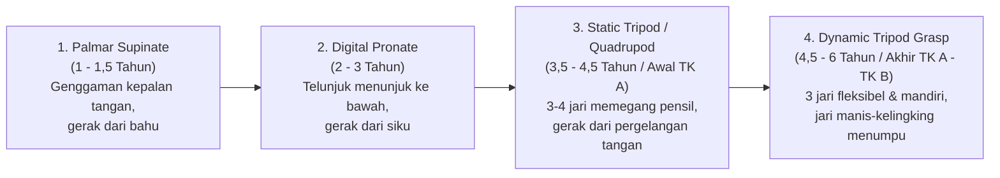

# Modul 02: Panduan Melatih Menulis yang Baik (Pre-Writing, Fine Motor & Emergent Writing)

Melatih anak usia 4–6 tahun menulis dengan baik **bukanlah** dimulai dengan memberikan lembar kerja (*worksheet*) berisi titik-titik huruf kecil di buku bergaris sempit untuk ditebalkan berlembar-lembar. Berdasarkan riset **Terapi Okupasi Pediatrik (*Pediatric Occupational Therapy*)**, metodologi **Handwriting Without Tears (Learning Without Tears)**, dan **Pedagogi Montessori**, menulis adalah puncak dari kematangan anatomi tulang tangan, stabilitas otot bahu, integrasi visual-motorik, dan pemahaman simbol bahasa.

---

## 1. Fakta Anatomi: Mengapa Anak 4 Tahun Tidak Boleh Dipaksa Menulis Banyak?

Jika kita melihat hasil rontgen (*X-ray*) tangan anak usia 3–4 tahun dibandingkan anak usia 6–7 tahun, terdapat perbedaan biologis yang sangat mencolok:

1. **Ossifikasi Tulang Karpal (Pergelangan Tangan) Belum Sempurna:**
   - Pada usia **3–4 tahun**, tulang-tulang karpal di pergelangan tangan anak masih berupa **tulang rawan (*cartilage*)** yang lunak dan terdapat banyak celah kosong di antaranya.
   - Proses pengerasan tulang (*ossification*) dan penyatuan ligamen telapak tangan baru mulai padat dan stabil pada usia **5,5 hingga 7 tahun**.
2. **Pembentukan Lengkung Telapak Tangan (*Palmar Arches*):**
   - Tangan manusia memiliki 3 lengkungan otot di telapak tangan yang memungkinkan jari-jari menekuk dan memegang pensil dengan presisi. Lengkungan ini hanya terbentuk melalui aktivitas **meremas, memanjat, merangkak, dan memanipulasi benda tiga dimensi**, bukan dari memegang pensil tipis.
3. **Pemisahan Dua Sisi Tangan (*Motoric Separation of the Hand*):**
   - Untuk menulis dengan lancar, tangan harus terbagi menjadi dua zona fungsi:
     - **Sisi Radial (Ibu jari, Telunjuk, Jari Tengah):** Sisi penggerak (*Skill Side*) yang memegang dan menggerakkan pensil.
     - **Sisi Ulnar (Jari Manis & Kelingking):** Sisi penstabil (*Stability Side*) yang menekuk ke dalam telapak tangan dan menumpu di atas meja agar tangan dapat meluncur dengan stabil.

> [!WARNING]
> **Dampak Memaksa Anak Menulis Terlalu Dini Tanpa Persiapan Motorik:**
> Anak yang dipaksa menulis berlembar-lembar sebelum otot dan tulang tangannya siap akan melakukan **kompensasi genggaman yang salah** (seperti *thumb wrap* atau *fisted grip* yang kaku), mengalami kelelahan dan rasa sakit di tangan, serta mengembangkan **trauma/kebencian terhadap kegiatan menulis** hingga jenjang SD.

---

## 2. Evolusi Perkembangan Genggaman Pensil (*Pencil Grasp Progression*)

Genggaman pensil anak berkembang secara bertahap sesuai kematangan saraf dari bahu menuju ujung jari (*Proximal to Distal*):

### Karakteristik Genggaman Ideal: *Dynamic Tripod Grasp* (dan *Dynamic Quadrupod*)
- **Ibu jari** dan **ujung jari telunjuk** menjepit batang pensil sekitar **1,5 – 2 cm** di atas ujung runcing pensil (membentuk ruang bulat terbuka di antara ibu jari dan telunjuk, bukan terjepit rapat).
- **Jari tengah** menyangga batang pensil dari sisi bawah.
- **Batang pensil** bersandar dengan rileks di lekukan antara ibu jari dan telunjuk (*web space*).
- **Jari manis dan kelingking** menekuk ke arah telapak tangan (*"tidur di dalam rumah"*).
- *Catatan Ilmiah Terapi Okupasi:* **Dynamic Quadrupod Grasp** (4 jari: ibu jari, telunjuk, tengah di batang pensil, disangga jari manis) juga diakui sebagai **genggaman fungsional dan matang** selama gerakan jari tetap dinamis dan tidak kaku.

### Trik Praktis Melatih Genggaman *Dynamic Tripod* Tanpa Stres
1. **Trik "Bantal Koin / Pom-Pom" (*Ulnar Stabilization Trick*):**
   - Berikan satu buah pom-pom kecil, tisu kecil, atau koin kepada anak. Minta anak **menjepit pom-pom tersebut menggunakan jari manis dan kelingking** ke arah telapak tangan (*"Jaga bantal kecil ini jangan sampai jatuh ya!"*), sementara **3 jari lainnya (ibu jari, telunjuk, jari tengah)** memegang pensil.
   - Cara ini secara otomatis memisahkan sisi stabil dan sisi penggerak tangan!
2. **Trik "Cubit dan Balik" (*Pinch and Flip*):**
   - Letakkan pensil di atas meja dengan ujung runcing **mengarah ke tubuh anak**.
   - Minta anak mencubit bagian dekat ujung pensil dengan ibu jari dan telunjuk, lalu **jungkir balikkan (*flip*)** bagian belakang pensil hingga bersandar di lekukan tangan.
3. **Gunakan Alat Tulis Pendek (*Golf Pencils / Broken Crayons*):**
   - Berikan krayon yang dipatahkan menjadi panjang **3–4 cm** atau pensil pendek (*golf pencil*). Secara biomekanik, anak **tidak mungkin** menggenggam krayon sepanjang 3 cm dengan kepalan tangan penuh; jari-jari mereka otomatis akan membentuk *Tripod Pinch*!

---

## 3. Fondasi Pra-Menulis: *Fine Motor Gym* (Usia 4–5 Tahun)

Sebelum dan berbarengan dengan latihan memegang pensil, kurikulum TK/PAUD wajib menyediakan aktivitas harian untuk memperkuat **3 kelompok otot utama**:

### 3.1 Stabilitas Bahu, Lengan Atas & Pergelangan Tangan (*Shoulder & Wrist Stability*)
- **Menulis dan Menggambar di Bidang Vertikal (*Vertical Surface Work*):**
  - Menempelkan kertas besar di dinding, menulis di papan tulis (*whiteboard/chalkboard*), melukis di *easel*, atau menempel magnet di kulkas.
  - **Mengapa sangat penting?** Saat tangan bekerja di bidang vertikal setinggi mata, pergelangan tangan otomatis menekuk ke atas sekitar $20^\circ\text{–}30^\circ$ (**wrist extension**). Posisi ekstensi pergelangan tangan ini secara anatomis mengunci tendon jari sehingga genggaman *tripod* menjadi kuat dan stabil.
- **Permainan Tumpuan Lengan (*Weight-Bearing Activities*):**
  - Jalan kepiting (*crab walk*), jalan gerobak dorong (*wheelbarrow walk*), merangkak melewati terowongan, dan menggantung di *monkey bar*.
  - Menggambar atau membaca sambil **tengkurap di lantai dengan bertumpu pada kedua siku (*prone on elbows*)**.

### 3.2 Kekuatan Otot Intrinsik Telapak Tangan (*Hand Arch & Grip Strength*)
- **Senam *Playdough* / Tanah Liat (*Playdough Gym / Dough Disco*):** Meremas, menggulung menjadi bola dengan dua telapak tangan, memilin menjadi ular panjang, dan menekan dengan satu per satu jari.
- **Botol Semprot & Spons (*Spray Bottles & Sponges*):** Menyiram tanaman dengan botol semprot menggunakan jari telunjuk-tengah, atau memeras air dari spons basah dari satu mangkuk ke mangkuk lain.
- **Merobek & Meremas Kertas:** Merobek kertas bekas dengan ujung ibu jari dan telunjuk, lalu meremasnya menjadi bola-bola kecil menggunakan **satu tangan saja**.

### 3.3 Kekuatan Jepitan 3 Jari (*Pincer & Tripod Pinch Strength*)
- **Permainan Pinset/Penjepit (*Tweezers / Tongs*):** Memindahkan pom-pom, biji jagung, atau kancing ke dalam cetakan es batu menggunakan penjepit kue atau pinset plastik besar.
- **Pipet Tetes (*Eyedropper Art*):** Menyedot dan meneteskan air berwarna ke atas tisu atau kapas—melatih kontrol tekanan ibu jari dan telunjuk yang sangat halus.
- **Jepitan Jemuran (*Clothespins*):** Menjepitkan penjepit baju kayu/plastik di sekeliling piring kertas sesuai jumlah titik atau warna.
- **Meronce (*Bead Threading*) & Menjahit Kertas (*Lacing Cards*):** Melatih koordinasi mata-tangan dan kerja sama dua tangan (*bilateral integration*—satu tangan memegang tali, satu tangan memegang papan/manik).

---

## 4. Sembilan Goresan Pra-Menulis (*The 9 Developmental Pre-Writing Strokes*)

Berdasarkan riset perkembangan **Beery-Buktenica Developmental Test of Visual-Motor Integration (Beery VMI)**, otak dan mata anak menguasai bentuk goresan garis dalam urutan biologis yang **pasti dan tidak bisa dilompati**. Seorang anak **belum siap** menulis huruf tertentu jika ia belum mampu menyalin (*copy*) goresan dasar pembentuk huruf tersebut:

| Urutan | Simbol Goresan | Nama Goresan | Usia Meniru (*Imitate*) | Usia Menyalin Mandiri (*Copy*) | Huruf & Angka yang Bergantung pada Goresan Ini |
| :---: | :---: | :--- | :---: | :---: | :--- |
| **1** | `\|` | Garis Vertikal (*Vertical Line*) | 2 Tahun | 2,5 – 3 Tahun | `I, L, T, H, F, E, 1, 4` |
| **2** | `—` | Garis Horizontal (*Horizontal Line*) | 2,5 Tahun | 3 Tahun | `L, T, H, F, E, Z, 2, 4, 5, 7` |
| **3** | `O` | Lingkaran (*Circle*) | 2,5 Tahun | 3 Tahun | `O, Q, C, G, D, P, B, R, a, c, d, e, g, o, p, q, 0, 6, 8, 9` |
| **4** | `+` | Tanda Tambah / Silang Tegak (*Cross*) | 3,5 Tahun | **4 Tahun** | Memotong garis tengah tubuh (*crossing midline*); fondasi huruf `t, f` dan tanda `+` |
| **5** | `/` | Garis Miring Kanan (*Right/Left Oblique Line*) | 4 Tahun | **4 – 4,5 Tahun** | `V, W, X, Y, Z, A, K, M, N, 7` |
| **6** | `□` | Persegi (*Square*) | 4 Tahun | **4,5 Tahun** | Kemampuan berhenti di sudut tajam dan mengubah arah $90^\circ$ (`E, F, H, L`) |
| **7** | `\` | Garis Miring Kiri (*Oblique Line*) | 4 – 4,5 Tahun | **4,5 – 5 Tahun** | `A, K, M, N, V, W, X, Y` |
| **8** | `X` | Tanda Silang Diagonal (*Oblique Cross*) | 4,5 Tahun | **5 Tahun** | `X, x, K, k, Y, y` (integrasi penuh belahan otak kiri dan kanan) |
| **9** | `△` | Segitiga (*Triangle*) | 5 Tahun | **5 – 5,5 Tahun** | `A, M, N, V, W` dan seluruh pembentukan huruf kompleks dengan sudut diagonal |

> [!TIP]
> **Perbedaan *Tracing* (Menebalkan Titik), *Imitating* (Meniru Gerakan), dan *Copying* (Menyalin Gambar):**
> 1. **Tracing (Menebalkan titik-titik):** Sering kali menipu! Anak hanya menghubungkan titik-titik secara pasif tanpa merekam memori motorik (*motor plan*) arah huruf di otaknya.
> 2. **Imitating (Meniru):** Guru menggambar garis di depan mata anak sambil mengucapkan irama suara (*"Tarik dari atas ke bawah: sreeet!"*), lalu anak langsung menirunya. **Ini jauh lebih efektif daripada menebalkan titik-titik.**
> 3. **Copying (Menyalin):** Anak melihat contoh bentuk yang sudah jadi, lalu menggambarnya sendiri dari awal.

---

## 5. Tahapan Perkembangan Menulis Anak (*Stages of Emergent Writing*)

Jangan mengharapkan tulisan anak langsung rapi seperti ketikan komputer. Hargai dan fasilitasi **6 tahapan alami perkembangan menulis anak**:

1. **Tahap 1: Menggambar & Mencoret (*Drawing & Scribbling* — Usia 2–3,5 Tahun):** Anak menyampaikan pesan melalui gambar dan coretan bebas.
2. **Tahap 2: Coretan Bergelombang Menyerupai Tulisan (*Wavy / Linear Scribbles* — Usia 3,5–4 Tahun):** Anak membuat garis bergelombang dari kiri ke kanan, meniru gerakan orang dewasa saat menulis.
3. **Tahap 3: Bentuk Menyerupai Huruf (*Letter-Like Forms / Mock Letters* — Usia 4–4,5 Tahun):** Muncul bulatan, garis, dan lengkungan yang terpisah-pisah menyerupai huruf abjad.
4. **Tahap 4: Rentetan Huruf Acak & Nama Sendiri (*Strings of Letters* — Usia 4,5–5 Tahun):** Anak gemar menulis huruf-huruf yang ada pada namanya sendiri secara berulang untuk mewakili kata apa saja.
5. **Tahap 5: Ejaan Fonetik / Ejaan Temuan (*Invented / Phonetic Spelling* — Usia 5–6 Tahun):** Anak mulai menghubungkan bunyi dengan huruf. Misalnya menulis `BL` atau `BOLA` untuk gambar bola, atau `SKL` untuk *sekolah*. **Rayakan tahap ini!** Ini adalah bukti kesadaran fonologis dan menulis yang luar biasa.
6. **Tahap 6: Penulisan Konvensional Awal (*Conventional Writing* — Usia 6+ Tahun):** Anak mulai menulis suku kata dan kata pendek secara lengkap dengan spasi antar kata.

---

## 6. Metodologi Terbaik Mengajarkan Bentuk Huruf (*Letter Formation*)

### 6.1 Mengapa Mengajarkan Huruf Kapital Terlebih Dahulu di Usia 4 Tahun?
Berdasarkan riset *Handwriting Without Tears (Jan Olsen, OTR)*:
1. **Semua Huruf Kapital Memiliki Tinggi yang Sama:** Semuanya berada di satu blok ruang yang seragam (tidak ada tiang tinggi seperti `b, d, h, k, l` atau ekor menggantung ke bawah garis seperti `g, j, p, q, y`).
2. **Semua Huruf Kapital Dimulai dari Atas (*Start at the Top*):** Tidak ada satu pun huruf kapital yang dimulai dari garis bawah.
3. **Hanya Tersusun dari 4 Elemen Dasar:** Garis Besar (*Big Line*), Garis Kecil (*Little Line*), Lengkung Besar (*Big Curve*), dan Lengkung Kecil (*Little Curve*).
4. **Bebas Kebingungan Terbalik (*Reversal-Free*):** Huruf `B, D, P, Q` sangat berbeda bentuknya, sedangkan huruf kecil `b, d, p, q` adalah bentuk yang sama persis namun diputar arahnya!

> **Kapan Mengajarkan Huruf Kecil (*Lowercase*)?**
> Untuk **membaca (pengenalan visual)**, perkenalkan huruf kecil sejak awal (usia 4–5 tahun) karena 95% teks di buku cerita menggunakan huruf kecil. Namun untuk **menulis dengan tangan (*motorik produksi*)**, latih pembentukan huruf kapital dan nama panggilan di usia 4–4,5 tahun (TK A), lalu transisikan ke penulisan huruf kecil secara terstruktur di usia 4,5–6 tahun (Semester 2 TK A hingga TK B).

### 6.2 Urutan Pengajaran Menulis Huruf Berdasarkan Kelompok Gerak Motorik
**JANGAN mengajarkan anak menulis huruf sesuai urutan nyanyian A – B – C – D!** Mengajarkan `A` diikuti `B` lalu `C` membuat otot tangan dan otak anak bingung karena pola geraknya berubah drastis di setiap huruf. Ajarkan huruf berdasarkan **Keluarga Gerakan Tarikan Garis (*Stroke Families*)**:

#### A. Urutan Menulis Huruf Kapital (4 Kelompok Mudah)
1. **Kelompok Garis Lurus Vertikal-Horizontal (*Straight-Line Capitals* — Paling Mudah):**
   - **`L, F, E, H, T, I`**
   - *Ciri:* Hanya menggunakan garis lurus vertikal (atas ke bawah) dan horizontal (kiri ke kanan).
2. **Kelompok Lompat Katak (*Frog Jump Capitals*):**
   - **`F, E, D, P, B, R, N, M`**
   - *Ciri:* Tarik garis lurus dari atas ke bawah $\rightarrow$ angkat pensil "lompat seperti katak" kembali ke titik pojok kiri atas $\rightarrow$ tambahkan garis atau lengkungan ke kanan.
3. **Kelompok Mulai dari Pojok Atas & Diagonal (*Starting Corner Capitals*):**
   - **`H, K, L, U, V, W, X, Y, Z`**
4. **Kelompok Mulai dari Tengah Atas / *Magic C Capitals*:**
   - **`C, O, Q, G, S, A, I, T, J`**

#### B. Urutan Menulis Huruf Kecil (*Lowercase Families* — Kunci Anti Terbalik `b` dan `d`)
1. **Keluarga *Magic C* (*Huruf Ajaib `c`* — Wajib Pertama!):**
   - **`c, o, a, d, g, q`** (serta **`s, e`**)
   - *Rahasia Utama:* Semua huruf ini dimulai dengan gerakan melengkung ke kiri membentuk huruf **`c`**!
   - Untuk menulis **`d`**: *"Buat huruf `c` dulu, naik tinggi ke atas seperti helikopter, lalu turun lurus ke bawah!"* Dengan cara ini, anak **tidak akan pernah tertukar** saat menulis `d` dan `b` karena gerakan awalnya berbeda total!
2. **Keluarga Penyelam (*Diver Letters* — Turun, Naik di Jalur yang Sama, Melengkung ke Kanan):**
   - **`r, n, m, h, b, p`**
   - Untuk menulis **`b`**: *"Menyelam lurus dari atas ke bawah, naik lagi lewat jalur yang sama ke tengah, lalu buat perut ke kanan!"*
3. **Keluarga Huruf Kecil Mudah (Sama Bentuknya dengan Kapital):**
   - **`v, w, x, z, t, i, u, l, k, j, f, y`**

### 6.3 Teknik Multisensori (*Montessori & Learning Without Tears*)
Sebelum menulis dengan pensil di atas kertas, latih memori otot (*muscle memory*) anak melalui **5 Langkah Multisensori**:
1. **Membangun Huruf (*Build It*):** Menyusun huruf menggunakan potongan kayu/karton (*Big Line, Little Line, Big Curve, Little Curve*) atau sosis *playdough*.
2. **Menulis di Udara (*Skywriting*):** Anak berdiri, meluruskan lengan dominan ke depan, dan menulis huruf raksasa di udara menggunakan gerakan bahu sambil mengucapkan mantra arah (*verbal pathway*, misal: *"Tarik lurus ke bawah, lompat ke atas, topi besar, topi kecil — Huruf F!"*).
3. **Menelusuri Huruf Amplas (*Montessori Sandpaper Letters*):** Menggunakan ujung jari telunjuk dan jari tengah untuk meraba tekstur huruf amplas sesuai arah tarikan yang benar sambil membunyikan fonemnya.
4. **Menulis di Baki Pasir / Garam (*Sand Tray*) & Metode *Wet-Dry-Try*:**
   - Pada metode *Wet-Dry-Try* (di papan tulis kapur kecil): Guru menulis huruf dengan kapur $\rightarrow$ Anak menghapus huruf tersebut mengikuti jalurnya dengan **spons kecil basah (*Wet*)** $\rightarrow$ Anak mengeringkan jejak airnya dengan **tisu kecil (*Dry*)** $\rightarrow$ Anak menulis kembali di atas jejak tersebut dengan **kapur pendek (*Try*)**.
5. **Menulis di Kertas dengan Garis Bantu Visual (*Double Lines / Sky-Grass-Dirt Lines*):**
   - Gunakan kertas dengan baris besar yang memiliki **ilustrasi visual**: Garis Langit (*Sky Line* - biru di atas), Garis Rumput (*Grass Line* - hijau di tengah), dan Garis Tanah (*Dirt/Worm Line* - cokelat di bawah untuk ekor huruf `g, j, p, q, y`).

---

## 7. Ergonomi Postur, Anak Kidal (*Left-Handed*), & Solusi Masalah Umum

### 7.1 Aturan Postur Duduk **90–90–90 Rule**
Pastikan meja dan kursi anak sesuai ukuran tubuhnya:
- **Pinggul membentuk sudut $90^\circ$** (punggung bersandar tegak di kursi).
- **Lutut membentuk sudut $90^\circ$** (paha sejajar lantai).
- **Pergelangan kaki membentuk sudut $90^\circ$** (**telapak kaki wajib menapak rata di lantai** atau di atas pijakan kaki/kotak kardus). Kaki yang menggantung di udara membuat otot perut lelah dan tangan tidak stabil!
- **Tangan non-dominan ("Tangan Penolong")** wajib memegang tepi kertas agar kertas tidak bergeser saat ditulisi.

### 7.2 Panduan Khusus untuk Anak Kidal (*Left-Handed Writers*)
Pada usia 4,5–5 tahun, dominasi tangan sudah mulai menetap. Jika anak kidal, **jangan pernah memaksa mengubahnya ke tangan kanan** (karena dominasi tangan diatur oleh belahan otak kontralateral). Fasilitasi anak kidal dengan 4 penyesuaian ergonomis:
1. **Kemiringan Kertas:** Miringkan sudut atas kertas ke arah **kanan** sekitar $20^\circ\text{–}35^\circ$ (kebalikan dari anak tangan kanan yang memiringkan kertas ke kiri).
2. **Posisi Jari di Pensil:** Minta anak kidal memegang pensil sedikit lebih tinggi (**2,5 – 3 cm** dari ujung pensil) agar matanya bisa melihat tulisan yang sedang dibuat dan tidak tertutup oleh tangannya sendiri (mencegah kebiasaan pergelangan tangan melengkung seperti kait/*hooked wrist*).
3. **Posisi Duduk di Kelas:** Dudukkan anak kidal di **sebelah kiri** temannya yang bertangan kanan agar siku mereka tidak saling berbenturan saat menulis.
4. **Arah Garis Horizontal:** Izinkan anak kidal menarik garis datar (`—` pada huruf `T, H, E, A`) dari kanan ke kiri (menarik pensil lebih mudah daripada mendorong pensil).

### 7.3 Tabel Solusi Masalah Menulis yang Sering Ditemui di TK/PAUD

| Masalah yang Ditemukan | Penyebab Utama (Akar Masalah) | Solusi Terapi & Pedagogis |
| :--- | :--- | :--- |
| **Menekan pensil terlalu keras** (ujung pensil sering patah, kertas robek, tangan cepat pegal) | Kurangnya kepekaan **Proprioseptif** (otak tidak tahu seberapa besar tenaga yang sedang dikeluarkan otot jari). | 1. Lakukan *heavy work* sebelum menulis (meremas *playdough*, mendorong kursi). 2. Letakkan lembaran **busa tipis (*craft foam*)** atau beberapa lapis tisu di bawah kertas anak; tantang anak menulis seperti "bulu ayam" tanpa melubangi kertas. 3. Gunakan pensil mekanik tebal (lead 2.0 mm) atau spidol *felt-tip*. |
| **Menekan pensil terlalu lemah** (goresan sangat tipis dan gemetar) | Tonus otot rendah (*low muscle tone*) atau lemahnya kekuatan otot bahu dan jari. | 1. Gunakan **spidol**, **krayon gel**, atau **pensil hitam pekat (4B/6B)** agar goresan tetap terlihat jelas tanpa butuh tenaga besar. 2. Latih menulis di bidang vertikal (*whiteboard*) dan permainan menjepit *clothespin*. |
| **Huruf & angka terbalik (*Mirror Writing*)** misal `b` jadi `d`, `3`, `5`, `S` terbalik | Pada usia **4 hingga 6,5 tahun**, *mirror writing* adalah **fenomena perkembangan otak yang normal** (karena otak manusia secara alami mengenali objek 3D sebagai benda yang sama meski menghadap kiri atau kanan—*mirror invariance*). | 1. **Jangan dimarahi.** 2. Ajarkan huruf kecil melalui **Keluarga *Magic C*** (`c -> d`) vs **Keluarga Penyelam** (`l -> b`). 3. Gunakan trik visual **"kasur `b-d`"** (kepala kasur `b` di kiri, kaki kasur `d` di kanan) atau **tangan `b-d`** (acungkan kedua jempol di depan dada: tangan kiri membentuk `b`, tangan kanan membentuk `d`). 4. Beri tanda stiker bintang hijau di pojok kiri atas kertas sebagai titik mulai (*Green = Go*). |
| **Anak menolak atau menangis saat diajak menulis** | Trauma lembar kerja (*worksheet fatigue*), kelelahan otot, atau tuntutan kerapian yang tidak sesuai usia. | Hentikan lembar kerja kertas selama 2 minggu. Ganti 100% dengan *sensory writing* (menulis dengan jari di busa cukur, baki pasir berwarna, melukis huruf dengan kuas dan air di tembok luar halaman, atau membuat surat rahasia untuk mainan favoritnya). |
