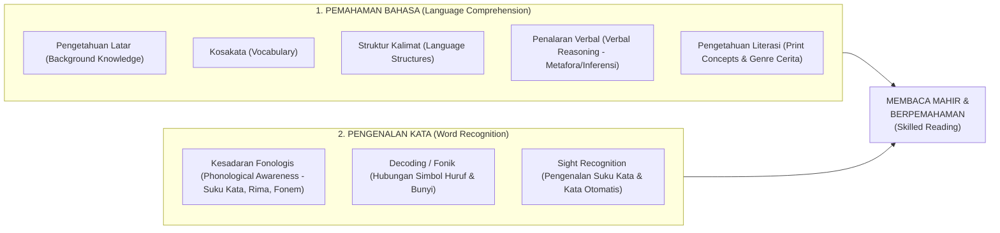

# Modul 03: Panduan Melatih Membaca yang Baik (Science of Reading, Kesadaran Fonologis, Fonik & Suku Kata)

Berbeda dengan kemampuan berbicara yang diperoleh anak secara alami melalui pergaulan sehari-hari, **membaca bukanlah kemampuan biologis bawaan manusia**. Menurut *The Science of Reading* (Stanislas Dehaene, *Reading in the Brain*), untuk dapat membaca, otak anak harus membangun sirkuit saraf baru di **Visual Word Form Area (VWFA)** yang menghubungkan **korteks visual** (penglihatan bentuk huruf) dengan **korteks auditori & bahasa** (bunyi dan makna kata).

Pendekatan terbaik untuk anak usia 4–6 tahun menggabungkan **Kesadaran Fonologis (*Phonological Awareness*)**, **Metode Fonik (*Phonics*)**, **Kupas Rangkai Suku Kata (KRS/SAS)** yang selaras dengan struktur Bahasa Indonesia, serta **Membaca Nyaring Interaktif (*Dialogic Reading*)**.

---

## 1. Kerangka Ilmiah: *Scarborough’s Reading Rope* & 5 Pilar Literasi

Dr. Hollis Scarborough (2001) memodelkan kemampuan membaca yang mahir seperti **dua untaian tali besar yang dipilin menjadi satu**:

> [!IMPORTANT]
> **Mengapa Banyak Anak "Bisa Membaca" Tetapi Tidak Paham Apa yang Dibaca?**
> Karena pengajaran tradisional hanya melatih untaian bawah (**Word Recognition / Dekoding mekanis**) melalui *drill* buku ejaan tanpa gambar dan tanpa cerita, tetapi mengabaikan untaian atas (**Language Comprehension / Kosakata & Pemahaman Cerita**). Anak TK/PAUD harus dilatih **kedua untaian tersebut secara bersamaan**.

### Enam Keterampilan Pra-Membaca (*6 Early Literacy Skills* — Usia 4 Tahun)
Sebelum anak membaca kata pertamanya, bangun 6 fondasi ini:
1. **Print Motivation (Cinta Buku):** Anak senang melihat buku, meminta dibacakan cerita, dan menganggap membaca adalah waktu paling hangat bersama orang tua/guru.
2. **Print Awareness (Kesadaran Cetak):** Anak tahu cara memegang buku yang benar, tahu bahwa tulisan (bukan gambar) yang dibaca, dan mengerti bahwa teks dibaca dari **kiri ke kanan** serta dari **atas ke bawah**.
3. **Phonological Awareness (Kesadaran Fonologis):** Kemampuan mendengar dan bermain dengan bunyi-bunyi di dalam kata lisan (tanpa melihat huruf).
4. **Vocabulary (Kekayaan Kosakata):** Semakin banyak kata yang pernah didengar dan dipahami anak secara lisan, semakin mudah ia mengenali kata tersebut saat membacanya kelak.
5. **Narrative Skills (Keterampilan Narasi):** Kemampuan menceritakan urutan kejadian (*awal $\rightarrow$ tengah $\rightarrow$ akhir*) dan menjawab pertanyaan tentang isi cerita.
6. **Letter-Sound Knowledge (Pengetahuan Huruf-Bunyi):** Mengenal bentuk huruf kecil & kapital beserta **bunyi suaranya (fonem)**.

---

## 2. Tahap 1: Melatih Kesadaran Fonologis (*Phonological Awareness*) Tanpa Huruf

Kesadaran fonologis adalah latihan **100% melalui telinga dan suara** (bahkan bisa dimainkan sambil menutup mata atau di perjalanan). Latih dalam urutan dari unit bunyi terbesar ke terkecil:

### 2.1 Kesadaran Kata dalam Kalimat (*Word Awareness*)
- **Permainan Lompat Kata:** Guru mengucapkan kalimat pendek: *"Kucing minum susu"* (3 kata). Anak melompat ke depan 3 kali di atas karpet/lingkaran, satu lompatan untuk setiap kata yang diucapkan.

### 2.2 Kesadaran Rima (*Rhyming & Alliteration*)
- **Tebak Rima Lucu:** *"Aku punya kata **BOLA**. Kata mana yang bunyi belakangnya sama dengan BOLA: **POLA** atau **MEJA**?"*
- **Lagu & Pantun Anak:** Menyanyikan lagu berima (*Cicak-Cicak di Dinding*, *Balonku*, *Pok Ame-Ame*) dan sengaja menghentikan kata terakhir agar anak yang meneriakkan kata berimanya.

### 2.3 Kesadaran Suku Kata (*Syllable Awareness* — Sangat Penting untuk Bahasa Indonesia!)
Bahasa Indonesia adalah bahasa berbasis suku kata (*syllable-timed language*).
- **Tepuk Suku Kata (*Syllable Clapping*):** Ajak anak menepuk tangan sesuai penggalan suku kata namanya dan benda di sekitar:
  - `Bo - la` (2 tepukan)
  - `Se - pa - tu` (3 tepukan)
  - `Ma - ta - ha - ri` (4 tepukan)
- **Robot Bicara (*Robot Talk*):** Guru berbicara patah-patah seperti robot: *"Tolong am-bil-kan bu-ku bi-ru"*, dan anak menebak kata utuhnya sambil mengambil benda tersebut.

### 2.4 Kesadaran Fonem (*Phonemic Awareness*: Bunyi Awal, *Blending*, *Segmenting*)
- **Detektif Bunyi Awal (*I-Spy Sound Game*):**
  - *"Aku melihat sesuatu di meja ini yang bunyi depannya `/m/` (`mmmmm`)... Apa ya?"* $\rightarrow$ **Meja / Mangga / Mobil**.
- **Penggabungan Bunyi Lisan (*Oral Blending*):**
  - Guru membunyikan fonem terpisah: *"`/b/` ... `/o/` ... `/l/` ... `/a/`, kalau digabung jadi kata apa?"* $\rightarrow$ **Bola!**

---

## 3. Tahap 2: Mengapa Metode Mengeja Konvensional Harus Dihindari?

Banyak orang dewasa dahulu belajar membaca dengan **Metode Mengeja Nama Abjad (*Alphabetic Spelling*)**:
- Melihat kata **`B - A - J - U`**, anak disuruh mengeja: *"Be – A = BA, Je – U = JU $\rightarrow$ BAJU"*.
- Melihat kata **`M - A - K - A - N`**, anak mengeja: *"Em – A = MA, Ka – A = KA, En = MAKAKAEN??"*

### Mengapa Mengeja Nama Huruf Membingungkan Otak Anak?
1. Nama huruf **`B`** adalah **"Be"** (mengandung bunyi `/b/` + `/e/`). Ketika digabung dengan **`A`**, secara logika bunyinya menjadi **"Be-A"**, bukan **"Ba"**!
2. Nama huruf **`M`** adalah **"Em"**, **`S`** adalah **"Es"**, **`N`** adalah **"En"**, **`G`** adalah **"Ge"**. Ketika anak bertemu akhiran konsonan atau gabungan **`NG`** (*"En-Ge"*), bunyi nama hurufnya sama sekali tidak menghasilkan bunyi sengau `/ŋ/`!
3. Anak harus melakukan **proses mental ganda**: melihat simbol $\rightarrow$ mengingat nama huruf $\rightarrow$ membuang vokal tambahan pada nama huruf $\rightarrow$ menggabungkan bunyi. Ini menguras *Working Memory* anak usia 4–5 tahun.

---

## 4. Kurikulum Membaca Bahasa Indonesia Terbaik: Kombinasi **Fonik + Kupas Rangkai Suku Kata (KRS/SAS)**

Bahasa Indonesia memiliki **Ortografi Transparan (*Shallow/Transparent Orthography*)**: hampir setiap huruf selalu mewakili satu bunyi yang konsisten (berbeda dengan Bahasa Inggris di mana huruf `a` pada *cat, car, cake, ball* semuanya berbunyi beda).

Oleh karena itu, metode paling cepat, logis, dan ramah otak untuk anak Indonesia usia 4–6 tahun adalah **Hibrida Fonik + Suku Kata Berjenjang (7 Level)**:

### Level 1: Pengenalan Bunyi Vokal & Huruf Kecil (`a, i, u, e, o`)
- Ajarkan **huruf kecil terlebih dahulu** dengan bunyi murninya:
  - `a` (buka mulut lebar: *apel, ayam*)
  - `i` (tersenyum: *ikan, ibu*)
  - `u` (bibir maju: *ular, udang*)
  - `e` (kenalkan bunyi `/ə/` *emas, enam* dan `/ɛ/` *ekor, ember*)
  - `o` (mulut bulat: *obat, obeng*)
- Gunakan lagu fonik dan gerakan tubuh (*kinesthetic phonics*) untuk setiap vokal.

### Level 2: Konsonan Berkelanjutan (*Continuous Consonants*) & Suku Kata Terbuka Pertama
Jangan ajarkan semua konsonan sekaligus. Mulailah dengan **konsonan yang bunyinya bisa ditahan panjang (*continuous sounds*)** sehingga mudah disambung dengan vokal:
- **Grup Konsonan 1:** **`m` (`/mmm/`), `s` (`/sss/`), `l` (`/lll/`), `r` (`/rrr/`), `n` (`/nnn/`)**
  - Contoh penyambungan (*sliding phonics*): `/mmmmmm/ ... /a/` $\rightarrow$ **`ma`**!
- **Grup Konsonan 2 (*Stop Consonants* - Bibir & Lidah Depan):** **`b` (`/b/`), `p` (`/p/`), `d` (`/d/`), `t` (`/t/`)**
  - *Catatan penting:* Bunyikan `/b/` secara singkat di bibir (seperti bunyi letupan kecil), **bukan** *"be"* atau *"beh"*.
- **Grup Konsonan 3:** **`k, g, c, j, y, w, h, f, z, v`**

### Level 3: Membaca Suku Kata Terbuka (`KV`) & Kata Dua Suku Kata (`KVKV`)
Setelah anak memahami bahwa `/b/` + `/a/` = **`ba`**, ajak anak mengenali suku kata terbuka (`ba, bi, bu, be, bo`, `ma, mi, mu, me, mo`, dll.) secara **langsung tanpa mengeja di mulut** (sistem **Cantol / Abaca / Montessori Membaca Merah-Biru**):
- Rangkai menjadi kata bermakna sehari-hari yang disertai gambar:
  - `ba - ju`, `bo - la`, `bu - ku`, `ma - ta`, `ka - ki`, `sa - pi`, `ro - ti`, `me - ja`, `ku - da`, `la - ri`.
- **Metode SAS (Struktural – Analitik – Sintetik) / Kupas Rangkai:**
  1. **Struktural (Utuh):** Tunjukkan gambar bola dan kartu kata **`bola`**.
  2. **Analitik (Kupas):** Potong/pisahkan menjadi suku kata **`bo - la`**, lalu ke bunyi huruf **`b - o - l - a`**.
  3. **Sintetik (Rangkai):** Gabungkan kembali **`b - o - l - a`** $\rightarrow$ **`bo - la`** $\rightarrow$ **`bola`**, lalu coba tukar suku katanya menjadi kata baru (misal `bo - la` dengan `ba - tu` dirangkai silang menjadi **`bo - lu`** dan **`ba - ta`**).

### Level 4: Kata dengan Akhiran Vokal atau Konsonan Tunggal Mudah (`V-KV`, `KVKV-K`)
- Kata berawalan vokal: `i - bu`, `a - pi`, `u - bi`, `i - tu`, `i - ni`, `a - ku`.
- Akhiran konsonan sengau/desis di ujung kata (`-n`, `-m`, `-s`, `-r`, `-l`, `-h`):
  - Contoh: `ma - kan`, `mi - num`, `ma -nis`, `ka - sur`, `bo - tol`, `ru - mah`, `ga - jah`.
  - *Trik mengajar:* Baca suku kata depannya dulu (`ma` + `ka`), lalu tutup bibir dengan bunyi `/nnn/` $\rightarrow$ `ma-kan`!

### Level 5: Suku Kata Tertutup di Tengah Kata (`KVK-KV` & `KVK-KVK`)
- Contoh: `lam - pu`, `pin - tu`, `pan - da`, `man - di`, `jam - bu`, `ban - tal`, `dom - pet`, `ker - tas`.

### Level 6: Gabungan Dua Konsonan / Digraf (`ng`, `ny`, `sy`, `kh`) & Vokal Rangkap / Diftong (`ai`, `au`, `oi`)
- **Digraf Sengau:** Ajarkan **`ng`** (`/ŋ/`) dan **`ny`** (`/ɲ/`) sebagai **satu kesatuan kartu simbol** (warnai kedua huruf dengan warna yang sama agar anak tidak membacanya terpisah):
  - Akhiran `-ng`: `ku - cing`, `pi - sang`, `bu - rung`, `ka - cang`.
  - Awalan `ng-` & `ny-`: `nga -uk`, `nyi - ur`, `nya - muk`, `nyo - nya`, `bu - nga`, `pe - nyu`.
- **Diftong:** `ca - bai`, `pan - tai`, `ke - ledai`, `pi - sau`, `hi - jau`, `ker - bau`.

### Level 7: Kluster Konsonan (`pr, kr, tr, st, sp, kl, bl, gr`) & Kalimat Cerita
- Contoh: `kre - ta`, `pra - hu`, `sto - beri`, `kla - pa`, `ang - grek`.
- Membaca kalimat pendek 3–5 kata dalam **Buku Bacaan Berjenjang (*Decodable Readers*)** yang memiliki ilustrasi menarik.

---

## 5. Pengantar Membaca Bahasa Inggris untuk Anak TK (*Systematic Synthetic Phonics*)

Jika sekolah atau orang tua juga memperkenalkan literasi Bahasa Inggris (di TK B / usia 5–6 tahun), gunakan urutan **Jolly Phonics / Synthetic Phonics**, bukan urutan alfabet A–Z:

1. **7 Grup Urutan Bunyi *Jolly Phonics*:**
   - **Grup 1:** **`s, a, t, i, p, n`** *(Mengapa 6 huruf ini duluan? Karena dari 6 huruf ini saja anak sudah langsung bisa membaca puluhan kata CVC 3 huruf: `sat, sit, pan, pin, tip, tap, ant, nap, tin`!)*
   - **Grup 2:** `c/k, e, h, r, m, d`
   - **Grup 3:** `g, o, u, l, f, b`
   - **Grup 4:** `ai, j, oa, ie, ee, or`
   - **Grup 5:** `z, w, ng, v, oo`
   - **Grup 6:** `y, x, ch, sh, th`
   - **Grup 7:** `qu, ou, oi, ue, er, ar`
2. **CVC Words (*Consonant-Vowel-Consonant*):** Latih *blending* 3 bunyi pendek menggunakan jari atau titik di bawah huruf (*sound buttons*): `c - a - t` $\rightarrow$ *cat*, `d - o - g` $\rightarrow$ *dog*, `s - u - n` $\rightarrow$ *sun*.
3. **Tricky Words / Sight Words:** Kata-kata frekuensi tinggi yang tidak mengikuti aturan fonik dasar dan perlu dikenali secara visual: `the, to, I, no, go, into, he, she, we, be, was, my, you`.

---

## 6. Teknik *Dialogic Reading*: Rahasia Melatih Pemahaman Bacaan & Cinta Buku

Membacakan buku dengan suara nyaring (*Interactive Read-Aloud*) selama **15 menit setiap hari** adalah investasi literasi terbaik. Gunakan metode ilmiah **Dialogic Reading** (Grover Whitehurst) dengan rumus **PEER** dan **CROWD**:

### Siklus Interaksi **PEER** Saat Membacakan Buku
- **P – Prompt (Pancing dengan Pertanyaan):** Ajukan pertanyaan tentang halaman buku yang sedang dibuka.
- **E – Evaluate (Evaluasi Respons Anak):** Dengarkan dan apresiasi jawaban anak.
- **E – Expand (Perluas Kalimat Anak):** Tambahkan kosakata baru yang lebih kaya ke dalam jawaban anak. *(Misal anak menjawab: "Anjingnya lari!" $\rightarrow$ Guru memperluas: "Iya betul, anjing cokelat yang besar itu berlari sangat kencang mengejar kupu-kupu!")*
- **R – Repeat (Minta Anak Mengulangi):** Ajak anak mengulangi kalimat atau kosakata baru tersebut.

### 5 Jenis Pertanyaan **CROWD** untuk Melatih Pemahaman (*Comprehension*)
1. **C – Completion Prompts (Melengkapi Kalimat):** Biarkan anak menyelesaikan akhir kalimat berima atau berulang di dalam cerita.
2. **R – Recall Prompts (Mengingat Kembali):** *"Tadi sebelum tupai bertemu kelinci, tupai kehilangan apa ya di hutan?"*
3. **O – Open-Ended Prompts (Pertanyaan Terbuka):** *"Coba lihat gambar halaman ini, menurutmu apa yang sedang terjadi di sini?"*
4. **W – Wh- Prompts (Apa, Siapa, Di mana, Mengapa, Bagaimana):** Fokus pada kata tanya **"Mengapa"** dan **"Bagaimana"** serta kosakata baru (*"Apa itu artinya 'terperanjat'?"*).
5. **D – Distancing Prompts (Menghubungkan Buku dengan Kehidupan Nyata Anak):** *"Di cerita ini Bimo sedih karena es krimnya jatuh. Kamu pernah tidak merasa sedih seperti Bimo? Waktu itu apa yang kamu lakukan?"*

---

## 7. Deteksi Dini Risiko Kesulitan Membaca (*Dyslexia Early Warning Signs*) di Usia 4–6 Tahun

Perlu dipahami bahwa menulis huruf terbalik (`b/d`) pada usia 4–6 tahun **bukanlah** indikator pasti disleksia. Menurut *International Dyslexia Association (IDA)*, tanda peringatan dini disleksia justru paling terlihat pada **pemrosesan bunyi bahasa (auditori-fonologis)**, bukan pada mata:

1. **Kesulitan Mengenali Rima:** Pada usia 5–6 tahun, tetap tidak mampu membedakan apakah dua kata berima (*bola - pola* vs *bola - meja*) meskipun sudah sering dilatih.
2. **Kesulitan Mengingat Bunyi Huruf:** Mudah menghafal lagu ABC, tetapi selalu lupa bunyi fonem dari simbol huruf yang baru saja dipelajari beberapa menit lalu.
3. **Sering Terbalik Mengucapkan Suku Kata Lisan (*Spoonerisms*):** Sering salah mengucapkan kata sehari-hari di usia 5–6 tahun (misal: *kupu-kupu* disebut *puku-puku*, *kelapa* disebut *kepala*).
4. **Kesulitan *Rapid Automatized Naming (RAN)*:** Lambat dalam menyebutkan nama-nama warna, objek, atau angka yang sudah sangat dikenalnya secara berurutan.
5. **Riwayat Keluarga:** Memiliki orang tua atau saudara kandung dengan riwayat keterlambatan bicara atau kesulitan membaca.

*Penanganan:* Jika tanda-tanda ini muncul, gunakan pendekatan **Multisensori Orton-Gillingham** (menggabungkan Visual + Auditori + Kinestetik-Taktil secara simultan pada setiap bunyi huruf).
