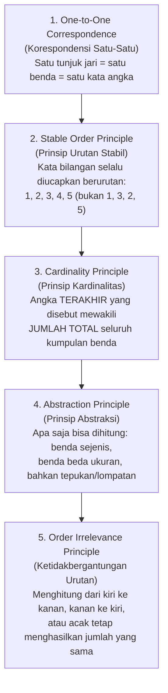
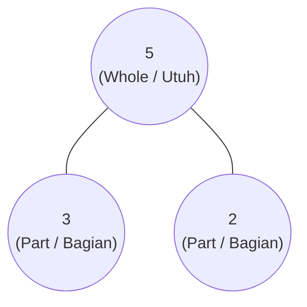

# Modul 04: Panduan Melatih Berhitung yang Baik (Number Sense, Metode CPA, Singapore Math & Montessori)

Kesalahan terbesar dalam pengajaran matematika untuk anak usia 4–6 tahun adalah menyamakan **kemampuan berhitung** dengan **kemampuan menghafal urutan angka 1 sampai 100 (*rote counting*)** atau mengerjakan lembar soal penjumlahan abstrak `7 + 5 = ...` dengan mengandalkan jari.

Seorang anak yang bisa menyebutkan angka 1 sampai 100 sebenarnya baru melakukan **tugas bahasa/memori urutan** (sama seperti menghafal lirik lagu), bukan tugas matematika. Inti dari matematika anak usia dini adalah membangun **Number Sense (Kepekaan Bilangan)** dan **Penalaran Matematis** melalui pendekatan **CPA (*Concrete – Pictorial – Abstract*)**.

---

## 1. Lima Prinsip Menghitung Ilmiah (*Gelman & Gallistel’s 5 Counting Principles*)

Psikolog kognitif Rochel Gelman dan C.R. Gallistel (1978) menemukan bahwa agar seorang anak benar-benar mampu menghitung secara bermakna (*rational counting*), otaknya harus menguasai **5 prinsip berhitung** secara berurutan:



### Cara Menguji & Melatih Prinsip #1 dan #3 di Kelas/Rumah
- **Kesalahan Umum Anak Usia 4 Tahun pada *One-to-One Correspondence*:** Mulut anak mengucapkan angka lebih cepat daripada gerakan jarinya menunjuk benda (sehingga 5 benda dihitung menjadi 7), atau satu benda ditunjuk dua kali.
  - **Solusi (*Touch and Move Strategy*):** Jangan biarkan anak hanya menunjuk benda di atas kertas! Berikan benda nyata (kancing, biji, batu kecil) di sebelah kiri, lalu minta anak **menggeser/memindahkan benda satu per satu ke dalam mangkuk** sambil mengucapkan angkanya. Satu geseran = satu suara.
- **Menguji *Cardinality Principle*:** Setelah anak selesai menghitung 5 balok (*"Satu, dua, tiga, empat, lima"*), tanyakan: **"Jadi, ada berapa balok semuanya?"**
  - Jika anak langsung menjawab **"Lima!"**, maka ia sudah menguasai prinsip Kardinalitas.
  - Jika anak justru menghitung ulang dari awal (*"Satu, dua, tiga, empat, lima"*), berarti ia belum paham bahwa kata *"lima"* adalah jumlah total himpunan tersebut. Latih dengan gerakan melingkari seluruh benda dengan tangan di akhir hitungan sambil berkata: *"Satu, dua, tiga, empat, lima — semuanya ada LIMA balok!"*
- **Latihan *Give Me N* (Ambilkan Sejumlah N):** Lebih sulit daripada sekadar menghitung! Minta anak: *"Tolong ambilkan Ibu 6 buah kancing dari kotak ini."*

---

## 2. Metodologi Emas: Pendekatan **CPA (Concrete – Pictorial – Abstract)**

Diperkenalkan oleh psikolog Amerika **Jerome Bruner** dan diadopsi sebagai tulang punggung kurikulum **Singapore Math** (yang konsisten menempati peringkat #1 dunia dalam TIMSS & PISA), setiap konsep matematika baru di usia 4–6 tahun **wajib** melewati 3 tahap ini:

| Tahap CPA | Penjelasan | Media & Contoh pada Penjumlahan `3 + 2 = 5` |
| :--- | :--- | :--- |
| **1. Concrete** *(Konkret / Doing)* | Anak memegang, menggeser, menyusun, dan memanipulasi benda fisik 3 dimensi secara langsung. (**Porsi 60–70% di TK A & TK B**) | Anak mengambil **3 apel mainan merah** di tangan kiri dan **2 apel mainan hijau** di tangan kanan, lalu menyatukannya di dalam keranjang dan menghitung totalnya. |
| **2. Pictorial** *(Piktorial / Seeing)* | Anak merepresentasikan benda nyata ke dalam bentuk gambar visual, lingkaran titik (*dot representation*), **Five-Frame / Ten-Frame**, atau diagram **Number Bonds**. (**Porsi 20–30%**) | Anak meletakkan 3 keping magnet merah dan 2 keping magnet kuning di atas petak **Five-Frame** atau menggambar 3 lingkaran dan 2 lingkaran di papan tulis. |
| **3. Abstract** *(Abstrak / Symbolic)* | Anak menggunakan simbol angka Arab (`1, 2, 3...`) dan operator matematika (`+`, `-`, `=`) setelah benar-benar paham maknanya. (**Porsi 10–15% di akhir TK B**) | Anak menuliskan kalimat matematika `3 + 2 = 5` sebagai rangkuman dari benda dan gambar yang sudah ia buktikan sendiri. |

---

## 3. Tujuh Keterampilan Inti Numerasi (*Core Early Numeracy Skills*) Usia 4–6 Tahun

### 3.1 *Subitizing* (Mengenali Jumlah Secara Instan Tanpa Menghitung)
*Subitizing* (dari bahasa Latin *subitus* = tiba-tiba) adalah kemampuan otak melihat sekelompok kecil benda dan **langsung tahu jumlahnya dalam sepersekian detik tanpa menghitung satu per satu**.
1. **Perceptual Subitizing (Usia 3,5 – 4,5 Tahun | Jumlah 1 – 4):**
   - Anak melihat 3 titik pada dadu atau 3 jari yang diacungkan dan langsung berteriak *"Tiga!"* tanpa menunjuk *"satu, dua, tiga"*.
2. **Conceptual Subitizing (Usia 5 – 6 Tahun | Jumlah 5 – 10):**
   - Anak melihat pola titik dan langsung mengenali bagian-bagiannya: misalnya melihat dadu angka 6 sebagai *"dua baris tigaan (3 dan 3 jadi 6)"*, atau melihat 7 jari sebagai *"satu tangan penuh (5) ditambah 2 jari"*.

#### Alat Terbaik untuk Melatih *Subitizing*: **Five-Frame** & **Ten-Frame**
**Ten-Frame** adalah kisi petak berukuran $2 \times 5$ (10 kotak). Alat sederhana ini adalah rahasia utama mengapa anak-anak di Singapura dan Jepang sangat cepat berhitung di luar kepala (sistem basis 10):

```
Contoh Angka 7 pada Ten-Frame (Baris atas penuh = 5, Baris bawah = 2):
+---+---+---+---+---+
| ● | ● | ● | ● | ● |   <-- Anak langsung melihat: 5 di atas + 2 di bawah = 7!
+---+---+---+---+---+   <-- Anak juga langsung melihat: Kurang 3 kotak kosong lagi untuk jadi 10!
| ● | ● |   |   |   |
+---+---+---+---+---+
```

### 3.2 *Number Bonds* (Ikatan Bilangan / Komposisi & Dekomposisi Angka)
Anak yang hanya diajarkan berhitung maju dengan jari akan mengalami kesulitan besar di SD ketika bertemu soal `8 + 5` (karena jarinya hanya 10!). Sebaliknya, anak yang menguasai **Number Bonds (Part-Part-Whole)** memahami bahwa setiap bilangan dapat dipecah (*dekomposisi*) dan disusun (*komposisi*) dari bilangan-bilangan yang lebih kecil:



- **Cara Bermain *Number Bonds* di TK (Permainan "Sembunyikan Beruang"):**
  - Siapkan 5 beruang plastik/kancing dan 1 gelas plastik tidak tembus pandang (sebagai "gua").
  - Ajak anak menghitung bahwa total beruang ada **5**.
  - Minta anak menutup mata sebentar, lalu sembunyikan beberapa beruang di bawah gelas gua, dan sisakan **2 beruang di luar gua**.
  - Anak membuka mata dan menebak: *"Tadi beruangnya ada 5. Di luar gua ada 2. Berarti ada berapa beruang yang bersembunyi di dalam gua?"* $\rightarrow$ **"Tiga!"**
- Target penguasaan di akhir TK B: Anak hafal di luar kepala pasangan bilangan pembentuk **5** (`1+4`, `2+3`) dan pembentuk **10** (*Teman Sepuluh / Friends of Ten*: `1+9`, `2+8`, `3+7`, `4+6`, `5+5`).

### 3.3 Membandingkan Kuantitas, Mengurutkan (*Seriation*), & Konsep Nol (`0`)
- Gunakan kosakata matematika yang presisi: **Lebih banyak (*more*), lebih sedikit (*fewer/less*), sama banyak (*equal*)**.
- **Cara Mengajarkan Konsep Angka Nol (`0`):** Jangan ajarkan nol sebagai simbol abstrak, melainkan melalui **pengalaman ketiadaan benda**.
  - *Permainan Montessori Zero Game:* Minta anak melompat 3 kali, bertepuk tangan 2 kali, lalu minta anak: *"Sekarang berikan Ibu NOL ciuman / melompat sebanyak NOL kali!"* Anak akan tertawa karena ia harus diam tidak melakukan apa-apa (*"Nol artinya kosong / tidak ada sama sekali!"*).

### 3.4 Pengenalan Nilai Tempat Awal: Angka Belasan (*Teen Numbers* 11–20)
Bagi anak usia 5–6 tahun, angka `11` s/d `19` sering membingungkan: mengapa tulisannya `1` dan `4` (`14`) padahal bunyinya *"Empat belas"* (angka 4 disebut duluan)?
- Ajarkan bahwa angka **`1`** di depan angka belasan bukanlah *"satu"*, melainkan **"Satu ikat SEPULUH"**.
- Gunakan **10 stik es krim yang diikat karet gelang** (sebagai 1 puluhan) ditambah **4 stik satuan**:
  - `14` = **10 dan 4**
  - Gunakan **Kartu Angka Tumpuk (*Montessori Seguin Teen Boards / Hide Zero Cards*)**: Kartu bertuliskan **`10`** yang bagian angka **`0`**-nya ditumpuk/digeser dengan kartu **`4`** sehingga menjadi **`14`**.

### 3.5 Pola (*Patterning*) — Fondasi Aljabar Sejak TK
Matematika pada hakikatnya adalah ilmu tentang pola. Kemampuan mengenali pola di usia 4–6 tahun berkorelasi langsung dengan kemampuan membaca dan aljabar di masa depan:
- **TK A (4–5 Tahun):** Mengenali, menyalin, dan melanjutkan pola berulang sederhana:
  - **Pola AB:** `Merah – Biru – Merah – Biru – ...`
  - **Pola ABB / AAB:** `Tepuk – Hentak – Hentak – Tepuk – Hentak – Hentak`
- **TK B (5–6 Tahun):** Membuat pola sendiri dan menerjemahkan pola (*pattern translation*):
  - **Pola ABC & AABB:** `Segitiga – Lingkaran – Persegi`
  - **Pola Bertumbuh (*Growing Pattern*):** `1 balok, 2 balok, 3 balok, 4 balok...`
  - **Translasi Pola:** Mengubah pola warna (`Merah - Kuning - Merah - Kuning`) menjadi pola gerak (`Berdiri - Jongkok - Berdiri - Jongkok`).

### 3.6 Geometri & Penalaran Spasial
- **Bangun Datar 2D:** Lingkaran, segitiga, persegi, persegi panjang, belah ketupat, segienam. Ajarkan **atributnya** (*"Mengapa ini disebut segitiga? Karena punya 3 sisi lurus dan 3 sudut lancip"*), termasuk menampilkan segitiga dalam berbagai kemiringan/orientasi agar anak tidak mengira segitiga harus selalu lancip di atas.
- **Bangun Ruang 3D:** Bola, kubus, balok, tabung, kerucut (hubungkan dengan benda nyata: bola sepak, dadu, kotak susu, kaleng biskuit, topi ulang tahun).
- **Komposisi Bentuk (*Tangram & Pattern Blocks*):** Menggabungkan 2 segitiga siku-siku menjadi 1 persegi; menggabungkan 6 segitiga sama sisi menjadi 1 segienam.

### 3.7 Pengukuran Non-Standar & Grafik Data (*Early Data Science*)
Sebelum mengenal penggaris sentimeter atau timbangan kilogram, anak usia 4–6 tahun harus bereksperimen dengan **satuan ukuran non-standar**:
- **Panjang/Tinggi:** *"Meja kita panjangnya sama dengan berapa jengkal tanganmu? Kalau diukur pakai stik es krim, butuh berapa stik?"*
- **Berat:** Menggunakan timbangan gantung sederhana (*balance scale*) untuk membandingkan berat 1 batu kecil vs 5 kapas, atau berapa kelereng yang dibutuhkan agar seimbang dengan 1 mobil mainan.
- **Volume/Kapasitas:** Bermain menakar air atau pasir menggunakan cangkir kecil ke dalam botol besar.
- **Grafik Gambar (*Pictograph*):** Mengumpulkan data di kelas (*"Buah favorit teman-teman kelas kita: Pisang, Apel, atau Jeruk?"*) lalu menempelkan stiker di papan grafik vertikal dan membaca hasilnya (*"Buah apa yang paling banyak disukai? Berapa selisih penyuka pisang dan apel?"*).

---

## 4. Kurikulum Matematika Montessori (Urutan Alat Peraga Konkret Terbaik)

Sistem Montessori memiliki urutan alat peraga matematika konkret yang sangat brilian dan dapat diadaptasi dengan bahan sederhana (DIY) di rumah maupun sekolah:

| Urutan | Nama Alat Montessori | Cara Kerja & Konsep Matematika yang Diajarkan | Ide Adaptasi Sederhana (DIY) |
| :---: | :--- | :--- | :--- |
| **1** | **Number Rods** *(Tongkat Bilangan Merah-Biru)* | 10 tongkat kayu dengan panjang bertingkat dari 10 cm (1 segmen merah) hingga 100 cm (10 segmen selang-seling merah-biru). Anak merasakan secara fisik bahwa `10` itu panjang dan besar, sedangkan `1` itu pendek. | Susunan lego *Duplo* atau potongan karton tebal berwarna selang-seling merah-biru ukuran 1 s/d 10 unit. |
| **2** | **Sandpaper Numerals** *(Angka Amplas 0–9)* | Kartu tekstur amplas angka `0` s/d `9`. Anak meraba arah penulisan angka sambil menyebutkan namanya. | Kartu karton dengan angka yang ditulis menggunakan lem tembak (*hot glue*) atau taburan pasir. |
| **3** | **Spindle Boxes** *(Kotak Gelendong 0–9)* | Kotak kayu bersekat bertuliskan angka `0` sampai `9` dengan 45 batang kayu. Anak mengikat batang kayu sesuai jumlah angkanya; kotak `0` dibiarkan kosong. Mengunci **korespondensi kuantitas dan simbol**. | 10 gelas plastik bertuliskan angka `0`–`9` dan 45 stik es krim + karet gelang. |
| **4** | **Cards and Counters** *(Kartu Angka & Keping Ganjil-Genap)* | Anak menyusun kartu angka `1`–`10` dan meletakkan keping merah berpasangan dua-dua di bawahnya. Jika semua punya pasangan = **Genap (*Even*)**; jika ada 1 keping sendirian di tengah bawah = **Ganjil (*Odd*)**. | Kartu angka dan tutup botol warna merah yang disusun berpasangan dua kolom. |
| **5** | **Golden Beads** *(Manik Emas Sistem Desimal)* | 1 manik tunggal = **Satuan (1)**; 1 batang isi 10 manik = **Puluhan (10)**; 1 lempeng isi $10\times10$ manik = **Ratusan (100)**; 1 kubus isi 1.000 manik = **Ribuan (1.000)**. Anak bisa "memegang" nilai tempat secara nyata! | Manik-manik meronce atau blok *Base-10* (satuan, batang puluhan, papan ratusan). |

---

## 5. Cara Mencegah *Math Anxiety* (Kecemasan Matematika) Sejak Dini

1. **Jangan Pernah Mengadu Kecepatan Berhitung di Usia 4–6 Tahun:** Soal cepat-cepatan (*timed math drills*) memicu hormon kortisol yang memblokir *Working Memory* di otak. Utamakan ketepatan konsep dan kemampuan anak menceritakan *bagaimana* ia mendapatkan jawabannya (*Math Talk*).
2. **Jangan Melarang Anak Menggunakan Jari atau Benda di Awal Belajar:** Penelitian neurosains (*Jo Boaler, Stanford University*) menunjukkan bahwa area otak yang mengatur persepsi jari tangan (*somatosensory finger area*) tetap aktif bahkan pada matematikawan dewasa saat berhitung. Gunakan jari secara terstruktur (seperti *subitizing* jari 5+2), lalu perlahan bimbing ke *Ten-Frame* dan *Number Bonds*.
3. **Integrasikan Matematika ke dalam Rutinitas & Permainan:**
   - **Board Games (Ular Tangga, Ludo, Monopoli Anak):** Sebuah studi dari *Carnegie Mellon University* (Siegler & Ramani) menemukan bahwa bermain *board game* bernomor secara linier bersama anak selama **15 menit sebanyak 4 kali** sudah meningkatkan pemahaman garis bilangan (*mental number line*), perbandingan angka, dan estimasi anak secara signifikan!
   - **Memasak & Menyiapkan Meja Makan:** *"Hari ini yang makan ada Ayah, Ibu, Kakak, dan Adik. Kita butuh berapa piring? Kalau sudah ada 2 sendok di meja, kurang berapa sendok lagi?"*
