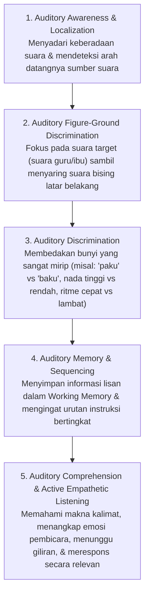

# Modul 05: Panduan Melatih Mendengar yang Baik (Active Listening, Pemrosesan Auditori & Fokus)

Sering kali orang tua dan guru mengeluh: *"Anak ini kalau dipanggil atau diberi tahu seperti tidak dengar, harus diulang berkali-kali atau diteriaki baru bergerak!"*

Dalam ilmu tumbuh kembang dan audiologi pediatrik, kita harus membedakan antara **Hearing (Mendengar Fisik)** dan **Listening (Menyimak Aktif / Pemrosesan Auditori)**. *Hearing* adalah proses pasif masuknya gelombang suara ke gendang telinga; sedangkan *Listening* adalah **keterampilan fungsi eksekutif aktif di otak** untuk memusatkan perhatian pada suara, menyaring kebisingan, menyimpan informasi di memori kerja, dan memahami maknanya. Kemampuan mendengar yang baik adalah fondasi utama dari kemampuan membaca (fonik), kemampuan mengikuti aturan di sekolah, dan kecerdasan sosial-emosional.

---

## 1. Lima Pilar Pemrosesan Auditori (*The Auditory Processing Hierarchy*)

Agar seorang anak usia 4–6 tahun dikatakan memiliki kemampuan mendengar (*menyimak*) yang matang, otaknya harus terlatih dalam 5 komponen bertingkat berikut:

### Tabel Tolok Ukur Kemampuan Menyimak Anak (Usia 4–5 Tahun vs 5–6 Tahun)

| Indikator Menyimak | Usia 4–5 Tahun (TK A) | Usia 5–6 Tahun (TK B) |
| :--- | :--- | :--- |
| **Kapasitas Instruksi Berurutan (*Multi-Step Directions*)** | Mampu mengikuti **2 hingga 3 instruksi berurutan** yang berhubungan (contoh: *"Ambil sepatumu, taruh di rak, lalu cuci tangan"*). | Mampu mengikuti **3 hingga 4 instruksi berurutan**, termasuk instruksi dengan kata hubung waktu terbalik (*"Sebelum kamu mengambil buku gambar, masukkan dulu krayonmu ke dalam kotak"*). |
| **Rentang Menyimak Cerita** | Menyimak cerita bergambar secara aktif selama **10–15 menit** dan mampu menjawab pertanyaan *Siapa, Apa, Di mana*. | Menyimak cerita selama **15–20+ menit** (bahkan cerita lisan tanpa bantuan gambar) dan menjawab pertanyaan *Mengapa* serta *Bagaimana*. |
| **Fokus di Ruang Ramai (*Figure-Ground*)** | Masih mudah terdistraksi oleh suara gaduh di kelas; membutuhkan panggilan nama dan kontak mata terlebih dahulu sebelum diberi instruksi. | Mampu tetap menyimak instruksi guru dalam kelompok besar meskipun ada suara aktivitas lain di sekitar ruangan. |
| **Memori Kerja Auditori (*Digit/Word Span*)** | Mampu mengulangi **3–4 deret angka atau kata acak** secara berurutan (misal: *"Kucing – Bola – Apel"*). | Mampu mengulangi **4–5 deret angka atau kata acak** secara berurutan (dan mengulangi 2–3 angka secara terbalik/mundur). |
| **Etika Menyimak Sosial** | Mulai belajar tidak memotong pembicaraan orang lain dengan pengingat visual (seperti menggunakan *Talking Stick*). | Mampu menunggu giliran berbicara dalam diskusi lingkaran (*Circle Time*), menatap lawan bicara, dan memberikan tanggapan yang nyambung dengan topik. |

---

## 2. Mengapa Anak Sering Terlihat "Tidak Mendengar"? (4 Penyebab Ilmiah)

Sebelum menyalahkan anak sebagai "pembangkang" atau "tidak fokus", pahami 4 fenomena neurologis berikut:

1. ** Efek *Hyperfocus* (*Attention Tunneling*):**
   - Otak anak usia 4–6 tahun memiliki kapasitas *single-channel attention* saat sedang asyik bermain (misal sedang fokus menyusun balok atau menggambar). Ketika orang dewasa berteriak memberi perintah dari jauh (*"Ayo mandi sekarang!"*), korteks auditori anak secara harfiah **memblokir suara tersebut** sebagai kebisingan latar belakang.
2. **Kelebihan Beban Auditori (*Auditory Overload*):**
   - Kalimat orang dewasa terlalu panjang, abstrak, dan bercampur omelan (misal: *"Kan Ibu sudah bilang dari tadi, kenapa mainannya masih berantakan di lantai, sebentar lagi Ayah pulang, cepat bereskan terus ambil handuk dan masuk kamar mandi!"*). *Working memory* anak hanya mampu menangkap 5–7 kata inti; sisanya berubah menjadi "suara dengungan" (*blah-blah-blah*).
3. **Habituasi terhadap Teriakan & Pengulangan (*The Nagging Effect*):**
   - Jika orang tua/guru terbiasa mengulangi perintah 5 kali sebelum bertindak (dan baru serius pada teriakan ke-5 dengan nada tinggi), otak anak belajar secara otomatis: *"Panggilan ke-1 sampai ke-4 tidak penting, aku baru perlu bergerak kalau suara Ibu sudah melengking di panggilan ke-5."*
4. **Gangguan Medis Pendengaran Konduktif Ringan (Sering Tidak Disadari):**
   - Penumpukan kotoran telinga (*serumen prop*) atau cairan di telinga tengah akibat batuk-pilek berulang (*Otitis Media Efusi*) dapat membuat anak mendengar suara dunia luar seperti "sedang berada di dalam air".

---

## 3. Protokol Komunikasi 5 Langkah agar Anak Langsung Mendengar (*Connection Before Direction*)

Latih seluruh guru dan orang tua menggunakan protokol standar ini saat memberikan instruksi kepada anak usia 4–6 tahun:

1. **Langkah 1 — Dekati & Turun Sejajar Mata (*Proximity & Eye-Level*):**
   - Jangan pernah berteriak dari ruangan lain atau dari ujung kelas! Berjalanlah mendekati anak, berlutut atau membungkuk hingga mata Anda sejajar dengan mata anak.
2. **Langkah 2 — Sentuhan Lembut & Jeda Perhatian (*Touch & Pause*):**
   - Sentuh pundak atau punggung tangan anak dengan lembut, sebut namanya sekali, dan **tunggu 2–3 detik** hingga mata anak menatap mata Anda.
3. **Langkah 3 — Gunakan Kalimat Positif, Singkat, dan Spesifik (*Say What TO Do, Not What NOT To Do*):**
   - Otak anak memproses kata benda dan kata kerja utama terlebih dahulu, serta sering mengabaikan kata *"Jangan"*.
   - ❌ **Salah:** *"Jangan lari-lari di koridor nanti jatuh!"* (Otak anak membayangkan: *Lari-lari*).
   - ✅ **Benar:** *"Gunakan kaki berjalan pelan ya."*
   - ❌ **Salah:** *"Jangan teriak-teriak di dalam kelas!"*
   - ✅ **Benar:** *"Gunakan suara bisik-bisik seperti kucing."*
4. **Langkah 4 — *Check for Understanding* (Minta Anak Mengulangi Instruksi):**
   - Untuk instruksi 2–3 langkah, ubah menjadi permainan: *"Ibu punya 3 misi rahasia buat Bimo: Satu, taruh tas di loker. Dua, cuci tangan pakai sabun. Tiga, duduk di karpet biru. Coba Bimo sebutkan lagi 3 misi rahasianya sambil hitung pakai jari!"*
5. **Langkah 5 — Beri Peringatan Transisi Waktu (*Transition Warning*):**
   - Jangan memutus permainan anak secara mendadak. Berikan peringatan **5 menit** sebelum berganti kegiatan (*"Lima menit lagi waktu bermain balok selesai ya, setelah bunyi lonceng kita beres-beres bersama"*).

---

## 4. Katalog 12 Permainan Terbaik untuk Melatih Menyimak Aktif & Memori Auditori

Permainan berikut dirancang khusus berdasarkan riset terapi wicara, Montessori, dan *Harvard Center on the Developing Child* untuk memperkuat jaringan saraf pendengaran dan fungsi eksekutif anak usia 4–6 tahun:

### A. Permainan Kesadaran & Fokus Suara (*Auditory Awareness & Attention*)

#### 1. *The Silence Game* (Permainan Hening — Maria Montessori)
- **Cara Bermain:** Anak-anak duduk melingkar dengan nyaman. Guru mengajak anak menenangkan tubuh, menutup mata, dan menciptakan "keheningan sempurna" selama 30–60 detik.
- **Tantangan Auditori:**
  1. Setelah membuka mata, anak berbisik menyebutkan suara-suara halus apa saja yang tadi terdengar saat kelas hening (detak jam dinding, kicau burung di luar, suara angin, suara napas teman).
  2. Di bagian kedua, guru berdiri di sudut ruangan dan **membisikkan nama anak satu per satu tanpa suara vokal** (hanya desis bisikan napas). Anak yang namanya dibisikkan harus berdiri dan berjalan paling pelan tanpa mengeluarkan suara langkah kaki menghampiri guru.

#### 2. *Sound Walk* (Detektif Suara di Alam)
- **Cara Bermain:** Berikan anak "Telinga Gajah" (karton yang dilengkungkan di belakang daun telinga) dan papan jalan (*clipboard*) berisi gambar ikon sumber suara (burung, mobil, air mengalir, langkah kaki, daun bergesekan, orang tertawa).
- **Tantangan Auditori:** Anak berjalan di halaman sekolah/taman dalam diam selama 5 menit dan memberi tanda centang setiap kali telinganya berhasil menangkap suara tersebut serta menunjuk arah datangnya suara.

#### 3. *Blindfold Sound Compass* (Kompas Suara Mata Tertutup)
- **Cara Bermain:** Satu anak duduk di tengah lingkaran dengan mata tertutup kain lembut. Anak-anak lain duduk mengelilinginya. Guru menunjuk satu anak di lingkaran untuk membunyikan kerincingan atau mengatakan *"Halo, tebak aku di mana?"*.
- **Tantangan Auditori:** Anak di tengah harus menunjuk tepat ke arah datangnya suara dan menebak suara teman siapa itu. Melatih *binaural auditory localization* dan pengenalan warna suara (*timbre*).

### B. Permainan Diskriminasi & Ritme Suara (*Auditory Discrimination*)

#### 4. *Sound Matching Cylinders / Mystery Shakers* (Tabung Suara Montessori)
- **Cara Bermain:** Siapkan 6 pasang botol kecil tidak tembus pandang (6 bertutup merah, 6 bertutup biru). Isi masing-masing pasangan dengan bahan berbeda: beras, pasir, kancing, lonceng kecil, batu kerikil, dan kapas.
- **Tantangan Auditori:** Anak menggoyang botol merah di telinga kiri dan mencari pasangannya dari deretan botol biru yang menghasilkan frekuensi dan tekstur bunyi yang **sama persis**, lalu mengurutkannya dari bunyi paling lembut (*softest*) ke paling nyaring (*loudest*).

#### 5. *Echo Clapping & Rhythm Coding* (Tepuk Gema & Kode Irama)
- **Cara Bermain:** Guru menepukkan sebuah pola irama (misal: `Tepuk – Tepuk – Jeda – Tepuk Cepat 3x`). Anak harus menyimak hingga guru selesai, lalu menirukan irama tersebut dengan tepat.
- **Level Lanjut (TK B):** Gunakan kode instrumen untuk gerakan tubuh:
  - Bunyi **Tamborin** = Berjalan maju
  - Bunyi **Segitiga (*Triangle*)** = Berjinjit pelan
  - Bunyi **Marakas** = Berputar di tempat
  - Bunyi **Peluit** = Membeku jadi patung!

#### 6. *Same or Different Words* (Detektif Kata Kembar)
- **Cara Bermain:** Guru menutup mulutnya dengan selembar kertas (agar anak tidak membaca gerak bibir, melainkan murni mengandalkan telinga) dan mengucapkan sepasang kata yang sangat mirip (*minimal pairs*):
  - `Bahu - Batu` (Beda!)
  - `Paku - Paku` (Sama!)
  - `Kuku - Buku` (Beda!)
  - `Mata - Bata` (Beda!)
- Anak mengangkat kartu Hijau (Benar/Sama) atau kartu Merah (Beda).

### C. Permainan Memori Kerja Auditori & Kontrol Impuls (*Working Memory & Inhibitory Control*)

#### 7. *Barrier Games* (Membangun atau Menggambar di Balik Sekat)
- **Cara Bermain:** Dua anak duduk berhadapan dipisahkan oleh sebuah map karton berdiri (sekat) sehingga tidak bisa melihat meja temannya. Keduanya diberi 1 set balok/lego atau kertas gambar & krayon yang identik.
- **Tantangan Auditori:** Anak A bertindak sebagai "Arsitek" yang menyusun balok sambil memberi instruksi lisan: *"Letakkan balok persegi panjang merah di paling bawah. Di atasnya sebelah kiri, taruh kubus biru..."* Anak B ("Pembangun") harus menyimak dengan teliti dan menyusun balok sesuai instruksi. Di akhir, sekat dibuka untuk melihat apakah bangunan keduanya identik!

#### 8. *Opposite Rules Freeze Dance* (Permainan Aturan Terbalik)
- **Cara Bermain:**
  - **Ronde 1 (Normal):** Musik cepat = menari cepat; Musik lambat = menari lambat; Musik berhenti = membeku.
  - **Ronde 2 (Aturan Terbalik / *Cognitive Flexibility*):** Musik cepat = bergerak **sangat lambat (*slow motion*)**; Musik lambat = menari cepat; Guru tepuk 1 kali = melompat; Guru tepuk 2 kali = duduk jongkok!
- **Manfaat:** Memaksa otak anak menyimak dengan tingkat konsentrasi tinggi dan menahan impuls otomatis.

#### 9. *I Went to the Market* (Pergi ke Pasar — Memori Berantai)
- **Cara Bermain:** Duduk melingkar.
  - Anak 1: *"Aku pergi ke pasar membeli **Apel**."*
  - Anak 2: *"Aku pergi ke pasar membeli **Apel** dan **Roti**."*
  - Anak 3: *"Aku pergi ke pasar membeli **Apel**, **Roti**, dan **Susu**."*
  - Berlanjut hingga 5–7 benda untuk melatih *Auditory Sequential Memory*.

#### 10. *Listen & Draw (Menggambar dari Instruksi Lisan Bertingkat)*
- **Cara Bermain:** Anak memegang kertas kosong dan krayon. Guru membacakan instruksi (setiap instruksi hanya diucapkan **dua kali**, anak tidak boleh menggambar sebelum guru selesai mengucapkan kalimatnya!):
  - *"Pertama, gambar sebuah rumah besar di tengah kertas... Kedua, gambar matahari berwarna kuning di pojok kanan atas... Ketiga, gambar dua bunga merah di sebelah kiri rumah..."*

#### 11. *Story Catchphrase / Secret Word Listening* (Kata Kunci Rahasia dalam Dongeng)
- **Cara Bermain:** Sebelum membacakan dongeng, tentukan satu atau dua "Kata Rahasia" (misal: setiap kali guru mengucapkan kata **"Kancil"**, anak harus menyentuh hidung; setiap kali mendengar kata **"Sungai"**, anak harus menggoyangkan tangan seperti ombak).
- **Manfaat:** Menjaga *sustained auditory attention* sepanjang cerita berlangsung.

#### 12. *Theater of the Mind* (Dongeng Audio Tanpa Gambar)
- **Cara Bermain:** Matikan layar dan simpan buku bergambar. Selama 7–10 menit, perdengarkan cerita melalui *audiobook* atau dongeng lisan guru dengan efek suara mulut (*sound effects*). Setelah selesai, minta anak **menggambar adegan yang tadi terbayang di dalam kepalanya**.
- **Mengapa Sangat Penting?** Ketika anak menonton video, otak pasif karena gambar sudah disediakan layar. Ketika anak menyimak cerita tanpa gambar, korteks auditori dan korteks visual harus bekerja keras menciptakan **imajinasi visual (*mental imagery*)**—kemampuan ini adalah kunci utama pemahaman bacaan (*reading comprehension*) saat anak membaca novel atau buku teks di SD kelak!

---

## 5. Mengajarkan *Active Empathetic Listening* (Menyimak dengan Empati)

Menyimak yang baik bukan hanya soal kecerdasan otak, tetapi juga karakter dan adab berkomunikasi:
1. **Metode *Whole Body Listening* (Menyimak dengan Seluruh Tubuh — Susanne Poulette Truesdale):**
   Ajarkan kepada anak usia 4–6 tahun dengan lagu dan poster visual:
   - **Mata** melihat ke arah orang yang sedang berbicara.
   - **Telinga** siap menangkap suara.
   - **Mulut** tenang dan tertutup (menunggu giliran).
   - **Tangan** tenang di pangkuan atau di meja.
   - **Kaki** tenang di lantai.
   - **Otak** memikirkan apa yang sedang dibicarakan.
   - **Hati** peduli pada perasaan teman yang sedang bercerita.
2. **Alat Peraga *Talking Stick* / Boneka Bicara saat *Circle Time*:**
   - Dalam diskusi kelompok, hanya anak yang sedang memegang *Talking Stick* (tongkat bicara/boneka kecil) yang giliran berbicara, sementara teman-teman lainnya mengaktifkan "Telinga Menyimak". Setelah selesai, anak memberikan tongkat kepada teman berikutnya dan teman tersebut boleh bertanya: *"Tadi aku dengar kamu pergi ke rumah Nenek, di sana kamu naik apa?"*
