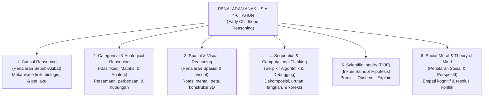

# Modul 06: Panduan Melatih Penalaran yang Baik (Critical Thinking, Logika, Sains & Computational Thinking)

Banyak orang mengira penalaran kritis (*critical thinking*), logika ilmiah, dan pemikiran komputasional (*computational thinking*) baru bisa diajarkan di bangku SMP atau SMA. Namun, riset psikologi perkembangan kognitif modern (Alison Gopnik, *The Philosophical Baby & The Scientist in the Crib*) membuktikan bahwa **anak usia 4–6 tahun pada dasarnya adalah ilmuwan alami**: mereka terus-menerus mengamati data, menguji sebab-akibat, membentuk hipotesis, dan menarik kesimpulan tentang cara kerja dunia.

Tugas pendidik dan orang tua bukanlah menjejali kepala anak dengan jawaban siap saji, melainkan **melatih cara mereka berpikir (*how to think, not just what to think*)**.

---

## 1. Enam Dimensi Penalaran Inti (*Core Reasoning Domains*) Usia 4–6 Tahun

---

### 1.1 Dimensi 1: Penalaran Sebab-Akibat (*Causal Reasoning*)
Anak usia 4–6 tahun sedang beralih dari *penalaran magis* menuju **penalaran kausal logis**. Mereka perlu dilatih dalam dua arah:
1. **Forward Causal Reasoning (Prediksi Dampak / *"Apa yang akan terjadi jika...?"*):**
   - *"Apa yang akan terjadi kalau kita menaruh es batu ini di bawah sinar matahari terik?"*
   - *"Apa yang akan terjadi kalau kita mencabut balok paling bawah dari menara tinggi ini?"*
2. **Backward Causal Reasoning (Analisis Akar Penyebab / *"Mengapa bisa begini...?"*):**
   - *"Lihat, tanaman kacang hijau di pot A tumbuh segar, tapi yang di pot B layu dan kering. Kira-kira kenapa ya pot B bisa layu?"*
   - *"Tadi mobil mainanmu meluncur sangat jauh di papan kayu, tapi langsung berhenti di atas karpet. Kenapa di atas karpet jalannya lebih lambat?"* (Pengenalan konsep gesekan/friksi secara konkret).

---

### 1.2 Dimensi 2: Penalaran Kategorikal, Matriks Logika & Analogi (*Analogical Reasoning*)
Kemampuan melihat hubungan tersembunyi antar benda atau konsep adalah inti dari kecerdasan fluida (*Fluid Intelligence*):

#### A. Klasifikasi Multi-Atribut & Permainan *Matriks 2D*
- **TK A (4–5 Tahun):** Mengelompokkan benda berdasarkan 1 atribut lalu **berganti aturan (*rule switching*)**:
  - *"Pertama, ayo kelompokkan kancing-kancing ini berdasarkan **warnanya**. Nah, sekarang campur lagi! Ayo kelompokkan berdasarkan **jumlah lubangnya** atau **ukurannya**!"*
- **TK B (5–6 Tahun):** Menyelesaikan **Tabel Matriks Logika $3 \times 3$** (menggabungkan 2 atribut sekaligus: baris = Bentuk, kolom = Warna):

| Matriks Logika | 🔴 Merah | 🔵 Biru | 🟢 Hijau |
| :--- | :---: | :---: | :---: |
| **Segitiga ($\triangle$)** | Segitiga Merah | Segitiga Biru | Segitiga Hijau |
| **Lingkaran ($\bigcirc$)** | Lingkaran Merah | **❓ (Apa isinya?)** | Lingkaran Hijau |
| **Persegi ($\square$)** | Persegi Merah | Persegi Biru | Persegi Hijau |

#### B. Permainan *Odd One Out* ("Mana yang Tidak Termasuk Kelompoknya & Mengapa?")
Berikan 4 benda/gambar, lalu minta anak memilih 1 benda yang berbeda **beserta alasannya** (hargai berbagai sudut pandang logis anak!):
- **Contoh Set:** `Apel Merah`, `Pisang Kuning`, `Jeruk Oranye`, `Bola Merah`.
  - *Jawaban Logis 1 (Kategori Fungsi):* **"Bola Merah"** yang berbeda, karena apel, pisang, dan jeruk adalah buah yang bisa dimakan, sedangkan bola adalah mainan!
  - *Jawaban Logis 2 (Kategori Bentuk):* **"Pisang Kuning"** yang berbeda, karena apel, jeruk, dan bola semuanya berbentuk bulat, sedangkan pisang melengkung panjang!
  - *(Kedua jawaban ini menunjukkan penalaran tingkat tinggi selama anak bisa menjelaskan alasannya!)*

#### C. Analogi Verbal & Visual (*A berhubungan dengan B, seperti C berhubungan dengan D*)
Latih menggunakan gambar dan percakapan sehari-hari:
- *"Payung dipakai saat hujan, kalau topi dipakai saat ... (**panas/terik matahari**)."*
- *"Burung terbang di udara, kalau ikan berenang di ... (**air**)."*
- *"Sarung tangan untuk tangan, kalau kaus kaki untuk ... (**kaki**)."*
- *"Anak anjing tumbuh menjadi anjing dewasa, kalau berudu/kecebong tumbuh menjadi ... (**katak**)."*

---

### 1.3 Dimensi 3: Penalaran Spasial & Visual (*Spatial-Visual Reasoning*)
Penelitian longitudinal menunjukkan bahwa **penalaran spasial di usia TK sangat berkorelasi dengan prestasi di bidang Sains, Teknologi, Teknik, dan Matematika (STEM)** di masa depan.

1. **Tantangan Konstruksi Balok (*Block Building Blueprints*):**
   - Jangan hanya membiarkan anak menumpuk balok secara bebas. Berikan **"Tantangan Arsitek"**:
     - *Tantangan Menyalin Struktur:* Tunjukkan foto bangunan dari 5–8 balok, minta anak meniru susunan yang sama persis (mana yang di bawah, di tengah, di kanan).
     - *Tantangan Rekayasa Jembatan:* *"Buatlah jembatan dari balok kayu yang cukup tinggi agar kapal mainan ini bisa lewat di bawahnya, dan cukup kuat menahan beban 3 mobil di atasnya!"*
2. **Rotasi Mental dengan *Tangram* & *Pattern Blocks*:**
   - Memutar kepingan segitiga atau jajargenjang di tangan (dan di pikiran) untuk mengisi bayangan bentuk hewan, roket, atau perahu.
3. **Membaca & Membuat Peta Harta Karun (*Map Reading & Spatial Perspective*):**
   - Gambarlah denah sederhana ruang kelas atau ruang tamu dilihat dari atas (*bird’s-eye view*). Tandai posisi meja, karpet, dan tanda **`X` merah**. Minta anak membaca peta tersebut untuk menemukan tempat benda rahasia disembunyikan!
4. **Permainan Labirin (*Mazes*) & *Jigsaw Puzzles* (12–48 Keping):**
   - Saat bermain labirin (*maze*), ajarkan anak melacak jalur dengan **mata dan jari terlebih dahulu (*planning ahead*)** sebelum menggoreskan pensil agar tidak terjebak jalan buntu.

---

### 1.4 Dimensi 4: *Computational Thinking Unplugged* (Berpikir Komputasional Tanpa Layar/Komputer)
Anak usia 4–6 tahun dapat menguasai logika pemrograman (*coding logic*) tanpa perlu menyentuh layar gawai sedikit pun melalui **4 Pilar Computational Thinking**:

| Pilar *Computational Thinking* | Konsep untuk Anak Usia 4–6 Tahun | Aktivitas Praktis di Kelas / Rumah |
| :--- | :--- | :--- |
| **1. Decomposition** *(Dekomposisi)* | Memecah tugas besar yang rumit menjadi langkah-langkah kecil yang mudah dikerjakan. | Memecah tugas *"Bersiap Pergi Sekolah"* atau *"Membuat Roti Lapis"* menjadi 4 kartu urutan gambar kecil. |
| **2. Pattern Recognition** *(Pengenalan Pola)* | Menemukan keteraturan yang berulang sehingga bisa menebak langkah selanjutnya. | Menemukan pengulangan gerakan tari atau urutan warna manik-manik pada gelang. |
| **3. Abstraction** *(Abstraksi)* | Menyaring detail yang tidak penting dan fokus pada informasi utama. | Saat menggambar simbol rumah atau menceritakan inti cerita buku dalam 3 kalimat utama. |
| **4. Algorithmic Thinking & Debugging** *(Algoritma & Perbaikan Kesalahan)* | Menyusun instruksi langkah-demi-langkah yang presisi untuk mencapai tujuan, dan mencari letak kesalahan (*bug*) jika hasilnya gagal. | **Permainan "Robot Guru" & "Coding di Ubin Lantai"** (lihat penjelasan di bawah). |

#### Cara Memainkan *"Unplugged Floor Grid Coding"* di Lantai Kelas
1. Gunakan petak ubin lantai ($4 \times 4$ atau $5 \times 5$ ubin) sebagai papan permainan.
2. Letakkan boneka **Kelinci** di petak pojok kiri bawah, **Wortel** di petak pojok kanan atas, dan **Batu/Serigala** di beberapa petak tengah sebagai rintangan yang tidak boleh diinjak.
3. Siapkan **Kartu Panah Kode**:
   - $\uparrow$ = Maju 1 petak
   - $\rightarrow$ = Belok/Hadap Kanan
   - $\leftarrow$ = Belok/Hadap Kiri
4. **Menyusun Algoritma:** Anak menyusun deretan Kartu Panah di pinggir ubin terlebih dahulu (misal: $\uparrow, \uparrow, \rightarrow, \uparrow, \uparrow$).
5. **Eksekusi & *Debugging*:** Satu teman berperan menjadi "Robot Kelinci" yang berjalan persis mengikuti urutan kartu panah yang disusun. Jika Robot Kelinci menabrak batu (*Bug ditemukan!*), anak tidak boleh marah atau menyerah—mereka berteriak *"Ada Bug! Ayo kita Debug!"* lalu mencari kartu panah mana yang salah dan menggantinya!

---

### 1.5 Dimensi 5: Penalaran Ilmiah melalui Metode **POE (Predict – Observe – Explain)**
Setiap minggu, lakukan minimal 1 eksperimen sains sederhana menggunakan siklus **POE**:
1. **P – Predict (Prediksi / Hipotesis):** Sebelum eksperimen dilakukan, tanyakan kepada anak: *"Menurutmu apa yang akan terjadi? Mengapa kamu menebak begitu?"* (Catat tebakan anak di papan tulis!).
2. **O – Observe (Observasi dengan Pancaindra):** Lakukan percobaan dan minta anak mengamati dengan mata, telinga, atau tangan. *"Lihat baik-baik, apa yang sedang terjadi sekarang?"*
3. **E – Explain (Penjelasan Sebab-Akibat):** Bandingkan hasil pengamatan dengan tebakan awal. *"Tadi kita menebak jeruk yang belum dikupas akan tenggelam, ternyata mengapung! Tapi waktu kulitnya dikupas, jeruknya tenggelam! Kira-kira kenapa ya kulit jeruk membuat jeruknya mengapung seperti pelampung?"*

#### 8 Ide Eksperimen Sains POE Terbaik untuk Usia 4–6 Tahun
1. **Terapung vs Tenggelam (*Sink or Float*):** Menguji batu, daun, koin, bola plastik, serta jeruk berkulit vs jeruk kupas.
2. **Kapilaritas "Air Berjalan" (*Walking Water & Color Mixing*):** 3 gelas berisi air warna primer (Merah, Kuning, Biru) dihubungkan tisu ke gelas kosong di antaranya hingga air merambat dan bercampur menjadi Oranye, Hijau, dan Ungu.
3. **Detektif Magnet (*Magnetic vs Non-Magnetic*):** Menebak dan menguji benda-benda di kelas menggunakan tongkat magnet.
4. **Gunung Berapi Soda Kue & Cuka:** Mengamati reaksi asam-basa yang menghasilkan gas gelembung.
5. **Bayangan & Cahaya (*Shadow Theater*):** Mengapa bayangan menjadi besar saat senter didekatkan ke boneka, dan mengecil saat senter dijauhkan?
6. **Misi Penyelamatan Mainan di Dalam Es:** Bagaimana cara paling cepat mencairkan mainan dinosaurus yang membeku di dalam balok es? (Air dingin vs air hangat vs garam vs sinar matahari).
7. **Kepadatan Cairan (*Liquid Tower*):** Menuangkan madu, air berwarna, dan minyak goreng ke dalam satu gelas bening, lalu menjatuhkan koin, anggur, dan gabus untuk melihat di lapisan mana benda itu berhenti.
8. **Rekayasa Perahu Aluminium Foil:** Membuat perahu dari selembar *aluminium foil* dan berlomba menghitung berapa banyak koin yang bisa ditampung sebelum perahu tenggelam.

---

### 1.6 Dimensi 6: Penalaran Sosial-Moral & *Theory of Mind*
Pada usia 4 hingga 5 tahun, terjadi lompatan besar dalam psikologi sosial anak yang disebut **Theory of Mind (ToM)**—kesadaran bahwa orang lain memiliki pikiran, keinginan, dan pengetahuan yang **berbeda** dari pikiran dirinya sendiri.
- **Melatih Perspektif & Resolusi Konflik (6 Langkah HighScope):**
  Saat dua anak berebut satu mainan, jangan langsung mengambil mainan tersebut atau memutuskan siapa yang salah. Bimbing penalaran sosial mereka dengan 6 langkah:
  1. Dekati dengan tenang dan hentikan tindakan agresif.
  2. Akui perasaan kedua anak (*"Ibu lihat Raka kesal dan Dito juga sedih karena kalian berdua sama-sama ingin memakai truk merah ini"*).
  3. Kumpulkan informasi dari masing-masing anak (*"Ceritakan apa yang terjadi?"*).
  4. Nyatakan kembali masalahnya (*"Jadi masalahnya: truk merahnya hanya ada satu, tapi ada dua anak yang ingin memainkannya sekarang"*).
  5. **Minta anak memikirkan solusi bersama (*Brainstorming*):** *"Menurut kalian berdua, bagaimana cara yang adil supaya kalian berdua sama-sama senang?"* (Biarkan anak mengusulkan: bergantian pakai *timer* pasir, membangun jalan raya bersama di mana satu jadi sopir truk dan satu jadi petugas derek, dll.).
  6. Dukung tindak lanjut solusi yang mereka pilih sendiri.

---

## 2. Seni Bertanya Tingkat Tinggi (*Taksonomi Bloom untuk Anak Usia Dini*)

Kualitas penalaran anak sangat ditentukan oleh **kualitas pertanyaan yang diajukan orang dewasa**. Ubah kebiasaan bertanya tertutup (*Ya/Tidak* atau sekadar mengetes hafalan) menjadi pertanyaan terbuka berbasis **Taksonomi Bloom**:

| Level Taksonomi Bloom | Kategori Berpikir | Contoh Pertanyaan saat Bermain / Membaca Cerita |
| :--- | :---: | :--- |
| **1. Mengingat (*Remembering*)** | *LOTS* | *"Siapa saja tokoh di dalam cerita Tiga Babi Kecil tadi? Rumahnya terbuat dari apa saja?"* |
| **2. Memahami (*Understanding*)** | *LOTS* | *"Coba ceritakan kembali dengan bahasamu sendiri, mengapa rumah dari jerami dan ranting mudah roboh?"* |
| **3. Menerapkan (*Applying*)** | *MOTS* | *"Kalau kita ingin membangun kandang kelinci di halaman sekolah supaya tidak roboh kena angin, bahan apa yang sebaiknya kita pilih?"* |
| **4. Menganalisis (*Analyzing*)** | **HOTS** | *"Apa bedanya cara kerja babi pertama dengan babi ketiga? Mengapa babi ketiga mau bersusah payah menyusun batu bata?"* |
| **5. Mengevaluasi (*Evaluating*)** | **HOTS** | *"Menurutmu, apakah tindakan Serigala itu baik? Kalau kamu menjadi babi ketiga, apa yang akan kamu katakan kepada Serigala?"* |
| **6. Mencipta (*Creating*)** | **HOTS** | *"Ayo kita rancang rumah baru yang tahan tiupan serigala menggunakan balok, stik es krim, dan plastisin di meja ini! Bagaimana desainmu?"* |

---

## 3. Dua Aturan Emas Pendampingan Penalaran: *Wait Time* & *Productive Struggle*

### 3.1 Aturan **Wait Time 5–10 Detik** (Mary Budd Rowe)
Rata-rata orang dewasa hanya menunggu **1 detik** setelah mengajukan pertanyaan kepada anak, lalu langsung menyela, mengulangi pertanyaan, atau menjawabnya sendiri!
- Otak anak usia 4–6 tahun membutuhkan waktu **5 hingga 10 detik** untuk:
  1. Memproses kalimat pertanyaan di korteks auditori,
  2. Mencari informasi dan menyusun logika di *Prefrontal Cortex*,
  3. Merangkai kata-kata untuk menjawab di area *Broca*.
- **Praktikkan:** Setelah bertanya *"Mengapa menurutmu perahu kertas ini tenggelam?"*, **tersenyumlah, tatap anak dengan hangat, dan hitung 1 sampai 7 di dalam hati tanpa berbicara**. Anda akan takjub melihat betapa cerdasnya jawaban yang keluar dari mulut anak pada detik ke-6!

### 3.2 Memelihara *Productive Struggle* (Kesulitan yang Produktif)
Ketika anak sedang berusaha memasang kepingan puzzle yang sulit, mengancingkan baju, atau menara baloknya roboh:
- **Jangan langsung mengambil alih** (*"Sini Ibu pasangkan!"*). Mengambil alih tugas anak mengirimkan pesan bawah sadar: *"Kamu tidak mampu, biar orang dewasa yang menyelesaikannya."*
- Gunakan **Scaffolding Minimal**:
  - Validasi usahanya: *"Wah, kepingan yang itu memang menantang ya."*
  - Beri petunjuk pertanyaan kecil: *"Coba perhatikan warna garis di pinggir kepingan itu, kalau kita putar sedikit ke kanan bagaimana?"*
  - Bangun **Growth Mindset** (Carol Dweck): Puji **strategi dan ketekunannya** (*"Ibu bangga sekali kamu tidak menyerah dan mencoba 3 cara berbeda sampai menaranya berdiri tegak!"*), bukan sekadar memuji bakat bawaan (*"Kamu memang anak pintar"*).
