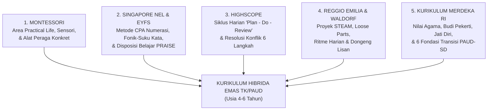

# Modul 07: Analisis Mendalam Kurikulum Internasional & Nasional Terbaik untuk TK/PAUD

Untuk merancang sistem pembelajaran terbaik bagi anak usia 4–6 tahun, kita perlu membedah filosofi, struktur materi, kekuatan, dan keterbatasan dari **10 kurikulum pendidikan anak usia dini (PAUD/ECEC) terbaik di dunia dan nasional**. Tidak ada satu kurikulum tunggal yang sempurna untuk semua aspek; namun dengan memahami keseluruhannya, kita dapat menyusun **Sintesis Kurikulum Hibrida Terbaik (*Best-of-Breed Curriculum*)**.

---

## 1. Bedah 10 Kurikulum PAUD Terbaik Dunia & Nasional

### 1.1 Metode Montessori (Dr. Maria Montessori — Italia / Global)
Didirikan oleh dokter wanita pertama Italia, Dr. Maria Montessori (1907), pendekatan ini merupakan salah satu kurikulum paling terstruktur secara ilmiah dalam membangun kemandirian, konsentrasi, dan pemahaman konsep abstrak melalui alat peraga konkret.

- **Filosofi Inti:** *Follow the Child*, *The Absorbent Mind* (0–6 tahun), *Sensitive Periods* (periode kepekaan khusus terhadap keteraturan, bahasa, gerak, sensorik, dan angka), serta prinsip *"Bantulah aku agar aku bisa melakukannya sendiri" (Help me to do it myself)*.
- **5 Area Kurikulum Montessori:**
  1. **Practical Life (Keterampilan Hidup Praktis):** Menuang air/biji-bijian, menyendok, memindahkan dengan pinset, mengelap meja, mencuci tangan, memakai bingkai baju (*dressing frames*: kancing, ritsleting, pita), serta adab & kesopanan (*Grace and Courtesy*). *Area ini adalah fondasi langsung untuk fokus dan otot menulis!*
  2. **Sensorial (Pendidikan Sensorik):** Mengisolasi satu kualitas fisik pada setiap alat (ukuran pada *Pink Tower* & *Brown Stair*, panjang pada *Red Rods*, silinder berknop, warna pada *Color Tablets*, tekstur, berat, dan suara).
  3. **Language (Bahasa):** *Sandpaper Letters* (huruf amplas fonik), *Metal Insets* (bingkai besi untuk kontrol pensil), *Moveable Alphabet* (menyusun kata sebelum tangan siap menulis di kertas), dan kartu membaca objek *Pink – Blue – Green Series*.
  4. **Mathematics (Matematika):** Urutan sangat logis dari *Number Rods*, *Sandpaper Numerals*, *Spindle Boxes*, *Cards & Counters*, hingga sistem desimal *Golden Beads* (satuan, puluhan, ratusan, ribuan) dan papan *Seguin*.
  5. **Cultural Studies (Budaya, Sains, Geografi, Botani, Zoologi, Seni):** Puzzle peta benua, bentuk daratan-perairan, bagian-bagian tanaman/hewan.
- **Metode Pengajaran Khas:**
  - **Three-Period Lesson (Pelajaran 3 Periode):**
    1. *Penamaan (Naming):* "Ini adalah segitiga."
    2. *Pengenalan/Asosiasi (Recognition):* "Tunjukkan padaku mana segitiga / Letakkan segitiga di pangkuanmu."
    3. *Pengingatan (Recall):* "Bentuk apakah ini?"
  - **Control of Error (Koreksi Mandiri):** Alat dirancang agar anak tahu sendiri jika salah tanpa perlu ditegur guru (misal: jika silinder dimasukkan ke lubang yang salah, silinder terakhir tidak akan muat).
  - **3-Hour Uninterrupted Work Cycle & Mixed-Age Classroom (Usia 3–6 Tahun digabung):** Anak usia 4 tahun belajar dari kakak usia 5–6 tahun; kakak usia 6 tahun menguatkan pemahamannya dengan membimbing adik kelas.

---

### 1.2 Reggio Emilia Approach (Loris Malaguzzi — Italia)
Lahir di kota Reggio Emilia, Italia pasca-Perang Dunia II, pendekatan ini diakui dunia sebagai standar emas untuk **kreativitas, proyek kolaboratif, dan ekspresi berpikir anak**.

- **Filosofi Inti:** **"The Hundred Languages of Children"** (Anak memiliki seratus bahasa untuk berpikir, bermain, berbicara, menggambar, mematung, menari, dan berimajinasi—jangan merampas 99 bahasa mereka dengan hanya menyisakan kertas kerja!).
- **Pilar Utama:**
  1. **Emergent & Project-Based Curriculum:** Tidak ada silabus kaku yang ditetapkan setahun sebelumnya. Proyek lahir dari rasa ingin tahu dan pertanyaan anak. Jika anak-anak terpesona melihat bayangan pohon di pagi hari, guru memfasilitasi proyek penelitian mendalam tentang "Cahaya dan Bayangan" selama berminggu-minggu yang mencakup sains, pengukuran matematika, menggambar, dan bercerita.
  2. **Environment as the Third Teacher (Lingkungan sebagai Guru Ketiga):** Ruang kelas ditata sangat estetis, kaya cahaya alami, tanaman hidup, cermin, dan material terbuka (**Loose Parts**: batu alam, ranting, kerang, balok kayu, kain perca, kaca pembesar, biji-bijian) yang mengundang eksplorasi (*provocations*).
  3. **Atelier & Atelierista:** Setiap sekolah memiliki studio seni (*Atelier*) dan guru seni khusus untuk membantu anak memvisualisasikan pemikiran mereka melalui tanah liat, lukisan, kawat, bayangan, dan konstruksi.
  4. **Pedagogical Documentation:** Guru memotret, merekam kutipan dialog anak, dan memajang proses berpikir anak di dinding sebagai bahan refleksi bersama.

---

### 1.3 IB PYP Early Years (International Baccalaureate Primary Years Programme, Usia 3–6 Tahun)
Kurikulum internasional premium yang berfokus pada pembentukan warga dunia (*global citizenship*) melalui **pembelajaran berbasis inkuiri dan konsep (*Concept-Driven Inquiry*)**.

- **Filosofi Inti:** Membangun **Learner Agency** (*Voice, Choice, and Ownership*—anak memiliki suara, pilihan, dan rasa kepemilikan atas proses belajarnya).
- **10 Atribut IB Learner Profile yang Ditanamkan Sejak TK:** *Inquirers* (Penanya), *Knowledgeable* (Berpengetahuan), *Thinkers* (Pemikir), *Communicators* (Komunikator), *Principled* (Berprinsip), *Open-minded* (Berpikiran terbuka), *Caring* (Peduli), *Risk-takers / Courageous* (Berani mencoba), *Balanced* (Seimbang), dan *Reflective* (Reflektif).
- **Struktur Kurikulum (4–6 Tema Transdisipliner per Tahun):**
  Seluruh pelajaran (bahasa, matematika, sains, sosial, seni) diikat ke dalam unit inkuiri besar (*Units of Inquiry*):
  1. *Who We Are* (Siapa Kita — identitas, tubuh, keluarga, emosi)
  2. *Where We Are in Place and Time* (Tempat & Waktu — rumah, perjalanan, sejarah keluarga)
  3. *How We Express Ourselves* (Cara Kita Mengekspresikan Diri — cerita, seni, musik, budaya)
  4. *How the World Works* (Bagaimana Dunia Bekerja — alam, cuaca, gaya, sains)
  5. *How We Organize Ourselves* (Bagaimana Kita Mengatur Diri — komunitas, profesi, aturan)
  6. *Sharing the Planet* (Berbagi Planet — tumbuhan, hewan, menjaga lingkungan)

---

### 1.4 EYFS (Early Years Foundation Stage — Inggris / UK National Curriculum)
Kerangka kurikulum nasional Inggris untuk usia 0–5/6 tahun yang sangat terkenal karena keseimbangan antara **perkembangan fondasi (*Prime Areas*)** dan **akademik awal (*Specific Areas*)**, serta kejelasan indikator tumbuh kembangnya.

- **3 Prime Areas (Fondasi Utama yang Wajib Kuat Terlebih Dahulu):**
  1. *Communication and Language (CL):* Menyimak, perhatian, pemahaman, dan berbicara.
  2. *Physical Development (PD):* Motorik kasar dan motorik halus.
  3. *Personal, Social and Emotional Development (PSED):* Regulasi diri, kemandirian, dan membangun hubungan.
- **4 Specific Areas (Tumbuh di Atas 3 Prime Areas):**
  4. *Literacy:* Pemahaman bacaan, membaca kata (*phonics*), dan menulis.
  5. *Mathematics:* *Number sense* (1–10 secara mendalam) dan pola numerik/spasial.
  6. *Understanding the World:* Masa lalu & sekarang, masyarakat & budaya, serta dunia alam.
  7. *Expressive Arts and Design:* Berkarya dengan material serta bermain imajinatif/peran.
- **3 Characteristics of Effective Learning (Cara Anak Belajar):**
  1. *Playing and Exploring* (Keterlibatan: mencari tahu, mencoba hal baru / *"having a go"*).
  2. *Active Learning* (Motivasi: fokus berkonsentrasi, terus mencoba saat gagal, bangga atas usaha).
  3. *Creating and Thinking Critically* (Berpikir: punya ide sendiri, menghubungkan konsep, memilih strategi).

---

### 1.5 Cambridge Early Years (Cambridge International, Usia 3–6 Tahun)
Dirancang sebagai tahap pertama dari *Cambridge Pathway* untuk mempersiapkan transisi mulus menuju *Cambridge Primary*.
- **6 Area Kurikulum Terintegrasi:**
  1. *Communication, Language and Literacy* (Bahasa pertama, bahasa kedua/multilingual, fonik awal).
  2. *Mathematics* (Konsep bilangan, bentuk, ukuran, dan pemecahan masalah).
  3. *Personal, Social and Emotional Development*.
  4. *Physical Development*.
  5. *Understanding the World* (Sains awal, lingkungan, dan kesadaran teknologi digital yang sehat).
  6. *Creative Expression* (Seni rupa, musik, tari, drama).
- **Keunggulan:** Kurikulum spiral (*Spiral Curriculum*) yang sistematis untuk konteks sekolah bilingual/internasional dengan asesmen observasi formatif (*Check Together*).

---

### 1.6 Singapore MOE Nurturing Early Learners (NEL Framework, Usia 4–6 Tahun)
Kerangka kurikulum nasional Singapura untuk *Nursery 2, Kindergarten 1 (K1), dan Kindergarten 2 (K2)* yang memadukan **nilai-nilai ketimuran (karakter, hormat, harmoni sosial)** dengan **pedagogi barat dan keunggulan matematika CPA**.

- **Tiga Pilar Karakter Utama (VSLD):**
  1. **Values (Nilai):** *Respect, Responsibility, Care, Honesty*.
  2. **Social & Emotional Competencies (SEC):** Kesadaran diri, manajemen diri, kesadaran sosial, manajemen hubungan, pengambilan keputusan bertanggung jawab.
  3. **Learning Dispositions (Disposisi Belajar — PRAISE):**
     - **P**erseverance (Tekun pantang menyerah)
     - **R**eflectiveness (Reflektif)
     - **A**ppreciation (Menghargai pendapat orang lain)
     - **I**nventiveness (Kreatif mencari cara baru)
     - **S**ense of wonder and curiosity (Rasa ingin tahu tinggi)
     - **E**ngagement (Terlibat aktif dan fokus)
- **6 Prinsip Pedagogi iTeach:**
  - **i**ntegrated approach to learning (Pendekatan terpadu)
  - **T**eachers as facilitators (Guru sebagai fasilitator)
  - **e**ngaging children in learning through purposeful play (Bermain yang bertujuan / *Purposeful Play*)
  - **A**uthentic learning through quality interactions (Interaksi berkualitas)
  - **c**hildren as constructors of knowledge (Anak sebagai pembangun pengetahuan)
  - **h**olistic development (Perkembangan holistik 5 area: *Aesthetics & Creative Expression, Discovery of the World, Health/Safety/Motor Skills, Language & Literacy [Bilingual], Numeracy*).

---

### 1.7 HighScope Curriculum (David Weikart — Amerika Serikat)
Kurikulum PAUD yang paling banyak diteliti secara ilmiah di dunia melalui **HighScope Perry Preschool Study** (studi longitudinal yang mengikuti anak-anak TK hingga usia 40 dan 50 tahun, membuktikan bahwa lulusan HighScope memiliki tingkat kelulusan perguruan tinggi, pendapatan, dan stabilitas hidup jauh lebih tinggi dibanding kelompok kontrol).

- **Inovasi Terbesar yang Wajib Diadopsi: Siklus Harian `PLAN – DO – REVIEW`:**
  1. **PLAN (Rencanakan — 5–10 Menit):** Dalam kelompok kecil, setiap anak memutuskan dan menyampaikan rencana kegiatannya sendiri kepada guru (*"Hari ini aku mau ke area balok bersama Rani untuk membuat rumah sakit hewan, aku akan mulai dengan membuat pagarnya dulu"*). Ini melatih **Prefrontal Cortex (Perencanaan & Niat)**!
  2. **DO (Lakukan / Work Time — 45–60 Menit):** Anak melaksanakan rencananya di area bermain sementara guru mendampingi, mengamati, dan memperluas pemikiran anak (*scaffolding*).
  3. **REVIEW (Tinjau Ulang / Recall — 10–15 Menit):** Setelah beres-beres, anak berkumpul kembali dan menceritakan apa yang tadi mereka lakukan, apakah sesuai rencana awal, kesulitan apa yang dihadapi, dan bagaimana mereka mengatasinya. Ini melatih **Memori Episodik, Metakognisi, dan Bahasa Narasi**!

---

### 1.8 Pendidikan Waldorf / Steiner (Rudolf Steiner — Jerman / Global)
- **Filosofi Inti:** Perkembangan manusia terbagi dalam siklus 7 tahunan:
  - **Usia 0–7 Tahun (TK):** Fokus pada **Hands / Willing (Kehendak, Gerak Fisik, & Peniruan / *Imitation*)**.
  - **Usia 7–14 Tahun (SD):** Fokus pada **Heart / Feeling (Perasaan, Imajinasi, & Seni)**.
  - **Usia 14–21 Tahun (SMA):** Fokus pada **Head / Thinking (Berpikir Abstrak & Kritis)**.
- **Karakteristik Khas:**
  - Menolak pengajaran calistung formal yang kaku dan penggunaan layar digital di bawah usia 6–7 tahun; seluruh energi difokuskan pada kematangan fisik, imajinasi bebas, mendongeng lisan (*oral storytelling* yang diulang selama berminggu-minggu), musik pentatonik, melukis cat air basah (*wet-on-wet painting*), membuat roti, berkebun, dan bermain dengan mainan berbahan alami (kayu, wol, lilin lebah) yang tidak terlalu detail agar imajinasi anak bekerja.
  - **Rhythm of the Day ("Breathing In and Breathing Out"):** Pergantian harmonis antara kegiatan yang membutuhkan konsentrasi tenang (*breathing in*: menyimak dongeng, melukis) dan kegiatan ekspansif bergerak bebas (*breathing out*: bermain di halaman, berlari).

---

### 1.9 Pendekatan Nordic / Finlandia ECEC & *Forest School (Friluftsliv)*
- **Filosofi Inti:** Anak-anak di Finlandia baru memulai sekolah dasar formal pada usia **7 tahun**, namun pada usia 15 tahun mereka menjadi salah satu pembaca dan pemecah masalah terbaik di dunia. Rahasianya di usia 4–6 tahun (*Varhaiskasvatussuunnitelma / Vasu*) adalah:
  1. **Zero Academic Stress & Joy of Learning:** Bermain adalah hak anak dan sarana belajar paling efektif.
  2. **Belajar di Alam Terbuka di Segala Cuaca (*Forest School*):** *"Tidak ada cuaca buruk, yang ada hanyalah pakaian yang kurang tepat."* Anak-anak menghabiskan 2–4 jam sehari di hutan/taman: memanjat pohon (*risky play* yang melatih perhitungan risiko), mengamati serangga, menghitung biji pinus, dan menyeimbangkan tubuh di atas batu licin.
  3. **Phenomenon-Based Learning:** Belajar dari fenomena nyata di sekitar anak secara lintas disiplin.

---

### 1.10 Kurikulum Merdeka PAUD (Indonesia — BSKAP Kemendikdasmen RI)
Kurikulum nasional terbaru Indonesia (Keputusan Kepala BSKAP No. 032/H/KR/2024) yang telah diselaraskan dengan praktik terbaik global melalui konsep **Fase Fondasi** dan **Gerakan Transisi PAUD ke SD yang Menyenangkan**.

- **3 Elemen Capaian Pembelajaran (CP) Fase Fondasi:**
  1. **Nilai Agama dan Budi Pekerti:** Mengenal Tuhan YME, ibadah sesuai agama, merawat diri (kebersihan, kesehatan, keselamatan), berakhlak mulia kepada sesama manusia, dan menyayangi alam/makhluk hidup.
  2. **Jati Diri:** Mengenali dan mengelola emosi, membangun hubungan sosial sehat, bangga sebagai anak Indonesia berlandaskan Pancasila, menyesuaikan diri dengan aturan/norma, serta menggunakan fungsi motorik kasar, halus, dan taktil secara mandiri.
  3. **Dasar-Dasar Literasi, Matematika, Sains, Teknologi, Rekayasa, dan Seni (STEAM):**
     - *Literasi:* Memahami pesan lisan/bacaan, berbicara, mengenal simbol pra-membaca & pra-menulis secara bermakna.
     - *Matematika:* Kepekaan bilangan, pola, bentuk, ukuran, posisi, dan pemecahan masalah sehari-hari.
     - *Sains, Teknologi, Rekayasa (Engineering), & Seni:* Observasi, eksperimen, merancang karya/konstruksi, dan ekspresi seni.
- **6 Kemampuan Fondasi Transisi PAUD ke SD:**
  1. Mengenal nilai agama dan budi pekerti.
  2. Keterampilan sosial dan bahasa untuk berinteraksi.
  3. Kematangan emosi untuk berkegiatan di lingkungan belajar.
  4. Kematangan kognitif untuk melakukan kegiatan belajar (dasar literasi, numerasi, dan cara dunia bekerja).
  5. Pengembangan keterampilan motorik dan perawatan diri untuk berpartisipasi di lingkungan sekolah secara mandiri.
  6. Pemaknaan terhadap belajar yang positif dan menyenangkan.

---

## 2. Matriks Perbandingan 10 Kurikulum PAUD

| Nama Kurikulum | Fokus Utama | Peran Guru | Pendekatan Calistung (4–6 Thn) | Keunggulan Terbesar | Catatan / Keterbatasan |
| :--- | :--- | :--- | :--- | :--- | :--- |
| **Montessori** | Kemandirian, sensorik, keteraturan, konsentrasi individu | Pengamat & pemandu (*Directress*) satu-lawan-satu | Sangat kuat & konkret (*Sandpaper, Moveable Alphabet, Golden Beads*) | Anak sangat mandiri, teratur, dan paham konsep abstrak lewat alat konkret | Bermain peran fantasi/imajinatif dan proyek kolaboratif kelompok relatif lebih sedikit |
| **Reggio Emilia** | Kreativitas, ekspresi 100 bahasa, proyek inkuiri kelompok | Mitra peneliti & pendokumentasi (*Co-learner*) | Emergent (muncul alami lewat proyek menggambar, membuat buku, mengukur) | Daya kritis, kolaborasi sosial, dan kreativitas seni/STEAM luar biasa | Tidak memiliki urutan pengajaran fonik/numerasi baku yang terstruktur |
| **IB PYP Early Years** | Pemahaman konsep lintas disiplin, warga global, *agency* | Fasilitator inkuiri (*Inquiry facilitator*) | Berbasis konteks di dalam 4–6 Tema Transdisipliner | Anak gemar bertanya, berpikir konseptual, dan komunikatif | Membutuhkan pelatihan guru yang sangat intensif agar tidak terlalu abstrak |
| **EYFS (UK)** | Keseimbangan 3 *Prime Areas* & 4 *Specific Areas* | Fasilitator bermain terarah & instruksi fonik singkat | Terstruktur sejak usia 4–5 thn (*Synthetic Phonics* & *Number Sense* 1–10) | Indikator perkembangan dan asesmen sangat jelas dan terukur | Jika diterapkan terlalu kaku di usia 4 tahun bisa terasa agak cepat bagi anak yang belum matang |
| **Cambridge Early Years** | Perkembangan holistik 6 area & kesiapan sekolah dasar internasional | Fasilitator bermain terarah (*Guided Play*) | Bertahap (spiral) untuk konteks bilingual/Bahasa Inggris | Transisi mulus ke kurikulum *Cambridge Primary* | Berfokus pada ekosistem sekolah internasional |
| **Singapore NEL** | Karakter (**VSLD / PRAISE**), bilingualisme, & numerasi CPA | Fasilitator *Purposeful Play* (**iTeach**) | Sangat sistematis namun lewat bermain bertujuan (*CPA Math* & *Literacy*) | Keseimbangan terbaik antara adab ketimuran, karakter, dan kesiapan akademik | Membutuhkan rasio guru-murid yang ideal untuk interaksi berkualitas |
| **HighScope** | Pembelajaran partisipatif aktif & Fungsi Eksekutif | Mitra diskusi dalam siklus *Plan-Do-Review* | Terintegrasi dalam 58 *Key Developmental Indicators (KDIs)* | Siklus **Plan-Do-Review** & resolusi konflik terbukti ilmiah meningkatkan kesuksesan hidup | Membutuhkan manajemen waktu kelas yang disiplin |
| **Waldorf** | Ritme alami, imajinasi, seni, dongeng lisan, gerakan fisik | Teladan yang patut ditiru (*Role model*) | Ditunda hingga usia 6,5–7 tahun (fokus pada pra-literasi lisan & motorik) | Kesehatan mental, imajinasi, kecintaan pada alam, dan kematangan motorik sangat kuat | Orang tua di Asia sering cemas karena anak belum diajarkan membaca huruf di usia 5 tahun |
| **Finlandia / Nordic** | Kesejahteraan anak (*well-being*), bermain bebas, eksplorasi alam | Pendamping yang hangat & demokratis | Pengenalan pra-akademik lewat bermain di usia 6 tahun (*Esiopetus*) | Anak sangat bahagia, mandiri, tangguh secara fisik, dan cinta belajar | Konteks SD di Finlandia baru mulai usia 7 tahun (berbeda dengan SD di Indonesia usia 6–7 tahun) |
| **Kurikulum Merdeka (RI)** | Agama & Budi Pekerti, Jati Diri, Literasi & STEAM (Fase Fondasi) | Fasilitator bermain bermakna & buku bacaan | Membangun fondasi literasi-numerasi secara menyenangkan (tanpa tes calistung SD) | Kontekstual dengan budaya Indonesia, agama, Pancasila, dan kebijakan SD nasional | Kualitas implementasi di lapangan sangat bergantung pada kreativitas guru merancang modul ajar |

---

## 3. Rekomendasi Sintesis: "Kurikulum Hibrida Emas" untuk TK/PAUD Indonesia

Bagi sekolah, orang tua, maupun pengembang platform edukasi di Indonesia, **formula kurikulum terbaik** adalah menggabungkan elemen terkuat dari kurikulum-kurikulum di atas ke dalam kerangka **Kurikulum Merdeka Fase Fondasi**:

### Cara Menggabungkannya dalam Praktik Sehari-hari:
1. **Karakter, Agama, & Konteks Budaya:** Gunakan **Kurikulum Merdeka (Nilai Agama, Budi Pekerti, Jati Diri)** dan disposisi **PRAISE (Singapore NEL)** sebagai jiwa pembiasaan setiap pagi.
2. **Manajemen Fungsi Eksekutif Harian:** Gunakan siklus **Plan – Do – Review (HighScope)** saat anak memilih kegiatan bermain di sentra/area kelas.
3. **Kemandirian & Kesiapan Menulis:** Gunakan **Montessori Practical Life & Sensorial** serta urutan goresan **Handwriting Without Tears** (Modul 02).
4. **Literasi & Membaca:** Gunakan **Interactive/Dialogic Read-Aloud**, **Kesadaran Fonologis**, dan **Fonik + Kupas Rangkai Suku Kata (KRS/SAS)** (Modul 03).
5. **Numerasi & Berhitung:** Gunakan pendekatan **CPA (Concrete-Pictorial-Abstract) Singapore Math** dipadukan dengan alat peraga **Montessori Mathematics** (*Ten-Frame, Number Bonds, Spindle Box*) (Modul 04).
6. **Penalaran, Sains, & Kreativitas:** Gunakan proyek inkuiri **Reggio Emilia (Loose Parts & Atelier)**, eksperimen **POE**, dan **Unplugged Coding** (Modul 06).
