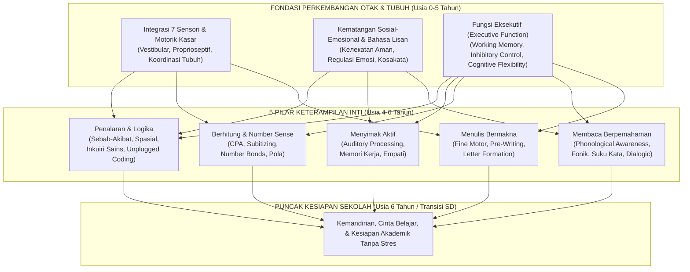

# Dokumentasi Referensi Utama: Kurikulum & Metodologi Pembelajaran Terbaik Anak TK/PAUD (Usia 4–6 Tahun)

Selamat datang di repositori pengetahuan dan referensi induk untuk **Pendidikan Anak Usia Dini (PAUD) / Taman Kanak-Kanak (TK) usia 4–6 tahun**. Dokumentasi ini disusun secara modular berdasarkan riset mendalam (*deep research*) dari neurosains perkembangan anak, terapi okupasi pediatrik, *The Science of Reading*, pedagogi matematika awal (*Early Numeracy*), psikologi kognitif, serta komparasi 10 kurikulum internasional dan nasional terbaik di dunia.

Dokumen ini dirancang sebagai **cetak biru (*blueprint*) referensi** bagi:
1. **Pendidik & Praktisi PAUD/TK** dalam menyusun silabus, aktivitas harian, dan asesmen otentik.
2. **Orang Tua** dalam mendampingi tumbuh kembang dan stimulasi anak di rumah secara tepat sasaran tanpa pemaksaan (*stress-free learning*).
3. **Pengembang Kurikulum, Buku, & Aplikasi Edukasi Anak (*EdTech*)** dalam merancang alur materi (*learning path*), mekanika permainan (*gamification*), dan evaluasi yang sesuai dengan tahap perkembangan biologis dan psikologis anak (*Developmentally Appropriate Practice / DAP*).

---

## Daftar Modul Dokumentasi (`docs/`)

Seluruh materi dibagi ke dalam **8 modul spesialis** yang saling terhubung:

| No | Nama File | Fokus Pembahasan Utama |
| :--- | :--- | :--- |
| **01** | [01-tumbuh-kembang-anak-4-6-tahun.md](file:///c:/Users/Zyrex/Videos/TK%20dan%20PAUD%20Project/docs/01-tumbuh-kembang-anak-4-6-tahun.md) | **Tumbuh Kembang Anak (4–6 Tahun):** Neurosains otak, *Executive Function*, teori Piaget/Vygotsky/Erikson, peta *milestones* 6 aspek perkembangan (TK A vs TK B), integrasi 7 sensori, rentang fokus, kebutuhan biologis, & deteksi dini *red flags*. |
| **02** | [02-panduan-melatih-menulis.md](file:///c:/Users/Zyrex/Videos/TK%20dan%20PAUD%20Project/docs/02-panduan-melatih-menulis.md) | **Cara Melatih Menulis yang Baik:** Anatomi tulang tangan anak, evolusi genggaman pensil (*Tripod Grasp*), penguatan motorik halus, 9 goresan pra-menulis (*Beery VMI*), metodologi *Handwriting Without Tears* & *Montessori*, urutan pengajaran huruf ergonomis, & solusi huruf terbalik (*mirror writing*). |
| **03** | [03-panduan-melatih-membaca.md](file:///c:/Users/Zyrex/Videos/TK%20dan%20PAUD%20Project/docs/03-panduan-melatih-membaca.md) | **Cara Melatih Membaca yang Baik:** *Science of Reading*, *Scarborough's Reading Rope*, kesadaran fonologis, metode Fonik Bahasa Indonesia + Kupas Rangkai Suku Kata (KRS/SAS) tanpa mengeja konvensional, *Jolly Phonics* (Inggris), & teknik *Dialogic Reading* (PEER/CROWD). |
| **04** | [04-panduan-melatih-berhitung.md](file:///c:/Users/Zyrex/Videos/TK%20dan%20PAUD%20Project/docs/04-panduan-melatih-berhitung.md) | **Cara Melatih Berhitung yang Baik:** Membangun *Number Sense*, 5 prinsip berhitung Gelman & Gallistel, pendekatan **CPA (Concrete-Pictorial-Abstract)** *Singapore Math*, *Subitizing*, *Ten-Frame*, *Number Bonds*, Matematika Montessori, pola, geometri, & pengukuran non-standar. |
| **05** | [05-panduan-melatih-mendengar.md](file:///c:/Users/Zyrex/Videos/TK%20dan%20PAUD%20Project/docs/05-panduan-melatih-mendengar.md) | **Cara Melatih Mendengar yang Baik:** Perbedaan *hearing* vs *active listening*, 5 pilar pemrosesan auditori (*auditory figure-ground*, diskriminasi, memori kerja auditori), permainan menyimak aktif (*Silence Game*, *Barrier Games*, *Simon Says*), & protokol komunikasi efektif tanpa berteriak. |
| **06** | [06-panduan-melatih-penalaran.md](file:///c:/Users/Zyrex/Videos/TK%20dan%20PAUD%20Project/docs/06-panduan-melatih-penalaran.md) | **Cara Melatih Penalaran yang Baik:** Logika sebab-akibat, klasifikasi multi-atribut, penalaran spasial, *Computational Thinking Unplugged* (algoritma & *debugging* untuk anak), inkuiri sains (POE), *Theory of Mind*, pertanyaan HOTS Taksonomi Bloom, *Wait Time*, & *Productive Struggle*. |
| **07** | [07-kurikulum-internasional-dan-nasional.md](file:///c:/Users/Zyrex/Videos/TK%20dan%20PAUD%20Project/docs/07-kurikulum-internasional-dan-nasional.md) | **Kurikulum Internasional & Nasional:** Bedah mendalam & perbandingan 10 kurikulum (Montessori, Reggio Emilia, IB PYP Early Years, EYFS Inggris, Cambridge Early Years, Singapore NEL, HighScope, Waldorf, Finlandia/Nordic, & Kurikulum Merdeka Fase Fondasi) beserta sintesis Kurikulum Hibrida Terbaik. |
| **08** | [08-silabus-aktivitas-dan-asesmen.md](file:///c:/Users/Zyrex/Videos/TK%20dan%20PAUD%20Project/docs/08-silabus-aktivitas-dan-asesmen.md) | **Silabus Terpadu, Rutinitas & Asesmen:** Peta jalan kurikulum 4 semester (TK A & TK B), jadwal harian ideal, tata ruang sentra/area kelas, katalog proyek bermain terintegrasi (*Super-Activities*), serta instrumen asesmen otentik (Catatan Anekdot, Ceklis, *Learning Stories*). |

---

## Arsitektur Holistik Pembelajaran Anak Usia 4–6 Tahun

Diagram berikut menggambarkan bagaimana seluruh aspek perkembangan dan keterampilan akademik awal saling menopang seperti sebuah bangunan. **Fondasi sensorimotor, sosial-emosional, dan fungsi eksekutif** harus kokoh terlebih dahulu sebelum anak dituntut menguasai keterampilan akademik tingkat tinggi:

---

## 7 Prinsip Emas (*Golden Rules*) Pendidikan Anak Usia 4–6 Tahun

Berdasarkan konsensus global dari **NAEYC (*National Association for the Education of Young Children*)**, **Harvard Center on the Developing Child**, **UNESCO**, dan **Kemendikdasmen RI**:

### 1. *Concrete Before Abstract* (Konkret Sebelum Abstrak)
Otak anak usia 4–6 tahun berada pada tahap pra-operasional menuju operasional konkret. Anak **harus menyentuh, memegang, dan memanipulasi benda nyata** sebelum diperkenalkan pada simbol di atas kertas atau layar:
- **Menulis:** Meremas *playdough*, meronce, dan menelusuri huruf amplas (*sandpaper letters*) sebelum memegang pensil di buku tulis.
- **Membaca:** Bermain tebak bunyi dan irama suara secara lisan sebelum menghafal simbol abjad.
- **Berhitung:** Memindahkan 5 buah kancing sungguhan sebelum menulis angka `5`.

### 2. *Guided Play is the Highest Form of Learning* (Bermain Terarah adalah Cara Belajar Terbaik)
Riset neurosains membuktikan bahwa sinapsis otak anak terbentuk hingga **10–20 kali lebih cepat** melalui permainan yang menyenangkan (*joyful play*) dibandingkan melalui latihan lembar kerja (*drill worksheets*) yang repetitif:
- Untuk membentuk sinapsis baru melalui *drill* tanpa bermain dibutuhkan sekitar **400 kali pengulangan**.
- Untuk membentuk sinapsis baru melalui **bermain** yang melibatkan emosi positif hanya dibutuhkan **10 hingga 20 kali pengulangan** (Karyn Purvis, *Institute of Child Development*).

### 3. *Proximal to Distal Development* (Dari Pusat Tubuh ke Ujung Jari)
Perkembangan motorik manusia selalu bergerak dari **tengah tubuh (*core*) $\rightarrow$ bahu $\rightarrow$ siku $\rightarrow$ pergelangan tangan $\rightarrow$ jari-jari tangan**. Anak yang belum kuat memanjat, merangkak, atau menjaga keseimbangan duduk akan kesulitan mengontrol pensil dengan stabil.

### 4. *Sound Before Symbol* (Bunyi Sebelum Simbol)
Baik dalam kemampuan mendengar maupun membaca, pemrosesan auditori adalah pintu masuk utama. Anak yang kaya kosakata lisan, sering dibacakan cerita (*read-aloud*), dan terbiasa membedakan bunyi bahasa akan jauh lebih cepat dan mudah memahami teks bacaan ketika mulai belajar membaca.

### 5. *Process Over Product* (Proses Lebih Penting dari Hasil Akhir)
Pada usia 4–6 tahun, nilai sebuah kegiatan terletak pada **bagaimana anak berpikir, mencoba, gagal, dan mencoba lagi**, bukan pada seberapa rapi gambar yang diwarnai atau seberapa lurus tulisan mereka. Biarkan anak mengalami *Productive Struggle* (kesulitan terukur yang membangun daya juang/*grit*).

### 6. *Connection Before Direction* (Koneksi Emosi Sebelum Instruksi)
Bagian otak berpikir logis (*Prefrontal Cortex*) akan "mati" (*hijacked*) apabila bagian otak emosi (*Amygdala*) merasa terancam, takut, malu, atau tertekan. Keamanan emosional, senyuman, dan validasi perasaan adalah syarat mutlak agar anak dapat menyerap pelajaran.

### 7. Menghormati Ritme Fokus Biologis Anak
Rentang perhatian fokus terarah (*sustained directed attention*) anak usia dini mengikuti rumus ilmiah **2 hingga 3 menit dikalikan usia anak**:
- **Usia 4 Tahun (TK A):** **8 – 12 menit** per sesi instruksi fokus, setelah itu harus diselingi gerak aktif atau eksplorasi mandiri.
- **Usia 5–6 Tahun (TK B):** **10 – 18 menit** per sesi instruksi fokus.

---

## Ringkasan Komparatif Target Capaian: TK A (4–5 Tahun) vs TK B (5–6 Tahun)

| Domain Keterampilan | Fokus Utama TK A (Usia 4–5 Tahun) | Fokus Utama TK B (Usia 5–6 Tahun) |
| :--- | :--- | :--- |
| **Motorik & Menulis** | Penguatan otot tangan (*playdough*, menggunting garis lurus/lengkung), genggaman *Static/Dynamic Tripod*, menguasai goresan `\|, —, O, +, □, /`, meniru huruf kapital dan menulis nama panggilan. | Genggaman *Dynamic Tripod* matang, menguasai goresan `X` dan `△`, menulis huruf kapital & huruf kecil (*lowercase*) dengan arah tarikan benar, menulis kata/kalimat pendek sederhana secara fonetik. |
| **Bahasa & Membaca** | Kesadaran fonologis (rima, tepuk suku kata, bunyi awal kata), mengenal bunyi fonik vokal & konsonan utama, membaca gambar & menceritakan kembali alur cerita sederhana. | Menggabungkan bunyi (*blending*) suku kata terbuka (`KV`, `KVKV`) & tertutup (`KVK`), mengenal digraf (`ng, ny`), membaca kalimat sederhana dengan pemahaman isi (*comprehension*). |
| **Berhitung & Numerasi** | Korespondensi satu-satu & kardinalitas 1–10, *subitizing* 1–5 (dadu/jari), mengenal simbol angka 1–10, membandingkan banyak-sedikit, pola `AB/ABB`, bentuk geometri dasar. | Membilang & memahami kuantitas 1–20, *Number Bonds* (komposisi/dekomposisi 1–10), penjumlahan & pengurangan konkret/piktorial 1–10, pola `ABC/AABB`, pengukuran non-standar & grafik gambar. |
| **Mendengar & Fokus** | Menyimak cerita 10–12 menit, mengikuti **2–3 instruksi berurutan**, membedakan bunyi lingkungan & bunyi kata mirip, mulai belajar menunggu giliran bicara. | Menyimak cerita 15–20 menit (termasuk tanpa gambar), mengikuti **3–4 instruksi bertingkat** dengan kata hubung waktu (*sebelum/sesudah*), fokus di ruang ramai (*figure-ground*), diskusi dua arah. |
| **Penalaran & Sains** | Klasifikasi benda berdasarkan 1–2 atribut, menjawab pertanyaan *"Mengapa"* sederhana, menyusun puzzle 12–24 keping, mengamati perubahan alam melalui pancaindra. | Klasifikasi matriks 2–3 atribut, membuat hipotesis **Predict-Observe-Explain (POE)**, *Unplugged Coding* (urutan algoritma 4–6 langkah & *debugging*), memecahkan masalah sosial secara mandiri. |
| **Sosial & Kemandirian** | Berpisah dari orang tua dengan tenang, memakai sepatu/baju sendiri, ke toilet mandiri, bermain asosiatif & mulai kooperatif, mengenali 4–6 emosi dasar. | Mengelola kekecewaan/frustrasi dengan kata-kata, bermain kooperatif dengan aturan bersama, merapikan alat belajar (*Plan-Do-Review*), empati aktif, siap beradaptasi dengan lingkungan SD. |

---

## Cara Menggunakan Dokumentasi Ini

- Jika Anda ingin memahami **psikologi, perkembangan otak, dan tolok ukur perkembangan anak**, mulailah dari **[Modul 01](file:///c:/Users/Zyrex/Videos/TK%20dan%20PAUD%20Project/docs/01-tumbuh-kembang-anak-4-6-tahun.md)**.
- Jika Anda sedang merancang **materi belajar spesifik** (Menulis, Membaca, Berhitung, Mendengar, Penalaran), buka langsung **[Modul 02](file:///c:/Users/Zyrex/Videos/TK%20dan%20PAUD%20Project/docs/02-panduan-melatih-menulis.md)** hingga **[Modul 06](file:///c:/Users/Zyrex/Videos/TK%20dan%20PAUD%20Project/docs/06-panduan-melatih-penalaran.md)**.
- Jika Anda ingin membandingkan dan mengadopsi **sistem kurikulum terbaik dunia & nasional**, pelajari **[Modul 07](file:///c:/Users/Zyrex/Videos/TK%20dan%20PAUD%20Project/docs/07-kurikulum-internasional-dan-nasional.md)**.
- Jika Anda membutuhkan **silabus per semester, jadwal harian, ide permainan terpadu, dan format penilaian rapor/observasi**, gunakan **[Modul 08](file:///c:/Users/Zyrex/Videos/TK%20dan%20PAUD%20Project/docs/08-silabus-aktivitas-dan-asesmen.md)**.
